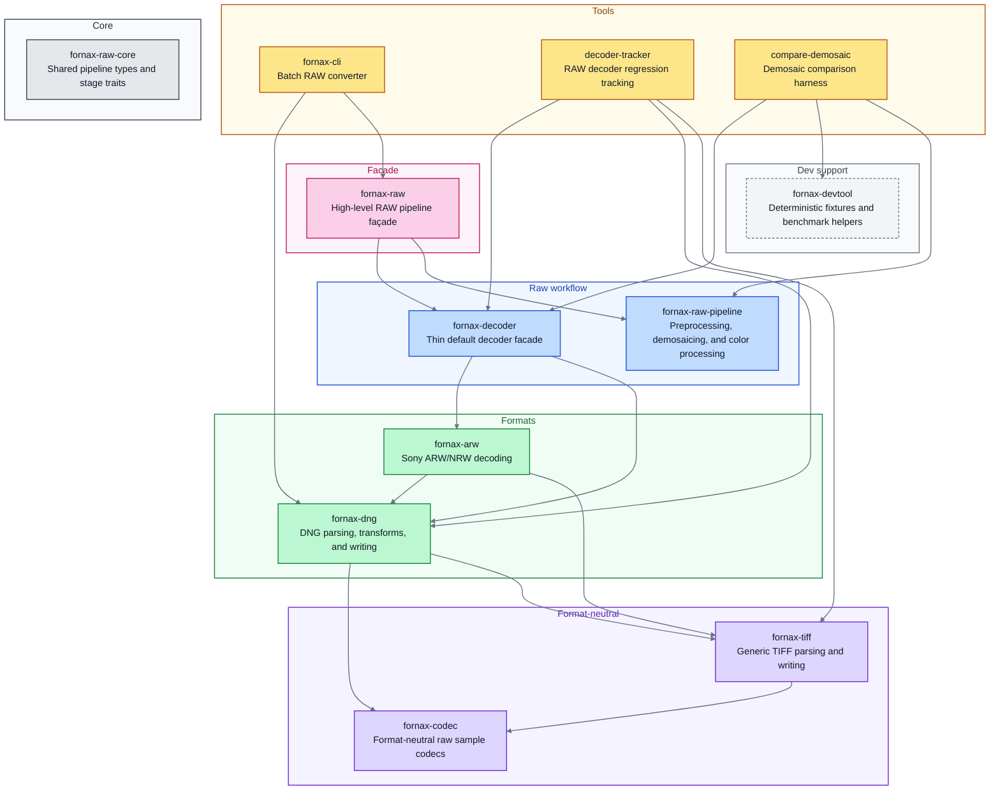

# Fornax


[](https://codecov.io/gh/Glatzel/fornax)
[](https://app.codspeed.io//Glatzel/fornax?utm_source=badge)

**Fornax** is an extensive raw image processing library.
Its goal is to provide a one-stop solution for raw image processing with both simple high-level APIs and low-level control, while also enabling users to extend or plug in their own raw image processing algorithms.

Fornax uses built-in or custom decoders and post-processors to produce `ImageBuffer`s (from the [`image`](https://crates.io/crates/image) crate) that can be further transformed into other data types for analysis or display.

## Key Features

- 🖼 **Flexible decoding pipeline** — Choose built-in or custom decoders.
- ⚙️ **Extensible post-processing** — Plug in your own algorithms.
- 🦀 **Rust + Python support** — Native performance with Python accessibility.
- 🔒 **Pure-Rust decoding** — No C/C++ decoder dependency in the production
  image pipeline.

## Architecture



Arrows point from a crate to a crate it depends on.
Every crate except fornax-cli, fornax-codec, fornax-tiff, and fornax-raw-core itself also depends on fornax-raw-core; those edges are omitted.

| Color | Group | Meaning |
| --- | --- | --- |
| Yellow | Tools | User-facing entry points and validation tools. |
| Pink | Facade | High-level API surface. |
| Blue | Raw workflow | Decode and post-decode processing stages. |
| Green | Formats | DNG- and Sony-specific handling. |
| Violet | Format-neutral | Reusable TIFF and sample-codec foundations. |
| Gray | Core | Shared types, metadata, errors, and stage contracts. |
| Light gray | Dev support | Fixtures, paths, and benchmark configuration. |

| Crate | Group | Role |
| --- | --- | --- |
| `fornax-cli` | Tools | Batch RAW converter. |
| `decoder-tracker` | Tools | Manual RAW decoder regression tracking. |
| `compare-demosaic` | Tools | Demosaic comparison harness. |
| `fornax-raw` | Facade | High-level façade for the RAW pipeline. |
| `fornax-decoder` | Raw workflow | Thin default decoder facade. |
| `fornax-raw-pipeline` | Raw workflow | Post-decode preprocessing, demosaicing, and color processing. |
| `fornax-dng` | Formats | Pure-Rust DNG parsing, transforms, and writing. |
| `fornax-arw` | Formats | Pure-Rust Sony ARW/NRW decoding. |
| `fornax-tiff` | Format-neutral | Generic TIFF parsing, values, and writing. |
| `fornax-codec` | Format-neutral | Format-neutral raw sample codecs. |
| `fornax-raw-core` | Core | Shared RAW pipeline types and stage traits. |
| `fornax-devtool` | Dev support | Deterministic fixtures and benchmark helpers. |

## Development

Install the development environment and pinned reference sources:

```bash
source scripts/setup.sh
```

On Windows, run the PowerShell setup from the repository root:

```powershell
./scripts/setup.ps1
```
