# Fornax


[](https://codecov.io/gh/Glatzel/fornax)
[](https://app.codspeed.io//Glatzel/fornax?utm_source=badge)

**Fornax** is an extensive raw image processing library.
Its goal is to provide a one-stop solution for raw image processing with both simple high-level APIs and low-level control, while also enabling users to extend or plug in their own raw image processing algorithms.

Fornax uses built-in or custom decoders and post-processors to produce `ImageBuffer`s (from the [`image`](https://crates.io/crates/image) crate) that can be further transformed into other data types for analysis or display.

## Key Features

- 🖼 **Flexible decoding pipeline** — Choose built-in or custom decoders.
- ⚙️ **Extensible post-processing** — Plug in your own algorithms.
- 🦀 **Rust + Python support** — Native performance with Python accessibility.
- 🔒 **Pure-Rust decoding** — No C/C++ decoder dependency in the production
  image pipeline.

## Components

- **fornax-core**: Shared pipeline types, the DNG decoder, typed DNG metadata,
  and the uncompressed DNG writer.
- **fornax-preprocessor**: Black/white-level normalization for active Bayer
  mosaics.
- **fornax-postprocessor**: Demosaic algorithms and RGB reconstruction.
- **fornax**: High-level facade tying the stages together.
- **fornax-devtool**: Pinned fixtures and development helpers.
- **compare-demosaic**: Reference-versus-Fornax demosaic comparison harness.
- **fornax-py**: Python binding source, currently excluded from the Rust
  workspace while its public API is stabilized.

## Crate Dependency Graph

This graph shows the direct dependencies between Fornax workspace crates,
grouped by architectural responsibility. It uses `flowchart BT`. Each arrow
starts at a dependent and points to a crate it depends on: `B --> A` means that
`B` depends on `A`. External crates, dev-dependencies, and the separately built
`fornax-py` binding are intentionally excluded.

```mermaid
flowchart BT
    subgraph SHARED_GROUP["Core & Container Types"]
        FORNAX_CORE["fornax-core<br/><small>Shared image, metadata, error, and stage contracts</small>"]
        FORNAX_TIFF["fornax-tiff<br/><small>Generic TIFF tags, parsing, and container writing</small>"]
    end

    subgraph CODEC_GROUP["Codecs"]
        FORNAX_CODEC["fornax-codec<br/><small>Format-neutral sample codecs and chunk pipelines</small>"]
    end

    subgraph FORMAT_GROUP["Format Implementations"]
        FORNAX_DNG["fornax-dng<br/><small>DNG metadata, transforms, decoding, and writing</small>"]
    end

    subgraph DECODER_GROUP["Decoders"]
        FORNAX_DECODER["fornax-decoder<br/><small>Default pure-Rust DNG decoder adapter</small>"]
        FORNAX_DECODER_RAWLER["fornax-decoder-rawler<br/><small>Rawler-backed 2x2 Bayer decoder</small>"]
        FORNAX_DECODER_DNC["fornax-decoder-dnc<br/><small>Adobe DNG Converter plus Rawler decoder</small>"]
    end

    subgraph PROCESSING_GROUP["Processing"]
        FORNAX_PREPROCESSOR["fornax-preprocessor<br/><small>Black- and white-level mosaic normalization</small>"]
        FORNAX_POSTPROCESSOR["fornax-postprocessor<br/><small>Demosaic algorithms and RGB reconstruction</small>"]
    end

    subgraph APPLICATION_GROUP["Facade & Applications"]
        FORNAX["fornax<br/><small>Public facade for the complete pipeline</small>"]
        FORNAX_CLI["fornax-cli<br/><small>Batch RAW conversion command-line application</small>"]
    end

    subgraph DEVELOPMENT_GROUP["Development & Evaluation"]
        FORNAX_DEVTOOL["fornax-devtool<br/><small>Fixtures, synthetic data, and benchmark configuration</small>"]
        BENCH_DECODER["bench-decoder<br/><small>Decoder and decoder-adapter benchmarks</small>"]
        COMPARE_DEMOSAIC["compare-demosaic<br/><small>Reference-versus-Fornax demosaic comparison</small>"]
    end

    FORNAX_CODEC --> FORNAX_CORE
    FORNAX_DNG --> FORNAX_CORE
    FORNAX_DNG --> FORNAX_CODEC
    FORNAX_DNG --> FORNAX_TIFF

    FORNAX_DECODER --> FORNAX_CORE
    FORNAX_DECODER --> FORNAX_DNG
    FORNAX_DECODER_RAWLER --> FORNAX_CORE
    FORNAX_DECODER_RAWLER --> FORNAX_DNG
    FORNAX_DECODER_RAWLER --> FORNAX_TIFF
    FORNAX_DECODER_DNC --> FORNAX_CORE
    FORNAX_DECODER_DNC --> FORNAX_DNG
    FORNAX_DECODER_DNC --> FORNAX_DECODER_RAWLER

    FORNAX_PREPROCESSOR --> FORNAX_CORE
    FORNAX_POSTPROCESSOR --> FORNAX_CORE
    FORNAX_DEVTOOL --> FORNAX_CORE

    FORNAX --> FORNAX_CORE
    FORNAX --> FORNAX_DNG
    FORNAX --> FORNAX_DECODER
    FORNAX --> FORNAX_DECODER_RAWLER
    FORNAX --> FORNAX_DECODER_DNC
    FORNAX --> FORNAX_PREPROCESSOR
    FORNAX --> FORNAX_POSTPROCESSOR

    FORNAX_CLI --> FORNAX_CORE
    FORNAX_CLI --> FORNAX_DNG
    FORNAX_CLI --> FORNAX_DECODER
    FORNAX_CLI --> FORNAX_DECODER_RAWLER
    FORNAX_CLI --> FORNAX_PREPROCESSOR
    FORNAX_CLI --> FORNAX_POSTPROCESSOR

    COMPARE_DEMOSAIC --> FORNAX_CORE
    COMPARE_DEMOSAIC --> FORNAX_DECODER
    COMPARE_DEMOSAIC --> FORNAX_DEVTOOL
    COMPARE_DEMOSAIC --> FORNAX_PREPROCESSOR
    COMPARE_DEMOSAIC --> FORNAX_POSTPROCESSOR

    classDef shared fill:#e8f1f8,stroke:#7894ad,color:#203040,stroke-width:1px
    classDef codec fill:#e8f5ec,stroke:#6f9a7c,color:#20362a,stroke-width:1px
    classDef format fill:#f1ebf7,stroke:#8b75a3,color:#32263d,stroke-width:1px
    classDef decoder fill:#fdf1e5,stroke:#b38a62,color:#3c2d1f,stroke-width:1px
    classDef processing fill:#f9eaf0,stroke:#aa768a,color:#40262f,stroke-width:1px
    classDef application fill:#e9edf8,stroke:#7483ad,color:#222b45,stroke-width:1px
    classDef development fill:#eef0f2,stroke:#89939c,color:#29323a,stroke-width:1px

    class FORNAX_CORE,FORNAX_TIFF shared
    class FORNAX_CODEC codec
    class FORNAX_DNG format
    class FORNAX_DECODER,FORNAX_DECODER_RAWLER,FORNAX_DECODER_DNC decoder
    class FORNAX_PREPROCESSOR,FORNAX_POSTPROCESSOR processing
    class FORNAX,FORNAX_CLI application
    class FORNAX_DEVTOOL,BENCH_DECODER,COMPARE_DEMOSAIC development

    style SHARED_GROUP fill:#f8fbfd,stroke:#d3e0e9,color:#314353
    style CODEC_GROUP fill:#f8fcf9,stroke:#d7e8dd,color:#31483a
    style FORMAT_GROUP fill:#fbf9fd,stroke:#e3d9ec,color:#463651
    style DECODER_GROUP fill:#fffbf7,stroke:#f0dfcd,color:#574330
    style PROCESSING_GROUP fill:#fdf8fa,stroke:#eedbe3,color:#533843
    style APPLICATION_GROUP fill:#f8f9fd,stroke:#d9deef,color:#303955
    style DEVELOPMENT_GROUP fill:#fafbfb,stroke:#e0e4e7,color:#3b444b
```



## Development

Install the development environment and pinned reference sources:

```bash
source scripts/setup.sh
```

On Windows, run the PowerShell setup from the repository root:

```powershell
./scripts/setup.ps1
```
