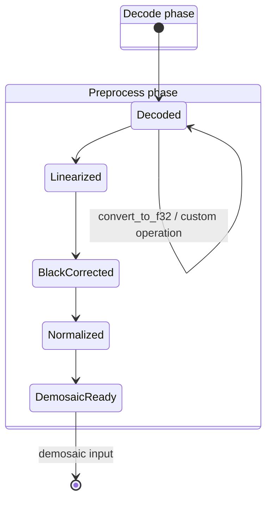

# DES-004 — Preprocessing Operations and Processing State

> **Task:** `DES-004`
> **Owner:** primary agent
> **Review:** GitHub task pull request; its open/merged state is authoritative.
> **Pull request:** [#549](https://github.com/Glatzel/fornax/pull/549).
> **Last updated:** 2026-10-24
>
> **Dependencies:** `SYN-01` (#540), `SYN-02` (#541), `DES-001` (#545), and
> `DES-003` (#543), all merged.
>
> **Normative design:** repository-root
> [`docs/raw-pipeline/`](../../../docs/raw-pipeline/README.md). This proposal
> records operation-level rationale and implementation signatures. The
> persistent [processing guide](../../../docs/raw-pipeline/raw-image-process.md)
> is updated in this PR with the operation contract.
>
> **Acceptance criteria (authoritative in the task manifest):**
>
> - [x] Concrete operation types and signatures are specified.
> - [x] Black-level formulas and clipping, normalization, and rounding rules
>   are explicit.
> - [x] Missing-metadata behavior and synthetic test strategy are specified.
> - [x] White balance and color matrices are explicitly excluded.
> - [x] Decisions cite merged SYN-01, SYN-02, DES-001, and DES-003 evidence.

## 1. Scope and state machine

This proposal defines the operation API between `DecodedRaw` and
`DemosaicReadyMosaic`.



`Decoded` is the only custom-processing state. Conversion to f32 and arbitrary
user transformations do not create another pipeline type. Every preprocessing
operation consumes the prior stage by value and returns the next stage.

The state sequence is mandatory:

1. optional f32 conversion/custom operation, still `Decoded`;
2. linearization;
3. black selection and subtraction;
4. normalization;
5. clipping to the demosaic-ready range.

Skipping or repeating a transition is not representable through the public
typed API.

## 2. Operation types

### 2.1 Linearization

```rust
#[derive(Clone, Debug, PartialEq)]
pub struct LinearizationTable {
    values: Box<[f32]>,
    source_domain: SampleEncoding,
}

impl LinearizationTable {
    pub fn try_new(
        _values: Box<[f32]>,
        _source_domain: SampleEncoding,
    ) -> Result<Self, PreprocessError> {
        todo!("linearization validation")
    }

    pub fn apply(&self, _code: u32) -> Result<f32, PreprocessError> {
        todo!("lookup design")
    }
}
```

Rules:

- If no table is present, integer codes convert exactly to f32 and float
  samples are retained.
- A table is indexed by stored integer code; out-of-range lookup is an error.
- Table output is stored as finite f32.
- A table applies once. The output state is `LinearizedRaw`.

### 2.2 Custom f32 operation

```rust
impl DecodedRaw {
    pub fn convert_to_f32(self) -> Result<Self, PreprocessError> {
        todo!("decoded f32 conversion")
    }

    pub fn apply_custom_f32<F>(
        self,
        _operation: OperationProvenance,
        _metadata_basis: MetadataBasis,
        _transform: F,
    ) -> Result<Self, PreprocessError>
    where
        F: FnOnce(&mut F32Plane) -> Result<(), CustomOperationError>,
    {
        todo!("custom processing design")
    }
}
```

`convert_to_f32`:

- accepts `Decoded` with u8, u16, or losslessly representable u32 samples;
- rejects u32 content requiring more than f32's 24-bit significand;
- retains an existing f32 plane without conversion;
- returns the same `DecodedRaw` type and records conversion provenance.

`apply_custom_f32`:

- requires an f32 plane;
- records the caller-provided operation and metadata basis;
- leaves the result in `DecodedRaw`;
- never applies standard black/white metadata automatically.

`MetadataBasis::OriginalLevelsValid` means the transform preserves the levels'
meaning. `ReplacedLevels` carries updated levels. `Incompatible` prevents entry
to standard preprocessing.

### 2.3 Black selection

```rust
#[derive(Clone, Debug, PartialEq)]
pub struct BlackSample {
    pub value: f64,
    pub slot: BayerSlot,
    pub provenance: Provenance,
}

pub struct BlackSelector<'a> {
    levels: &'a Sourced<BlackLevels>,
}

impl BlackSelector<'_> {
    pub const fn levels(&self) -> &Sourced<BlackLevels> {
        self.levels
    }

    pub fn select(
        &self,
        _layout: &BayerLayout,
        _stored: PixelCoord,
    ) -> Result<BlackSample, PreprocessError> {
        todo!("black selection design")
    }
}
```

The selected value is:

```text
common
  + per_slot[slot_index]
  + repeat[(row - active.top) % rows,
           (col - active.left) % cols,
           plane]
```

The universal level model remains general. Initial preprocessing accepts only
exact conventional 1×1/2×2 fold/decomposition. Larger tiles and
BlackLevelDeltaH/V return `UnsupportedBlackPattern`.

### 2.4 White level

```rust
#[derive(Clone, Debug, PartialEq)]
pub struct SelectedWhite {
    pub value: f64,
    pub slot: BayerSlot,
    pub provenance: Provenance,
}
```

Initial support uses the declared white level. Adjusted and measured maxima
remain diagnostic/provenance values and do not silently replace the declared
level. Missing white uses the declared format default only when unambiguously
derivable; otherwise preprocessing returns `MissingWhiteLevel`.

## 3. Consuming transition signatures

```rust
impl DecodedRaw {
    pub fn into_linearized(
        self,
        _table: Option<LinearizationTable>,
    ) -> Result<LinearizedRaw, PreprocessError> {
        todo!("linearization transition")
    }
}

impl LinearizedRaw {
    pub fn subtract_black(
        self,
    ) -> Result<BlackCorrectedRaw, PreprocessError> {
        todo!("black subtraction transition")
    }
}

impl BlackCorrectedRaw {
    pub fn normalize(
        self,
    ) -> Result<NormalizedRaw, PreprocessError> {
        todo!("normalization transition")
    }
}

impl NormalizedRaw {
    pub fn finish_for_demosaic(
        self,
    ) -> Result<DemosaicReadyMosaic, PreprocessError> {
        todo!("clipping transition")
    }
}
```

No method accepts a `&mut` pipeline image. A correction cannot remain attached
to the prior stage, and a stage cannot store duplicated processing flags.

## 4. Numerical rules

For active sample `(r,c)`:

```text
l       = linearize(stored_sample)
black   = select_black(r,c,slot)
white   = select_white(r,c,slot)
q64     = f64::from(l) - black
q       = round_f32(q64)
n64     = f64::from(q) / (white - black)
n       = round_f32(n64)
ready   = clamp(n, 0.0, 1.0)
```

All planes are f32; scalar subtraction, division, range checks, and rounding
decisions may use f64. `round_f32` is IEEE round-to-nearest, ties-to-even.

### Subtraction

- Must not clip.
- Negative underflow remains negative in `BlackCorrectedRaw`.
- Input and output geometry/CFA phase are unchanged.

### Normalization

- Requires `white > black`.
- Produces an unclipped f32 normalized value.
- Preserves negative underflow and above-one overflow.
- A zero, negative, or non-finite range returns `InvalidLevelRange`.

### Clipping

```rust
#[derive(Clone, Copy, Debug, Eq, PartialEq)]
pub enum ClipPolicy {
    UnitRange,
}
```

The initial policy is explicit `clamp(x, 0.0, 1.0)` at
`DemosaicReadyMosaic`. NaN/Infinity is an error before clipping. Backend
clipping behavior is not inherited.

## 5. Errors and missing metadata

```rust
#[derive(Debug, PartialEq)]
pub enum PreprocessError {
    WrongStage(&'static str),
    MissingCfa,
    MissingBlackLevel,
    MissingWhiteLevel,
    InvalidLinearization,
    LinearizationOutOfRange,
    UnsupportedBlackPattern,
    InvalidLevelRange,
    InvalidSample,
    IncompatibleMetadataBasis,
    CustomOperationFailed,
    AllocationFailed,
}
```

Rules:

- missing required metadata fails before allocation where possible;
- absent black level uses zero only when the source format explicitly declares
  zero;
- absent white level uses the source-format default only when unambiguous;
- unsupported general tiles/deltas fail instead of being ignored;
- non-finite source or intermediate values fail;
- a backend image already marked corrected/normalized is rejected; and
- custom processing with stale metadata fails before linearization.

## 6. Allocation and mutation policy

- `into_linearized` allocates at most one owned f32 plane, replacing the
  stored source plane.
- Black selection is computed per sample and does not allocate a black plane.
- `subtract_black`, `normalize`, and `finish_for_demosaic` mutate the owned f32
  buffer in place while changing the Rust stage type.
- Caller-requested diagnostics may allocate the unclipped normalized plane;
  the default path does not.
- All allocation-size arithmetic is checked before allocation.
- No preprocessing API clones metadata; `Arc<ValidatedMetadata>` is retained.

## 7. Explicit exclusions

This task does not apply:

- white-balance coefficients;
- camera-to-working-space color matrices;
- highlight reconstruction;
- gain maps or DNG opcodes;
- masked-area-derived black estimation;
- hot-pixel/defect correction;
- raw denoise, chromatic-aberration correction, tone mapping, display color,
  gamma, sharpening, or denoising.

WB and matrices remain descriptive metadata for later consumers.

## 8. Synthetic test plan

1. u8/u16/u32/f32 decode conversion into `DecodedRaw`.
2. u32 conversion rejects precision beyond f32's exact range.
3. Custom operation stays in `DecodedRaw` and records provenance.
4. Custom operation with incompatible/stale levels cannot enter linearization.
5. Identity and lookup-table linearization, including out-of-range rejection.
6. Scalar and four-slot black selection across all Bayer phases.
7. Odd ActiveArea origins select the same black level after crop.
8. 1×1/2×2 black tile decomposition matches declared metadata.
9. General tile and delta vectors reject.
10. Subtraction retains negative values.
11. Normalization preserves negative/overflow values before final clipping.
12. `white <= black` and non-finite arithmetic reject.
13. Corrected f32 clamps to exactly `[0,1]` at demosaic-ready.
14. Reapplying any operation is impossible through the state API.
15. Processing preserves Arc metadata and ActiveArea/CFA geometry.

## 9. Open questions

- The final `PreprocessOptions` struct may need explicit allocation/diagnostic
  policy during implementation.
- Error-return typing may use a dedicated `(error, original)` result if
  transactional recovery is required.
- General black tiles, deltas, and DNG opcodes require separately approved
  implementations and tests.
- Exact behavior for invalid white-level vector lengths should be shared with
  DES-001 validation.

## 10. Evidence

- [Persistent processing flow](../../../docs/raw-pipeline/raw-image-process.md):
  normative stages, precision, and exclusions.
- [Persistent precision rules](../../../docs/raw-pipeline/precision.md):
  f32 buffers and f64 scalar arithmetic.
- [SYN-02 numeric model](../../research/notes/SYN-02.md#numerical-model):
  formulas, rounding, and clipping.
- [SYN-02 processing-state constraints](../../research/notes/SYN-02.md#processing-state-constraints):
  consuming-state and double-correction prevention.
- [DES-001 stage model](DES-001-universal-raw-representation.md#3-stage-typed-image):
  `Decoded`/preprocessing types.
- [DES-003 CFA model](DES-003-cfa-indexing.md#3-channel-lookup-and-coordinates):
  slot and ActiveArea indexing.

## Acceptance checklist

- [x] Concrete operation types and signatures are specified.
- [x] Black-level formulas and clipping, normalization, and rounding rules are
  explicit.
- [x] Missing-metadata behavior and synthetic test strategy are specified.
- [x] White balance and color matrices are explicitly excluded.
- [x] Decisions cite merged SYN-01, SYN-02, DES-001, and DES-003 evidence.
