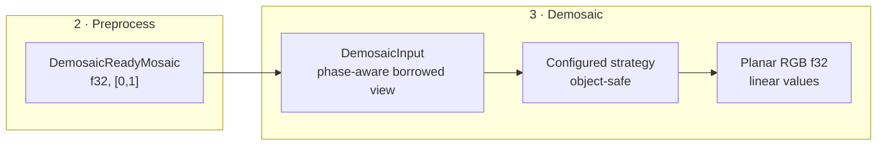

# DES-005 — Shared Demosaicing Interface

> **Task:** `DES-005`
> **Owner:** primary agent
> **Review:** GitHub task pull request; its open/merged state is authoritative.
> **Pull request:** [#550](https://github.com/Glatzel/fornax/pull/550).
> **Last updated:** 2026-10-24
>
> **Dependencies:** `SYN-01` (#540), `SYN-03` (#546), `DES-001` (#545), and
> `DES-003` (#543), all merged.
>
> **Normative design:** repository-root
> [`docs/raw-pipeline/`](../../../docs/raw-pipeline/README.md). This proposal
> records the concrete demosaic interface and algorithm extension point.
>
> **Acceptance criteria (authoritative in the task manifest):**
>
> - [x] Concrete traits, types, and signatures are specified.
> - [x] The generic or object-safe strategy choice is justified.
> - [x] Independent algorithms can be added without changing shared types.
> - [x] Border, output, metadata, allocation, and error semantics are explicit.
> - [x] Decisions cite merged SYN-01, SYN-03, DES-001, and DES-003 evidence.

## 1. Boundary

Demosaicing accepts a validated, preprocessed single-channel Bayer mosaic and
returns linear planar RGB at the same active dimensions.



Demosaicing does not perform black correction, normalization, WB, camera color
matrices, highlight reconstruction, tone mapping, denoising, or display
conversion.

## 2. Input contract

```rust
use std::collections::BTreeMap;
use std::sync::Arc;

pub struct DemosaicInput<'a> {
    samples: &'a [f32],
    width: u32,
    height: u32,
    layout: BayerLayout,
    metadata: &'a ValidatedMetadata,
}

impl<'a> DemosaicInput<'a> {
    pub fn new(
        _image: &'a DemosaicReadyMosaic,
    ) -> Result<Self, DemosaicError> {
        todo!("input validation design")
    }

    pub fn samples(&self) -> &'a [f32] { self.samples }
    pub const fn width(&self) -> u32 { self.width }
    pub const fn height(&self) -> u32 { self.height }
    pub const fn layout(&self) -> BayerLayout { self.layout }
    pub const fn metadata(&self) -> &'a ValidatedMetadata { self.metadata }

    pub fn slot_at_active(
        &self,
        _row: u32,
        _col: u32,
    ) -> Result<BayerSlot, DemosaicError> {
        todo!("active-to-stored CFA lookup")
    }
}
```

Validation:

- `samples.len() == width * height`, checked for overflow;
- dimensions are non-zero;
- all samples are finite and in `[0,1]`;
- the layout is a conventional 2×2 RGB Bayer layout;
- the active dimensions match `BayerLayout`/metadata;
- the image remains in `DemosaicReadyMosaic` state.

`slot_at_active` translates dense active-buffer coordinates back to stored
coordinates using ActiveArea origin, then delegates to `BayerLayout::slot_at`.
Algorithms therefore do not lose CFA phase after cropping.

## 3. Output contract

```rust
#[derive(Clone, Debug, PartialEq)]
pub struct PlanarRgbF32 {
    width: u32,
    height: u32,
    samples: Vec<f32>, // R plane, then G plane, then B plane
}

impl PlanarRgbF32 {
    pub fn try_new(_width: u32, _height: u32) -> Result<Self, DemosaicError> {
        todo!("fallible planar allocation")
    }

    pub fn width(&self) -> u32 { self.width }
    pub fn height(&self) -> u32 { self.height }
    pub fn plane(&self, channel: RgbChannel) -> &[f32] {
        let plane = self.width as usize * self.height as usize;
        let range = match channel {
            RgbChannel::Red => 0..plane,
            RgbChannel::Green => plane..2 * plane,
            RgbChannel::Blue => 2 * plane..3 * plane,
        };
        &self.samples[range]
    }
    pub fn plane_mut(&mut self, channel: RgbChannel) -> &mut [f32] {
        let plane = self.width as usize * self.height as usize;
        let range = match channel {
            RgbChannel::Red => 0..plane,
            RgbChannel::Green => plane..2 * plane,
            RgbChannel::Blue => 2 * plane..3 * plane,
        };
        &mut self.samples[range]
    }
    pub fn as_chw(&self) -> &[f32] { &self.samples }
}

#[derive(Clone, Copy, Debug, Eq, PartialEq)]
pub enum RgbChannel {
    Red,
    Green,
    Blue,
}
```

Rules:

- channel order is fixed `R,G,B`;
- storage is planar CHW: `3 * width * height` f32 samples;
- output dimensions equal active input dimensions;
- values are linear and are not quantized;
- the interface does not implicitly clip algorithm output;
- algorithms that overshoot/undershoot document that behavior in their
  capability record and tests;
- allocation multiplication uses checked arithmetic and fallible reserve; and
- no per-pixel metadata is emitted.

Planar CHW is selected because the Rust `demosaic` candidate already exposes a
caller-owned planar f32 output. Interleaved conversion is an optional consumer
adapter, not a second pipeline representation.

## 4. Strategy interface

```rust
pub trait DemosaicStrategy: Send + Sync {
    fn id(&self) -> DemosaicAlgorithmId;
    fn capabilities(&self) -> DemosaicCapabilities;

    fn validate(
        &self,
        input: &DemosaicInput<'_>,
        output: &PlanarRgbF32,
    ) -> Result<(), DemosaicError>;

    fn process(
        &self,
        input: &DemosaicInput<'_>,
        output: &mut PlanarRgbF32,
    ) -> Result<DemosaicRun, DemosaicError>;
}
```

The trait is object-safe so a registry can store independently compiled
algorithms with different internal settings. Algorithm-specific options are
fields of the concrete strategy value and are configured at construction:

```rust,ignore
let strategy: Box<dyn DemosaicStrategy> =
    Box::new(MhcStrategy::new(MhcOptions::default()));
```

A generic `DemosaicStrategy<O>` trait was rejected as the shared boundary
because it prevents one runtime registry from storing algorithms with different
option types. Generic typed builders may still wrap concrete strategies before
erasing them.

Strategies:

- must not require shared input fields to change per algorithm;
- may allocate private scratch buffers;
- receive caller-owned output and must not replace/resize it;
- must not mutate the input mosaic or metadata;
- report algorithm identity and border behavior in `DemosaicRun`; and
- must be deterministic for the same input/configuration.

## 5. Capabilities and registry

```rust
#[derive(Clone, Debug, Eq, PartialEq, Ord, PartialOrd)]
pub struct DemosaicAlgorithmId(Box<str>);

#[derive(Clone, Debug, Eq, PartialEq)]
pub struct DemosaicCapabilities {
    pub phases: BayerPhaseMask,
    pub min_width: u32,
    pub min_height: u32,
    pub border_policy: BorderPolicy,
}

#[derive(Clone, Copy, Debug, Eq, PartialEq)]
pub enum BorderPolicy {
    Clamp,
    BilinearFallback,
    AlgorithmDefined,
}

#[derive(Default)]
pub struct DemosaicRegistry {
    strategies: BTreeMap<DemosaicAlgorithmId, Box<dyn DemosaicStrategy>>,
}

impl DemosaicRegistry {
    pub fn get(
        &self,
        id: &DemosaicAlgorithmId,
    ) -> Option<&dyn DemosaicStrategy> {
        self.strategies.get(id).map(Box::as_ref)
    }

    pub fn len(&self) -> usize {
        self.strategies.len()
    }

    pub fn register(
        &mut self,
        _strategy: Box<dyn DemosaicStrategy>,
    ) -> Result<(), DemosaicError> {
        todo!("registry insertion")
    }

    pub fn validate(
        &self,
        _id: &DemosaicAlgorithmId,
        _input: &DemosaicInput<'_>,
        _output: &PlanarRgbF32,
    ) -> Result<(), DemosaicError> {
        todo!("registry validation")
    }

    pub fn process(
        &self,
        _id: &DemosaicAlgorithmId,
        _input: &DemosaicInput<'_>,
        _output: &mut PlanarRgbF32,
    ) -> Result<DemosaicRun, DemosaicError> {
        todo!("registry dispatch")
    }
}
```

Registration rejects duplicate IDs and capabilities that claim unsupported
CFA phases for the initial interface.

`BayerPhaseMask` is a small bitset for RGGB/BGGR/GRBG/GBRG. The initial
interface accepts only strategies supporting all four phases; narrower support
returns `UnsupportedPhase`.

## 6. Border and dimensions

- Output dimensions equal input dimensions.
- No implicit crop, ROI reset, or CFA rebase is allowed.
- Algorithms requiring a halo may process a larger internal region only when
  they can gather it from the input; the shared interface does not add a
  halo type.
- `BorderPolicy` is descriptive and must match tests.
- An image smaller than `capabilities().min_width/min_height` returns
  `TooSmall`.
- Algorithm-specific kernels must document whether known CFA samples remain
  untouched, how borders are extrapolated, and whether overshoot is possible.

## 7. Metadata retention

```rust
#[derive(Clone, Debug, PartialEq)]
pub struct DemosaicOutput {
    pub planes: PlanarRgbF32,
    pub metadata: Arc<ValidatedMetadata>,
    pub provenance: DemosaicRun,
}
```

`DemosaicOutput` retains the input metadata through `Arc`. It does not duplicate
RAW geometry or reinterpret ActiveArea. WB, color matrices, crop, orientation,
and original decoder provenance remain available but unapplied.

## 8. Errors and allocation

```rust
#[derive(Debug, PartialEq)]
pub enum DemosaicError {
    InvalidInputLength,
    InvalidDimensions,
    InputOutOfRange,
    NonFiniteInput,
    UnsupportedPhase,
    TooSmall,
    InvalidOutputSize,
    UnknownAlgorithm,
    DuplicateAlgorithm,
    AlgorithmFailed { message: Box<str> },
    AllocationFailed,
}
```

Allocation policy:

- `PlanarRgbF32::try_new` uses checked `3 * width * height` arithmetic and
  `Vec::try_reserve_exact`;
- callers may reuse output buffers across invocations with matching dimensions;
- strategies may allocate one or more private scratch buffers;
- scratch allocation failure returns `AllocationFailed`; and
- no shared output is allocated after validation failure.

## 9. Initial algorithms and adapters

The initial algorithm order remains:

1. bilinear — baseline, deterministic, cheap;
2. Malvar–He–Cutler — fixed kernel, stronger quality/cost tradeoff; then
3. edge-aware algorithms after quality/options evidence.

The `demosaic` crate adapter:

- maps all four `BayerPattern` values to its CFA enum;
- maps configured algorithm IDs to its algorithm enum;
- validates exact input/output lengths before calling;
- uses the primary planar f32 API; and
- does not expose crate CFA/error/algorithm types publicly.

MeraRAW remains a test/design reference because its pipeline-wide raw types and
some unimplemented strategies do not satisfy this interface.

## 10. Test plan

1. Construct valid input for all four Bayer phases.
2. Reject non-finite, out-of-range, wrong-length, and non-zero-dimension input.
3. Verify `slot_at_active` preserves phase at odd ActiveArea origins.
4. Bilinear known-channel preservation and deterministic border behavior.
5. MHC known-channel preservation, border clamping/fallback, and overshoot
   characterization.
6. Registry registration/duplicate/unknown-ID behavior.
7. Strategy declaring subset phase support returns `UnsupportedPhase`.
8. Too-small dimensions and checked output-size overflow errors.
9. Allocation failure path through a test allocator/policy.
10. Output is exactly planar `R,G,B` and input remains immutable.
11. Metadata Arc identity and values survive demosaicing.
12. No WB, color matrix, tone, or display operation occurs.

## 11. Open questions

- Whether to expose a separate allocate-and-run convenience method is an API
  ergonomics decision.
- Whether strategy scratch memory should be reusable between runs is left to
  concrete implementations.
- Exact edge-aware algorithm capabilities remain deferred.
- Interleaved output conversion belongs to a downstream adapter and requires a
  measured need.

## 12. Evidence

- [Persistent processing flow](../../../docs/raw-pipeline/raw-image-process.md):
  demosaic phase and excluded operations.
- [Persistent precision rules](../../../docs/raw-pipeline/precision.md):
  f32 input/output.
- [Persistent structure design](../../../docs/raw-pipeline/raw-image-struct.md):
  `DemosaicReady` and output types.
- [SYN-03 §Demosaicing](../../research/SYN-03-summary.md#6-demosaicing):
  algorithm order and output boundary.
- [RES-05 §2.4–§2.5](../../research/RES-05-demosaicing.md#24-output-semantics):
  output semantics and algorithm selection.
- [RES-08 §2.1–§2.2](../../research/RES-08-rust-demosaicing.md#21-demosaic-crate-api-and-bayer-contract):
  Rust `demosaic` input/output and validation.
- [DES-001 §3–§7](DES-001-universal-raw-representation.md#3-stage-typed-image):
  consuming stage types and demosaic-ready invariants.
- [DES-003 §3](DES-003-cfa-indexing.md#3-channel-lookup-and-coordinates):
  CFA slot/phase mapping.

## Acceptance checklist

- [x] Concrete traits, types, and signatures are specified.
- [x] The generic or object-safe strategy choice is justified.
- [x] Independent algorithms can be added without changing shared types.
- [x] Border, output, metadata, allocation, and error semantics are explicit.
- [x] Decisions cite merged SYN-01, SYN-03, DES-001, and DES-003 evidence.
