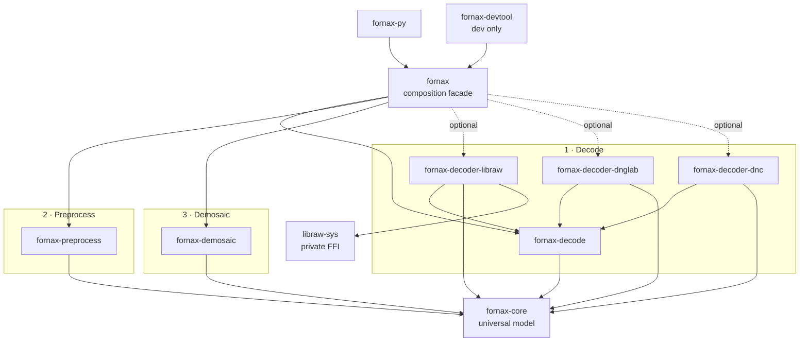

# DES-006 — Crate Architecture and Dependency Boundaries

> **Task:** `DES-006`
> **Owner:** primary agent
> **Review:** GitHub task pull request; its open/merged state is authoritative.
> **Pull request:** [#552](https://github.com/Glatzel/fornax/pull/552).
> **Last updated:** 2026-10-24
>
> **Dependencies:** `SYN-03` (#546), `DES-001` (#545), `DES-004` (#549), and
> `DES-005` (#550), all merged.
>
> **Normative design:** repository-root
> [`docs/raw-pipeline/`](../../../docs/raw-pipeline/README.md). This proposal
> records crate-boundary rationale and migration decisions. The persistent
> [architecture guide](../../../docs/raw-pipeline/architecture.md) is added in
> this PR.
>
> **Acceptance criteria (authoritative in the task manifest):**
>
> - [x] No existing crate is retained without justification.
> - [x] No crate is introduced without a defined responsibility.
> - [x] The shared core is independent of LibRaw and decoder adapters remain
>   behind interfaces.
> - [x] The dependency graph is acyclic.
> - [x] Feature and error strategy are documented.
> - [x] Decisions cite merged synthesis and foundational design PRs.
> - [x] The persistent architecture guide is updated and linked.

## 1. Architecture principles

The topology follows the finalized pipeline:

```text
select decoder backend -> decode -> preprocess -> demosaic
```

Rules:

- `fornax-core` contains no decoder implementation and no upstream decoder
  types.
- Every concrete decoder is behind a `RawDecoderBackend` adapter and Cargo
  feature.
- Preprocessing consumes core stage types through an extension trait, avoiding
  a dependency from core to numeric algorithms.
- Demosaicing owns an object-safe strategy contract and optional external
  adapter features.
- The `fornax` facade is the only production crate that composes concrete
  decoders, preprocessing, and demosaicing.
- Optional dependencies do not silently change backend selection.

## 2. Proposed crate map

| Crate | Responsibility | Public surface | Depends on |
| --- | --- | --- | --- |
| `fornax-core` | Universal RAW samples, metadata, geometry, CFA, stage markers, validation | Stable universal model and structured core errors | `image`; optional `serde` |
| `fornax-decode` | Decoder contract, capabilities, selection registry, provenance | `RawDecoderBackend`, IDs/capabilities, decode config/errors | `fornax-core` |
| `fornax-decoder-libraw` | LibRaw adapter | Constructor/config for LibRaw backend | `fornax-core`, `fornax-decode`, `libraw-sys` |
| `fornax-decoder-dnglab` | dnglab/rawler adapter | Constructor/config for Rust DNG/vendor backend | `fornax-core`, `fornax-decode`, `rawler` |
| `fornax-decoder-dnc` | Adobe DNG conversion bridge composed with a DNG backend | Generic `DncBackend<D>` constructor | `fornax-core`, `fornax-decode`; external converter |
| `fornax-preprocess` | LUT, black subtraction, normalization, clipping, custom f32 extension | Stage-specific extension traits, options, errors | `fornax-core`; optional parallel backend |
| `fornax-demosaic` | Bayer strategy contract/registry, planar output, built-in/external adapters | `DemosaicStrategy`, registry, input/output/errors | `fornax-core`; optional `demosaic` crate |
| `fornax` | High-level composition/backend registry configuration | `Pipeline`/builder and top-level errors | core/decode/preprocess/demosaic plus opted-in adapters |
| `fornax-py` | Python API over facade | Python module/types | `fornax`, `pyo3` |
| `fornax-devtool` | Development fixtures/examples only | Not published | Dev/tooling dependencies |
| `libraw-sys` | Generated LibRaw FFI and native-link support | Not re-exported by universal APIs | `libc`, `bindgen` build |

The proposed names are final unless `.release-plz`/package publishing requires
a collision resolution. Crate boundaries are responsibilities, not compatibility
shims.

## 3. Dependency graph

Arrow direction means **depends on**.



External dependencies remain outside the workspace:

- LibRaw through `libraw-sys`;
- rawler through `fornax-decoder-dnglab`;
- Adobe DNG Converter through the process boundary;
- optional `demosaic` crate through `fornax-demosaic`.

There is no edge from `fornax-core` to any adapter, and no cycle between
decode/preprocess/demosaic.

## 4. Public contracts

### 4.1 Core

`fornax-core` owns:

- geometry and pixel payloads;
- typed/extensible metadata and provenance;
- `RawImage<S>`, decoded/preprocessing/demosaic-ready stage markers;
- level metadata and validation; and
- `CoreError`/`RawValidationError`.

It does not own decoder capabilities, backend IDs, preprocessing algorithms, or
demosaic strategies.

Stage types live in core so decode output and demosaic input have one definition.
Their transition construction is exposed through a constrained, doc-hidden
pipeline transition API and is not part of the supported user API.

### 4.2 Decode

```rust
pub trait RawDecoderBackend: Send + Sync {
    fn id(&self) -> DecoderBackendId;
    fn capabilities(&self) -> DecoderCapabilities;

    fn probe(&self, input: &RawInput<'_>) -> Result<ProbeResult, DecodeError>;
    fn decode(
        &self,
        input: &RawInput<'_>,
        config: &DecodeConfig,
    ) -> Result<DecodedRaw, DecodeError>;
}
```

`DecoderRegistry` owns configured backend instances. Selection is explicit by
stable `DecoderBackendId`; capability-based fallback must be requested and its
resolution recorded.

Adapters translate upstream samples/metadata into `fornax-core`, contain known
panics/error preconditions, and never expose upstream image types.

### 4.3 Preprocess

Because stage types belong to core and preprocessing algorithms belong to
`fornax-preprocess`, transitions are provided by an extension trait:

```rust
pub trait LinearizeExt {
    fn into_linearized(
        self,
        options: &PreprocessOptions,
    ) -> Result<LinearizedRaw, PreprocessError>;
}

pub trait SubtractBlackExt {
    fn subtract_black(
        self,
        options: &PreprocessOptions,
    ) -> Result<BlackCorrectedRaw, PreprocessError>;
}

pub trait NormalizeExt {
    fn normalize(
        self,
        options: &PreprocessOptions,
    ) -> Result<NormalizedRaw, PreprocessError>;
}

pub trait FinishForDemosaicExt {
    fn finish_for_demosaic(
        self,
        options: &PreprocessOptions,
    ) -> Result<DemosaicReadyMosaic, PreprocessError>;
}
```

Method applicability is implemented only for the correct source stage. This
keeps state transitions consuming and prevents core from depending on
preprocessing algorithms.

### 4.4 Demosaic

`fornax-demosaic` owns the object-safe `DemosaicStrategy`/registry, input/output
types, border policy, and `DemosaicError`. Built-in algorithms and the optional
external `demosaic` adapter implement the same trait.

No upstream demosaic types cross into core or the facade.

### 4.5 Facade

`fornax` exposes a builder that:

1. accepts a selected backend or explicit registry policy;
2. decodes into core types;
3. applies the configured preprocessing sequence;
4. dispatches the selected demosaic strategy; and
5. returns a demosaic result plus retained metadata.

The facade does not re-export backend crates by default and never chooses a
backend solely because its Cargo feature is enabled.

## 5. Error strategy

Errors are typed by boundary:

| Crate | Error |
| --- | --- |
| `fornax-core` | `RawValidationError`, geometry/encoding/metadata/cfa failures |
| `fornax-decode` | `DecodeError` with backend, unsupported capability, malformed input, contained panic, internal adapter failure |
| `fornax-preprocess` | `PreprocessError` with missing metadata, invalid levels, custom-basis mismatch, numeric/allocation failure |
| `fornax-demosaic` | `DemosaicError` with invalid input/output, unsupported phase/algorithm, too-small, algorithm/allocation failure |
| `fornax` | `FornaxError` wrapping the relevant stage error with source context |

Rules:

- no `String`-only top-level error;
- no `anyhow`/type-erased error in public APIs;
- upstream errors are translated, not exposed;
- panics from known unsafe upstream entry points are contained at adapters and
  reported structurally; and
- errors preserve selected backend and stage provenance where useful.

## 6. Cargo features

| Crate | Features |
| --- | --- |
| `fornax-core` | `serde` |
| `fornax-decode` | `serde` |
| `fornax-preprocess` | `parallel` |
| `fornax-demosaic` | `external-demosaic`, `parallel` |
| `fornax` | `backend-libraw`, `backend-dnglab`, `backend-dnc`, `demosaic-external`, `parallel`, `serde` |
| adapter crates | No default features; their package presence is the opt-in |

Facade defaults are empty. A backend must be enabled and explicitly selected at
runtime. This avoids hidden native linking and makes packaging behavior
predictable. Python distributions choose their backend feature set explicitly.

## 7. Existing crate migration

| Existing asset | Decision | Migration |
| --- | --- | --- |
| `fornax-core` | Retain name, replace contents | Move current `BayerImage`/traits out; install universal model/stages/errors |
| `fornax-dalim` | Retire as architecture | Adapt `DemosaicLinear`, tests, and benchmark into `fornax-demosaic`; no compatibility trait |
| `libraw` | Retire public wrapper | Move ownership/accessor logic into `fornax-decoder-libraw`; fix stride and pointer defects |
| `libraw-sys` | Retain private FFI support | Link only from LibRaw adapter; no re-export |
| `dnc` | Move/rework | Create `fornax-decoder-dnc` composed backend; process/license/temp-file rules explicit |
| `fornax` | Retain name, replace facade | New pipeline builder over backend registry |
| `fornax-py` | Retain package name | Rewrite over new facade; migrate Python fixture tests |
| `fornax-devtool` | Retain dev-only | Update fixtures/examples; exclude from production release |

RES-01 assets remain reusable only after adaptation and tests. No legacy public
trait or crate type is preserved for compatibility.

## 8. Validation strategy

1. Validate the workspace dependency graph is acyclic.
2. Check `fornax-core` dependency tree contains no decoder/adapter crates.
3. Build each backend feature independently and in supported combinations.
4. Verify facade with no backends compiles and rejects decode until a backend
   is selected.
5. Compile demosaic external and built-in feature combinations.
6. Run adapter conformance tests for the same synthetic RAW model.
7. Verify stage extension methods reject wrong source stages.
8. Measure allocations across decode/preprocess/demosaic.

## 9. Open questions

- Whether generic DNC composition should live in `fornax-decoder-dnc` or the
  facade is an API ergonomics decision.
- Serialization feature propagation and stable metadata schema versioning
  require release review.
- The exact package names may be shortened before publishing, but dependency
  directions and responsibilities are fixed.
- `parallel` thresholds and implementation details require benchmarks.
- Future darktable/rawspeed integration remains a separate decoder adapter and
  license decision.

## 10. Evidence

- [Persistent architecture guide](../../../docs/raw-pipeline/architecture.md).
- [SYN-03 architecture recommendations](../../research/SYN-03-summary.md#3-architecture-and-decoder-boundary).
- [RES-01 workspace inventory](../../research/RES-01-fornax-inventory.md#21-current-workspace-topology-inventory-only).
- [RES-09 backend/dependency recommendations](../../research/RES-09-rust-ecosystem.md#4-implications-for-fornax).
- [DES-001 stage model](DES-001-universal-raw-representation.md#3-stage-typed-image).
- [DES-004 preprocessing operations](DES-004-preprocessing-state.md#3-consuming-transition-signatures).
- [DES-005 demosaicing interface](DES-005-demosaicing-interface.md#4-strategy-interface).

## Acceptance checklist

- [x] No existing crate is retained without justification.
- [x] No crate is introduced without a defined responsibility.
- [x] The shared core is independent of LibRaw and decoder adapters remain
  behind interfaces.
- [x] The dependency graph is acyclic.
- [x] Feature and error strategy are documented.
- [x] Decisions cite merged synthesis and foundational design PRs.
- [x] The persistent architecture guide is updated and linked.
