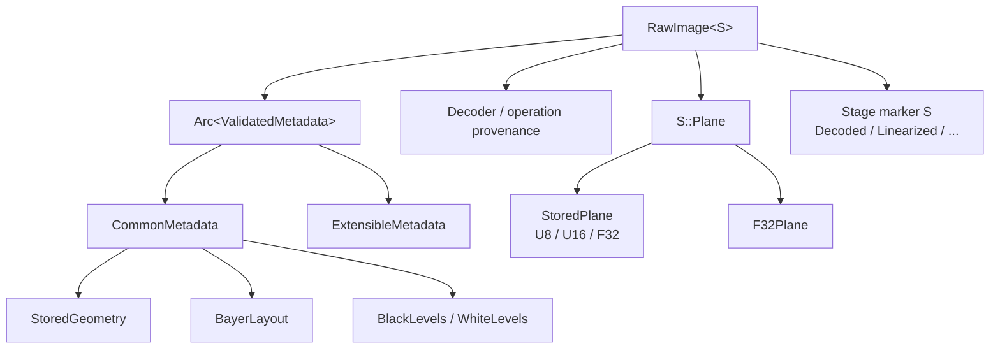
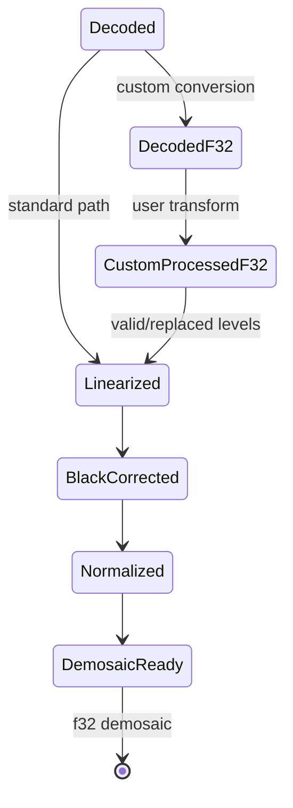

# Key Structures and Fields

This is a field-oriented index for the proposed DES-001 model. The complete
normative Rust snippets and validation rules are in
[DES-001 §2–§8](../DES-001-universal-raw-representation.md#2-representative-rust-types).

## Ownership map

## Core image

| Type/field | Type | Unit | Invariant |
| --- | --- | --- | --- |
| `RawImage<S>::metadata` | `Arc<ValidatedMetadata>` | N/A | Immutable during processing |
| `RawImage<S>::plane` | `S::Plane` | samples | Matches declared dimensions and stage |
| `RawImage<S>::stage` | `S` | N/A | Carries state/provenance; no implicit stage recovery |
| `StoredPlane` | `U8`, `U16`, or `F32` variant | sample | Container compatible with `SampleEncoding` |
| `F32Plane` | `ImageBuffer<Luma<f32>, Vec<f32>>` | sample | Preprocessing/demosaic stages only |

## Geometry and encoding

| Type/field | Type | Unit | Invariant |
| --- | --- | --- | --- |
| `PixelSize::{width,height}` | `u32` | pixels | Both non-zero for a stored image |
| `PixelCoord::{row,col}` | `u32` | pixel | Stored raster coordinate |
| `PixelRect::{top,left,bottom,right}` | `u32` | half-open pixels | `top < bottom`, `left < right`, inside stored size |
| `SampleEncoding::bits_per_sample` | `NonZeroU8` | bits | Semantic source precision |
| `SampleEncoding::format` | `SampleFormat` | enum | Unsigned integer or float |
| `StoredGeometry::dimensions` | `PixelSize` | pixels | Must equal payload dimensions |
| `StoredGeometry::source_row_stride_bytes` | `NonZeroU64` | bytes | Preserves original backend stride |

`StoredGeometry::source_row_stride_bytes` describes the backend allocation
before compacting. The canonical `ImageBuffer` is tightly packed.

## CFA, crop, and levels

| Type/field | Type | Unit | Invariant |
| --- | --- | --- | --- |
| `BayerLayout::pattern` | `BayerPattern` | enum | `RGGB`, `BGGR`, `GRBG`, or `GBRG` |
| `BayerLayout::active_area` | `ActiveArea` | stored pixels | Pattern origin is ActiveArea top-left |
| `DefaultCrop::{origin_x,origin_y,width,height}` | `Rational` | pre-scale raw coordinates | Kept separate from ActiveArea |
| `Orientation` | `u8` newtype | TIFF enum | Valid range 1–8 |
| `BlackLevels::common` | `Rational` | stored sample code | Scalar component |
| `BlackLevels::per_slot` | `[Rational; 4]` | stored sample code | CFA slots remain distinct |
| `BlackLevels::repeat` | `Option<BlackTile>` | stored sample code | ActiveArea-relative tile |
| `BlackTile::{rows,columns,samples_per_plane}` | `NonZeroU32` | samples | Value count matches dimensions × planes |
| `WhiteLevels::declared` | `Box<[Rational]>` | stored sample code | Source-declared saturation |
| `WhiteLevels::adjusted_maximum` | `Option<Box<[Rational]>>` | stored sample code | Decoder-adjusted value kept separate |
| `WhiteLevels::measured_maximum` | `Option<Box<[Rational]>>` | stored sample code | Observed value kept separate |

## Stage types

| Stage | Plane | Meaning |
| --- | --- | --- |
| `Decoded` | `StoredPlane` | Native backend source samples |
| `DecodedF32` | `F32Plane` | Explicit lossless custom-processing input |
| `CustomProcessedF32` | `F32Plane` | User-transformed samples plus metadata basis |
| `Linearized` | `F32Plane` | LUT applied once or identity |
| `BlackCorrected` | `F32Plane` | Black subtracted once; unclipped |
| `Normalized` | `F32Plane` | Linear-reference semantics; unclipped |
| `DemosaicReady` | `F32Plane` | Finite f32 values in `[0,1]` |

## Validation fields and errors

`ValidatedMetadata` is constructed only after checking required metadata,
geometry, CFA, level lengths, sample encoding, and provenance conflicts.
`RawValidationError` distinguishes missing metadata, invalid geometry/encoding,
unsupported CFA/non-mosaic input, invalid levels, conflicts, and incompatible
custom-processing basis.

Unsupported input is rejected at the adapter/constructor boundary. No code
guesses a missing CFA origin, fabricates black levels, converts an unknown CFA
to RGB, or treats a display image as a sensor plane.

## Related guides

- [Raw image processing flow](raw-image-process.md)
- [Precision by phase](precision.md)
