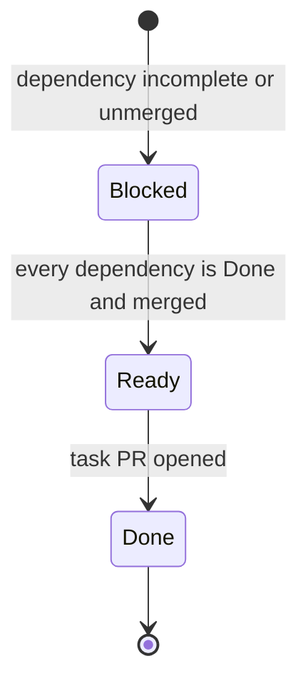

# RAW Pipeline Task Status

**Snapshot:** 2026-10-24

This is the manually maintained task-status overview for the RAW pipeline. It
is updated when a task PR opens and when dependency PRs merge.

`Done` means the task deliverable is complete and its task PR exists; the PR may
still be open. GitHub remains the review and merge authority. A downstream task
becomes `Ready` only after every dependency task is `Done` and every dependency
PR is merged.

Unfinished implementation and QA task PRs integrate through
`refactor/raw-pipeline-v2`. `main` remains unchanged until the final QA gate
passes on that branch and the user merges the promotion PR.

## Status legend

| Status | Meaning |
| --- | --- |
| `Blocked` | A dependency is not `Done`, or a dependency task PR is still open. |
| `Ready` | Every dependency is `Done` and merged; work has not started. |
| `Done` | The task deliverable is complete and its task PR exists, whether open or merged. |

## Summary

| Phase | Tasks | Blocked | Ready | Done |
| --- | ---: | ---: | ---: | ---: |
| Research | 9 | 0 | 0 | 9 |
| Synthesis | 3 | 0 | 0 | 3 |
| Design | 6 | 0 | 0 | 6 |
| Implementation | 15 | 14 | 0 | 1 |
| QA | 6 | 6 | 0 | 0 |
| **Total** | **39** | **20** | **0** | **19** |

## Research

| ID | Task | Depends on | Status | Artifact / PR |
| --- | --- | --- | --- | --- |
| `RES-01` | [Inventory existing components](raw-pipeline/RES-01.toml) | none | `Done` | [report](../research/RES-01-fornax-inventory.md), [#534](https://github.com/Glatzel/fornax/pull/534) |
| `RES-02` | [Research LibRaw](raw-pipeline/RES-02.toml) | none | `Done` | [report](../research/RES-02-libraw.md), [#534](https://github.com/Glatzel/fornax/pull/534) |
| `RES-03` | [Research dnglab and DNG metadata](raw-pipeline/RES-03.toml) | none | `Done` | [report](../research/RES-03-dnglab.md), [#534](https://github.com/Glatzel/fornax/pull/534) |
| `RES-04` | [Research darktable preprocessing](raw-pipeline/RES-04.toml) | none | `Done` | [report](../research/RES-04-darktable.md), [#534](https://github.com/Glatzel/fornax/pull/534) |
| `RES-05` | [Research demosaicing](raw-pipeline/RES-05.toml) | none | `Done` | [report](../research/RES-05-demosaicing.md), [#534](https://github.com/Glatzel/fornax/pull/534) |
| `RES-06` | [Survey Rust RAW decoders](raw-pipeline/RES-06.toml) | none | `Done` | [report](../research/RES-06-rust-raw-decoders.md), [#534](https://github.com/Glatzel/fornax/pull/534) |
| `RES-07` | [Survey Rust TIFF and DNG components](raw-pipeline/RES-07.toml) | none | `Done` | [report](../research/RES-07-rust-dng-tiff.md), [#534](https://github.com/Glatzel/fornax/pull/534) |
| `RES-08` | [Survey Rust demosaicing crates](raw-pipeline/RES-08.toml) | none | `Done` | [report](../research/RES-08-rust-demosaicing.md), [#534](https://github.com/Glatzel/fornax/pull/534) |
| `RES-09` | [Recommend selectable raw decoder backends](raw-pipeline/RES-09.toml) | `RES-01`–`RES-04`, `RES-06`–`RES-08` | `Done` | [report](../research/RES-09-rust-ecosystem.md), [#537](https://github.com/Glatzel/fornax/pull/537) |

## Synthesis

| ID | Task | Depends on | Status | Artifact / PR |
| --- | --- | --- | --- | --- |
| `SYN-01` | [Reconcile metadata and sample semantics](raw-pipeline/SYN-01.toml) | `RES-01`–`RES-04`, `RES-06`, `RES-07` | `Done` | [note](../research/notes/SYN-01.md), [#540](https://github.com/Glatzel/fornax/pull/540) |
| `SYN-02` | [Reconcile preprocessing and black levels](raw-pipeline/SYN-02.toml) | `RES-02`, `RES-04`, `SYN-01` | `Done` | [note](../research/notes/SYN-02.md), [#541](https://github.com/Glatzel/fornax/pull/541) |
| `SYN-03` | [Synthesize cross-source recommendations](raw-pipeline/SYN-03.toml) | all `RES-*`, `SYN-01`, `SYN-02` | `Done` | [summary](../research/SYN-03-summary.md), [#546](https://github.com/Glatzel/fornax/pull/546) |

## Design

| ID | Task | Depends on | Status | Proposal / PR |
| --- | --- | --- | --- | --- |
| `DES-001` | Design universal RAW representation | `SYN-01`, `SYN-02`, `DES-003` | `Done` | [proposal](../design/raw-pipeline/DES-001-universal-raw-representation.md), [#545](https://github.com/Glatzel/fornax/pull/545) |
| `DES-002` | Design metadata and provenance | `SYN-01` | `Done` | [proposal](../design/raw-pipeline/DES-002-metadata-provenance.md), [#542](https://github.com/Glatzel/fornax/pull/542) |
| `DES-003` | Design Bayer CFA model and indexing | `SYN-01` | `Done` | [proposal](../design/raw-pipeline/DES-003-cfa-indexing.md), [#543](https://github.com/Glatzel/fornax/pull/543) |
| `DES-004` | Design preprocessing and processing state | `SYN-01`, `SYN-02`, `DES-001`, `DES-003` | `Done` | [proposal](../design/raw-pipeline/DES-004-preprocessing-state.md), [#549](https://github.com/Glatzel/fornax/pull/549) |
| `DES-005` | Design the demosaicing interface | `SYN-01`, `SYN-03`, `DES-001`, `DES-003` | `Done` | [proposal](../design/raw-pipeline/DES-005-demosaicing-interface.md), [#550](https://github.com/Glatzel/fornax/pull/550) |
| `DES-006` | Design crate boundaries | `SYN-03`, `DES-001`, `DES-004`, `DES-005` | `Done` | [proposal](../design/raw-pipeline/DES-006-crate-architecture.md), [#552](https://github.com/Glatzel/fornax/pull/552) |

## Implementation

| ID | Task | Depends on | Status | Manifest |
| --- | --- | --- | --- | --- |
| `IMPL-CORE-001` | Implement the universal RAW model and global protocol in fornax | `DES-001`–`DES-003`, `DES-006` | `Done` | [manifest](raw-pipeline/IMPL-CORE-001.toml), [#556](https://github.com/Glatzel/fornax/pull/556) |
| `IMPL-DEC-001` | Implement the decoder backend contract and registry | `IMPL-CORE-001`, `DES-006` | `Blocked` | [manifest](raw-pipeline/IMPL-DEC-001.toml) |
| `IMPL-DEC-002` | Implement the LibRaw decoder adapter | `IMPL-DEC-001`, `DES-002`, `DES-003` | `Blocked` | [manifest](raw-pipeline/IMPL-DEC-002.toml) |
| `IMPL-DEC-003` | Implement the dnglab/rawler decoder adapter | `IMPL-DEC-001`, `DES-002`, `DES-003` | `Blocked` | [manifest](raw-pipeline/IMPL-DEC-003.toml) |
| `IMPL-DEC-004` | Implement the DNC conversion bridge backend | `IMPL-DEC-001`, `IMPL-DEC-003` | `Blocked` | [manifest](raw-pipeline/IMPL-DEC-004.toml) |
| `IMPL-DEC-005` | Validate decoder conformance and format fixtures | `IMPL-DEC-002`–`IMPL-DEC-004` | `Blocked` | [manifest](raw-pipeline/IMPL-DEC-005.toml) |
| `IMPL-PRE-001` | Implement preprocessing foundation and linearization substep | `IMPL-CORE-001`, `DES-004` | `Blocked` | [manifest](raw-pipeline/IMPL-PRE-001.toml) |
| `IMPL-PRE-002` | Implement ActiveArea-aware black subtraction | `IMPL-PRE-001`, `DES-003` | `Blocked` | [manifest](raw-pipeline/IMPL-PRE-002.toml) |
| `IMPL-PRE-003` | Implement the single preprocessing entry point | `IMPL-PRE-002` | `Blocked` | [manifest](raw-pipeline/IMPL-PRE-003.toml) |
| `IMPL-DEM-001` | Implement the demosaicing contract and registry | `IMPL-CORE-001`, `DES-005` | `Blocked` | [manifest](raw-pipeline/IMPL-DEM-001.toml) |
| `IMPL-DEM-002` | Implement the bilinear demosaic strategy | `IMPL-DEM-001`, `DES-005` | `Blocked` | [manifest](raw-pipeline/IMPL-DEM-002.toml) |
| `IMPL-DEM-003` | Add Malvar–He–Cutler through the optional adapter | `IMPL-DEM-002`, `DES-005`, `RES-05` | `Blocked` | [manifest](raw-pipeline/IMPL-DEM-003.toml) |
| `IMPL-INT-001` | Implement the explicit end-to-end pipeline module | `IMPL-DEC-005`, `IMPL-PRE-003`, `IMPL-DEM-001`, one of `IMPL-DEM-002` / `IMPL-DEM-003` | `Blocked` | [manifest](raw-pipeline/IMPL-INT-001.toml) |
| `IMPL-INT-002` | Migrate Python bindings and development tooling to fornax | `IMPL-INT-001` | `Blocked` | [manifest](raw-pipeline/IMPL-INT-002.toml) |
| `IMPL-INT-003` | Retire legacy decoder, demosaic, and facade architecture | `IMPL-DEC-002`, `IMPL-DEC-004`, `IMPL-DEM-002`, `IMPL-DEM-003`, `IMPL-INT-002` | `Blocked` | [manifest](raw-pipeline/IMPL-INT-003.toml) |

## QA

| ID | Task | Depends on | Status | Manifest |
| --- | --- | --- | --- | --- |
| `QA-001` | Validate metadata preservation | `IMPL-DEC-005`, `IMPL-INT-001` | `Blocked` | [manifest](raw-pipeline/QA-001.toml) |
| `QA-002` | Add numerical regression coverage | `IMPL-INT-001`, `IMPL-PRE-003`, `IMPL-DEM-002`, `IMPL-DEM-003` | `Blocked` | [manifest](raw-pipeline/QA-002.toml) |
| `QA-003` | Validate error paths and unsupported inputs | `IMPL-DEC-005`, `IMPL-PRE-003`, `IMPL-INT-001` | `Blocked` | [manifest](raw-pipeline/QA-003.toml) |
| `QA-004` | Establish performance baselines | `IMPL-DEC-005`, `IMPL-INT-001`, `IMPL-DEM-003` | `Blocked` | [manifest](raw-pipeline/QA-004.toml) |
| `QA-005` | Document behavior and API migration | `IMPL-INT-002`, `IMPL-INT-003` | `Blocked` | [manifest](raw-pipeline/QA-005.toml) |
| `QA-006` | Run final workspace validation | `IMPL-INT-003`, `QA-001`–`QA-005` | `Blocked` | [manifest](raw-pipeline/QA-006.toml) |

## Update rules

1. When a task branch is pushed and its PR is opened, mark the task `Done` and
   add the report/proposal link plus PR number.
2. Keep dependent tasks `Blocked` while any dependency PR remains open.
3. After every dependency PR is merged, mark the dependent task `Ready` only
   when no worktree or task PR has been created for it.
4. When a `Ready` task opens its PR, mark it `Done` and repeat the process for
   its dependents.
5. Do not add an intermediate worktree/PR status. The presence of a worktree or
   open PR can be inferred from the branch, PR link, and `Done` state.

