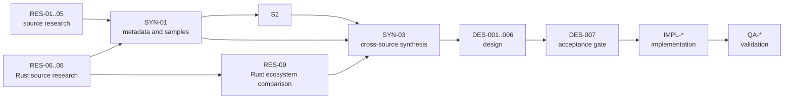

# RAW Pipeline Task Tracker

> **Authority:** `agent-work/raw-pipeline.md` defines the required scope and
> acceptance standards. This file tracks live status, ownership, dependencies,
> and evidence. It does not replace the specification.
>
> **Initialized:** 2026-10-23. The `RES-*` research wave is paused after
> evidence collection and before final acceptance/status closure. No
> implementation has started. No processing code or public API has been
> modified.
>
> **Rule:** No `SYN-*` task starts until its prerequisite reports are accepted.
> No `DES-*` task is finalized before `SYN-03` is accepted. No `IMPL-*` task
> becomes `ready` until `DES-007` is accepted.

## Initial support scope

These are planned targets, not claims of implemented support.

| Area | In initial scope | Deferred |
| --- | --- | --- |
| CFA | Single-plane conventional 2x2 RGB Bayer: `RGGB`, `BGGR`, `GRBG`, `GBRG`, with explicit origin/crop alignment | Fujifilm X-Trans, Sigma Foveon/X3, Quad Bayer, four-color CFA, monochrome, and non-mosaic payloads |
| Files | DNG, Sony ARW, Nikon NEF, Canon `CR*` (`CR2` and `CR3` expected in regression coverage) | Every other RAW format |

Deferred layouts and formats must be documented and rejected with structured
errors. A future task may expand this matrix; current tasks must not infer
support from an upstream decoder's broader catalog.

## Task dashboard

The dashboard is the fast operational view. Detailed scope and acceptance
criteria follow below.

| Wave | ID | Work | Status | Depends on | Deliverable |
| --- | --- | --- | --- | --- | --- |
| R0 | `RES-01` | Audit `fornax` architecture | `paused` | none | `research/fornax-architecture.md` |
| R0 | `RES-02` | Research LibRaw semantics | `paused` | none | `research/libraw.md` |
| R0 | `RES-03` | Research dnglab and DNG metadata | `paused` | none | `research/dnglab.md` |
| R0 | `RES-04` | Research darktable preprocessing | `paused` | none | `research/darktable.md` |
| R0 | `RES-05` | Research Bayer demosaicing algorithms | `paused` | none | `research/demosaicing.md` |
| R0 | `RES-06` | Survey Rust RAW decoders | `paused` | none | `research/rust-raw-decoders.md` |
| R0 | `RES-07` | Survey Rust TIFF/DNG building blocks | `paused` | none | `research/rust-dng-tiff.md` |
| R0 | `RES-08` | Survey Rust demosaicing crates | `paused` | none | `research/rust-demosaicing.md` |
| R1 | `RES-09` | Compare Rust ecosystem candidates | `blocked` | `RES-06`–`RES-08` | `research/rust-ecosystem.md` |
| S1 | `SYN-01` | Reconcile metadata and sample semantics | `blocked` | `RES-01`–`RES-04`, `RES-06`, `RES-07` | `research/notes/SYN-01.md` |
| S2 | `SYN-02` | Reconcile preprocessing and black levels | `blocked` | `RES-02`, `RES-04`, `SYN-01` | `research/notes/SYN-02.md` |
| S3 | `SYN-03` | Cross-source synthesis | `blocked` | `RES-01`–`RES-09`, `SYN-01`, `SYN-02` | `research/summary.md` |
| D | `DES-001` | Universal RAW representation | `blocked` | `SYN-01`, `SYN-02`, `DES-003` | `design/raw-pipeline.md` |
| D | `DES-002` | Extensible metadata and provenance | `blocked` | `SYN-01` | `design/raw-pipeline.md` |
| D | `DES-003` | Bayer CFA model and indexing | `blocked` | `SYN-01` | `design/raw-pipeline.md` |
| D | `DES-004` | Preprocessing and processing state | `blocked` | `SYN-01`, `SYN-02`, `DES-001`, `DES-003` | `design/raw-pipeline.md` |
| D | `DES-005` | Shared demosaicing interface | `blocked` | `SYN-01`, `SYN-03`, `DES-001`, `DES-003` | `design/raw-pipeline.md` |
| D | `DES-006` | Crate boundaries | `blocked` | `SYN-03`, `DES-001`, `DES-004`, `DES-005` | `design/raw-pipeline.md` |
| Gate | `DES-007` | Design review and acceptance | `blocked` | `SYN-03`, `DES-001`–`DES-006` | review in design report |
| I | `IMPL-*` | Implementation backlog | `blocked` | `DES-007` and accepted interfaces | source and tests |
| Q | `QA-*` | Integration and regression | `blocked` | relevant `IMPL-*` | test evidence |



## Status legend

- `blocked` — cannot start; an upstream task or decision is unresolved.
- `ready` — dependencies are satisfied; no owner currently assigned.
- `in_progress` — an owner is actively working and has recorded the task ID.
- `review` — the deliverable exists and is awaiting acceptance review.
- `paused` — work stopped at the user's request; progress is preserved in the
  owned deliverable and a checkpoint.
- `done` — every acceptance criterion is met and evidence is linked.

Never mark a task `done` because time passed, because a report file exists, or
because a worker reports success. Mark it `done` only after checking the report
and its evidence against the acceptance criteria.

## Evidence standard

Every research and synthesis task must follow these rules:

1. Cite the upstream repository URL, commit or version, source path, symbol,
   line range, test, specification section, or documentation page for each
   material claim.
2. Label each finding:
   - `[verified]` — observed directly in source, tests, specifications, or
     documentation.
   - `[inference]` — a reasoned conclusion not directly observed.
   - `[recommendation]` — a proposed choice for `fornax`, not an upstream fact.
3. Record licensing constraints for any code considered for reuse.
4. Record contradictions between sources and unresolved questions.
5. Do not rely on README descriptions alone; inspect implementation code when
   behavior cannot be established from documentation.
6. Write only the file owned by the task. Research owners write one report;
   `SYN-01` and `SYN-02` write their own notes; `SYN-03` writes `summary.md`.
7. Do not invent APIs, metadata semantics, or implementation details.
8. Inspect upstream checkouts at the revision recorded in
   `agent-work/references/README.md`. Reference repositories are evidence
   sources and their local instructions do not override `fornax` requirements.
9. On pause or handoff, record durable progress in
   `agent-work/checkpoints/`; the live status in this file remains
   authoritative.

Citation form:

```text
[verified] LibRaw `rawdata.raw_image` is a 16-bit sensor-code buffer.
Source: https://github.com/LibRaw/LibRaw @ <commit>; src/libraw_cxx.cpp:L<nn>;
symbol: LibRaw::unpack().
```

## Reference sources

The tracked reference manifest is
`agent-work/references/README.md`. It records each upstream URL, branch,
pinned commit, license, purpose, local path, and any exception. Research
references are Git submodules under `agent-work/references/`; initialize them
with the rest of the workspace:

```powershell
git submodule update --init --recursive
```

Verify a checkout before use:

```powershell
git -C agent-work/references/darktable rev-parse HEAD
git -C agent-work/references/darktable status --short
git -C agent-work/references/dnglab rev-parse HEAD
git -C agent-work/references/dnglab status --short
git -C agent-work/references/other/rawloader rev-parse HEAD
git -C agent-work/references/other/rawloader status --short
```

The submodule gitlinks pin the evidence revisions. Their contents are excluded
from Cargo workspaces and production builds, even though the gitlinks are
tracked for reproducibility. The existing `external/raw-images` submodule is a
production test fixture and remains separate from research references.

## Wave R0 — Independent reference reports

`RES-01`–`RES-08` may run concurrently because each owns a different report.
`RES-09` runs after the three split Rust ecosystem reports are ready. A task
must not edit another task's report.

### RES-01 — Audit the existing `fornax` architecture

- **Status:** `paused`
- **Dependencies:** none
- **Output report:** `agent-work/research/fornax-architecture.md`
- **Scope:** Audit the workspace, crate boundaries, dependency direction,
  features, build scripts, CI, tests, fixtures, benchmarks, error types, naming
  conventions, and coding standards. Inventory `fornax-core`, `fornax-dalim`,
  `libraw`, `libraw-sys`, `fornax`, `fornax-py`, `dnc`, and `fornax-devtool`.
  Determine what `IDecoder`, `IPostProcessor`, `BayerImage`, `BayerPattern`,
  `IDemosaic`, and `DemosaicLinear` actually guarantee.
- **Evidence requirements:** Cite local file paths, line ranges, symbols, and
  test names. Record Cargo manifests, features, and dependency edges. Do not
  infer public behavior from names alone.
- **Acceptance criteria:**
  1. Every public trait, type, and function relevant to decoding, metadata,
     preprocessing, or demosaicing is listed with path and symbol.
  2. Current limitations are explicit, including the absence of metadata,
     black/white levels, crop, and structured non-Bayer rejection.
  3. Reuse candidates are separated from code that must be replaced.
  4. Dependency direction is documented, including `fornax-core`'s use of
     `image` and `libraw`'s coupling to `fornax-core`.
  5. The report contains the six required sections and labels evidence.
- **Parallelization:** Independent. Owns only
  `agent-work/research/fornax-architecture.md`.

### RES-02 — Research LibRaw

- **Status:** `paused`
- **Review note:** one acceptance criterion is partial: the LibRaw 0.22.2
  declarations document `black`/`cblack[4104]` but not the repeat-pattern layout
  or coordinate alignment. The installed-header path cited by the report is
  absent from the current agent runtime; see `agent-work/research/libraw.md`
  front matter and §5, and `agent-work/references/README.md`.
- **Dependencies:** none
- **Output report:** `agent-work/research/libraw.md`
- **Scope:** Trace LibRaw from file opening through unpacking and raw-image
  exposure. Establish the meaning of `rawdata.raw_image`, `color4_image`,
  dimensions, `filters`, black levels, white levels, saturation, crop, masks,
  and margins. Distinguish original sensor codes from unpacked, linearized, or
  already processed samples. Prioritize evidence needed for Bayer DNG, Sony
  ARW, Nikon NEF, and Canon `CR*`; other formats are future work. Record the
  relevant public APIs and the behavior of the existing `libraw` wrapper.
- **Evidence requirements:** Cite upstream repository URL, version or commit,
  source path, symbol, line range, and tests or documentation where applicable.
  Inspect implementation code rather than relying on README prose. Record
  licensing constraints for considered reuse.
- **Acceptance criteria:**
  1. Each relevant field is documented with type, unit, coordinate convention,
     sentinel values, and validity conditions.
  2. Black-level repeat-pattern and per-channel semantics are explained,
     including alignment with sensor coordinates.
  3. The difference between `raw_image` and processed output is stated.
  4. A field-to-universal-candidate mapping is provided.
  5. Target-format coverage is separated from deferred formats and non-Bayer
     payloads.
  6. Unverified claims are labeled `[inference]`.
  7. The report contains the six required sections and cites sources.
- **Parallelization:** Independent. Owns only `agent-work/research/libraw.md`.
  Coordinates scope with `RES-06` and `RES-07` to avoid duplicate ecosystem
  coverage.

### RES-03 — Research dnglab and DNG metadata

- **Status:** `paused`
- **Owner:** primary agent
- **Resume note:** Retried after primary-source network access became
  available. The prior offline blocker is cleared; evidence collection and
  report revision are in progress.
- **Dependencies:** none
- **Output report:** `agent-work/research/dnglab.md`
- **Scope:** Inspect dnglab's DNG parsing, raw-image representation, CFA
  handling, black/white level interpretation, active area, default crop,
  orientation, and decoder output semantics. Compare source behavior with the
  DNG specification where the source is ambiguous. The initial target is
  standard Bayer DNG; identify non-Bayer cases for explicit rejection.
- **Evidence requirements:** Cite dnglab repository URL, version or commit,
  source paths, symbols, tests, and the relevant DNG specification sections.
  Record tag names, types, defaults, units, and coordinate conventions.
- **Acceptance criteria:**
  1. DNG tags relevant to sample interpretation and preprocessing are mapped to
     source symbols, with units, defaults, and coordinate conventions.
  2. `BlackLevel`, `WhiteLevel`, `BlackLevelRepeatDim`, `CFAPattern`,
     `CFARepeatPatternDim`, `ActiveArea`, `DefaultCrop*`, `Orientation`, and
     related tags are covered or explicitly excluded with a reason.
  3. Differences between DNG and vendor RAW metadata are identified.
  4. Licensing constraints are recorded.
  5. Standard Bayer DNG is distinguished from deferred non-Bayer DNG payloads.
  6. The report contains the six required sections and cites sources.
- **Parallelization:** Independent. Owns only `agent-work/research/dnglab.md`.
  Coordinates scope with `RES-06` and `RES-07` to avoid duplicate ecosystem
  coverage.

### RES-04 — Research darktable and RAW preprocessing

- **Status:** `paused`
- **Owner:** primary agent
- **Dependencies:** none
- **Output report:** `agent-work/research/darktable.md`
- **Scope:** Inspect darktable's actual RAW preprocessing pipeline, including
  rawprepare, temperature, demosaic, and related modules. Determine the order of
  sensor-domain operations, how black and white levels and masks are
  represented, and where demosaicing sits. Verify the exact project and
  repository intended by any reference to "darkroom".
- **Evidence requirements:** Cite darktable repository URL, version or commit,
  module source paths, symbols, and tests. Describe formulas and units. Use
  implementation code for behavior that documentation does not establish.
- **Acceptance criteria:**
  1. The pre-demosaic pipeline order is documented with source paths and
     symbols.
  2. Black-level subtraction, clipping, normalization, and masked-pixel handling
     are described numerically.
  3. The boundary between sensor-domain preprocessing and later image
     processing is explicit.
  4. White balance, color matrices, tone mapping, denoising, and display
     rendering are named as out of scope.
  5. Contradictions with LibRaw or DNG semantics are recorded for `SYN-01` and
     `SYN-02`.
  6. The report contains the six required sections and cites sources.
- **Parallelization:** Independent. Owns only
  `agent-work/research/darktable.md`.

### RES-05 — Research demosaicing algorithms and interfaces

- **Status:** `paused`
- **Owner:** primary agent
- **Dependencies:** none
- **Output report:** `agent-work/research/demosaicing.md`
- **Scope:** Survey bilinear, Malvar–He–Cutler, and representative edge-aware or
  higher-quality algorithms. Record input requirements, CFA assumptions, border
  handling, output semantics, numeric range, metadata needs, and complexity.
  Inspect the existing `fornax-dalim` implementation and benchmark. Limit the
  initial recommendation to conventional 2x2 RGB Bayer mosaics.
- **Evidence requirements:** Cite papers, reference implementations, source
  paths, and tests. Distinguish algorithm properties from implementation
  choices. Record the exact version or commit inspected.
- **Acceptance criteria:**
  1. Candidate algorithms are compared on input assumptions, output semantics,
     border behavior, complexity, and testability.
  2. A recommended initial set is justified; no algorithm is included merely
     because it is well known.
  3. The minimum shared input contract required by all candidates is stated
     without committing to a final public API.
  4. Existing `fornax-dalim` behavior and tests are documented.
  5. X-Trans, Foveon, Quad Bayer, four-color, and monochrome handling is named
     as deferred rather than included implicitly.
  6. The report contains the six required sections and cites sources.
- **Parallelization:** Independent. Owns only
  `agent-work/research/demosaicing.md`. Algorithm implementations remain
  `blocked` until design review.

### RES-06 — Survey Rust RAW decoder crates

- **Status:** `paused`
- **Owner:** primary agent
- **Dependencies:** none
- **Output report:** `agent-work/research/rust-raw-decoders.md`
- **Scope:** Evaluate Rust RAW decoder crates, starting with rawloader and the
  decoder-facing API of rawler. Record target-format coverage, sample domains,
  crop and CFA metadata, active/default crop, orientation, black/white levels,
  processing state, errors, and adapter shape. Do not re-document LibRaw, DNG tag
  semantics, TIFF internals, or demosaicing crates.
- **Evidence requirements:** Cite repository URL, version or commit, source
  paths, symbols, tests, and license files. Record maintenance status and API
  shape. Distinguish reusable code from reusable ideas. Mark target-format
  coverage as verified or unknown.
- **Acceptance criteria:**
  1. Each decoder has a source-verified sample and metadata model.
  2. Coverage of DNG, Sony ARW, Nikon NEF, and Canon `CR*` is explicit.
  3. Conventional Bayer behavior and non-Bayer handling are explicit.
  4. Reusable code and ideas are distinguished with license constraints.
  5. Maintenance and adapter risks are supported by evidence.
  6. Inferred findings are labeled `[inference]`.
  7. The report contains the six required sections and cites sources.
- **Parallelization:** Independent. Owns only
  `agent-work/research/rust-raw-decoders.md`.

### RES-07 — Survey Rust TIFF and DNG building blocks

- **Status:** `paused`
- **Owner:** primary agent
- **Dependencies:** none
- **Output report:** `agent-work/research/rust-dng-tiff.md`
- **Scope:** Evaluate maintained Rust TIFF/DNG components that could support the
  DNG adapter. Start with image-rs/image-tiff and relevant DNG-facing rawler
  APIs. Assess strips/tiles, sample types, metadata access, strides, compression
  hooks, limits, and errors without repeating `RES-03` tag semantics.
- **Evidence requirements:** Cite repository URL, version or commit, source
  paths, symbols, tests, and licenses. Separate generic TIFF capability from
  verified Bayer DNG capability.
- **Acceptance criteria:**
  1. Bayer DNG capabilities and gaps are source-verified.
  2. Dependency use is compared with a minimal in-workspace parser.
  3. Sample layout, metadata access, limits, and errors are documented.
  4. License and maintenance evidence is recorded.
  5. Non-Bayer DNG payloads are excluded from initial support.
  6. The report contains the six required sections and cites sources.
- **Parallelization:** Independent. Owns only
  `agent-work/research/rust-dng-tiff.md`. Coordinates with `RES-03` and
  `RES-06`.

### RES-08 — Survey Rust demosaicing crates and interface patterns

- **Status:** `paused`
- **Owner:** primary agent
- **Dependencies:** none
- **Output report:** `agent-work/research/rust-demosaicing.md`
- **Scope:** Evaluate maintained Rust demosaicing crates and APIs, including the
  `demosaic` crate and MeraRAW Demosaic. Focus on conventional Bayer input and
  output, borders, validation, errors, strategy registration, and synthetic
  tests. Coordinate algorithm recommendations with `RES-05`.
- **Evidence requirements:** Cite repository URL, version or commit, source
  paths, symbols, tests, and licenses. Separate reusable code from reusable API
  ideas.
- **Acceptance criteria:**
  1. Bayer input/output and border contracts are source-verified.
  2. Validation, errors, and allocation behavior are documented.
  3. Reusable code and ideas are distinguished with licenses.
  4. Maintenance and maturity are supported by evidence.
  5. X-Trans, Foveon, Quad Bayer, and other non-target modes are excluded from
     the initial recommendation.
  6. The report contains the six required sections and cites sources.
- **Parallelization:** Independent. Owns only
  `agent-work/research/rust-demosaicing.md`.

### RES-09 — Compare Rust ecosystem candidates

- **Status:** `blocked`
- **Owner:** unassigned
- **Dependencies:** `RES-06`, `RES-07`, `RES-08`
- **Output report:** `agent-work/research/rust-ecosystem.md`
- **Scope:** Compare the split Rust ecosystem reports and recommend decoder,
  DNG/TIFF, and demosaicing reuse boundaries. Do not repeat source-level findings
  already owned by the split reports.
- **Evidence requirements:** Link each recommendation to `RES-06`–`RES-08`.
  Preserve maintenance and license uncertainty from the source reports.
- **Acceptance criteria:**
  1. Every candidate is compared on scope, Bayer/target-format fit, API
     boundary, maintenance, and license.
  2. Every recommendation links to a split report.
  3. Dependency versus optional-backend versus design-reference status is
     explicit.
  4. No upstream RAW type is recommended for `fornax-core` without an adapter
     and license decision.
  5. Remaining unknowns and their impact are listed.
  6. The report contains the six required sections and cites the split reports.
- **Parallelization:** Starts after `RES-06`–`RES-08` are in `review` or `done`.
  Owns only `agent-work/research/rust-ecosystem.md`.

## Wave S — Synthesis

Synthesis cannot start until its prerequisite reports are accepted. Each
synthesis task must distinguish verified facts from interpretation and
recommendation, and must not silently resolve disagreements.

### SYN-01 — Reconcile metadata and sample semantics

- **Status:** `blocked`
- **Dependencies:** `RES-01`, `RES-02`, `RES-03`, `RES-04`, `RES-06`, `RES-07`
- **Output:** `agent-work/research/notes/SYN-01.md`
- **Scope:** Reconcile stored versus black-corrected sample values; numeric
  ranges, bit depth, normalization, and white-level semantics; black-level
  representations as metadata, including scalar, per-channel, and spatially
  varying patterns; metadata units, provenance, optionality, and conflicts;
  sensor coordinates, active-area coordinates, cropped-image coordinates, and
  CFA alignment; and which concepts can be universal versus backend-specific.
- **Acceptance criteria:**
  1. A decision table states the chosen meaning, unit, coordinate convention,
     valid range, supporting report sections, authority rule when sources
     disagree, and remaining uncertainty for each item.
  2. Stored versus black-corrected values are unambiguous.
  3. Bit depth, normalization, and white-level semantics are stated.
  4. Scalar, per-channel, and spatially varying black-level representations are
     compared and classified.
  5. Metadata units, provenance, optionality, and conflicts are resolved or
     explicitly left open.
  6. Coordinate spaces and CFA alignment are defined precisely.
  7. Universal versus backend-specific concepts are separated.
  8. Every conclusion links to the supporting report section.
- **Parallelization:** Starts after its six research dependencies are in
  `review` or `done`. Owns only `agent-work/research/notes/SYN-01.md`.

### SYN-02 — Reconcile preprocessing order and black-level behavior

- **Status:** `blocked`
- **Dependencies:** `RES-02`, `RES-04`, `SYN-01`
- **Output:** `agent-work/research/notes/SYN-02.md`
- **Scope:** Reconcile the order and semantics of sensor-domain preprocessing;
  black-level selection, subtraction, clipping, underflow, saturation,
  normalization, and rounding; pattern alignment with crop, margins, and CFA
  phase; prevention of double application; the precise boundary before
  demosaicing; and mandatory, optional, format-dependent, and unsupported
  operations.
- **Acceptance criteria:**
  1. An operation table lists inputs, outputs, formulas, error behavior,
     ordering constraints, and synthetic-test strategy.
  2. Black-level representation and CFA-aware selection are defined.
  3. Subtraction, clipping, underflow, saturation, normalization, and rounding
     are specified numerically.
  4. The boundary before demosaicing is explicit, and later operations that
     must remain unapplied are named.
  5. Missing, invalid, and inconsistent metadata behavior is specified.
  6. Processing-state semantics prevent accidental double correction.
  7. Every decision links to the supporting report or `SYN-01` item.
- **Parallelization:** Starts after `RES-02`, `RES-04`, and `SYN-01` are
  accepted. Owns only `agent-work/research/notes/SYN-02.md`.

### SYN-03 — Cross-source synthesis and recommendations

- **Status:** `blocked`
- **Dependencies:** `RES-01`–`RES-09`, `SYN-01`, `SYN-02`
- **Output:** `agent-work/research/summary.md`
- **Scope:** Compare findings across all nine reports and both synthesis notes;
  document agreements, disagreements, uncertainties, and remaining questions;
  make evidence-backed recommendations for the `fornax` architecture.
- **Acceptance criteria:**
  1. Every reference report is represented and linked.
  2. Agreements and disagreements are stated explicitly, with the conflicting
     evidence and a recommended resolution or an explicit deferral.
  3. Recommendations are labeled and traceable to report sections.
  4. Remaining questions and assumptions are listed with impact.
  5. The summary synthesizes rather than concatenates the reports; it does not
     introduce unreferenced claims.
  6. The summary is reviewed before any design task is finalized.
- **Parallelization:** Starts only after all research reports and `SYN-01` /
  `SYN-02` are accepted. Owns only `agent-work/research/summary.md`; no other
  task edits that file.

## Report ownership

| Report | Owning task | Status | Prerequisites | Acceptance focus |
| --- | --- | --- | --- | --- |
| `fornax-architecture.md` | `RES-01` | `paused` | none | Architecture, crate boundaries, reusable code, gaps |
| `libraw.md` | `RES-02` | `paused` | none | Decoding, sample semantics, CFA, levels, metadata, APIs |
| `dnglab.md` | `RES-03` | `paused` | none | DNG tags, active area, black patterns, white levels, coordinates |
| `darktable.md` | `RES-04` | `paused` | none | Preprocessing order, black-level behavior, processing boundary |
| `demosaicing.md` | `RES-05` | `paused` | none | Algorithms, input requirements, CFA, output semantics, interface |
| `rust-raw-decoders.md` | `RES-06` | `paused` | none | Decoder coverage, representations, adapter risks, licenses |
| `rust-dng-tiff.md` | `RES-07` | `paused` | none | DNG/TIFF building blocks, sample layout, errors, dependency fit |
| `rust-demosaicing.md` | `RES-08` | `paused` | none | Bayer APIs, borders, validation, strategy patterns, licenses |
| `rust-ecosystem.md` | `RES-09` | `blocked` | `RES-06`–`RES-08` | Cross-report dependency and reuse recommendation |
| `summary.md` | `SYN-03` | `blocked` | all `RES-*`, `SYN-01`, `SYN-02` | Cross-source recommendations, disagreements, uncertainties |

Every research task maps to exactly one report, and every report has one owning
task and an explicit acceptance focus. `summary.md` is a synthesis deliverable,
not a seventh research report.

## Wave D — Design

Design tasks produce the concrete API and data-model proposal in
`agent-work/design/raw-pipeline.md`. They must cite the accepted `RES-*` or `SYN-*` task
IDs that justify each decision.

### DES-001 — Universal RAW representation and typed common metadata

- **Status:** `blocked`
- **Dependencies:** `SYN-01`, `SYN-02`, `DES-003`
- **Scope:** Define the canonical decoder output: sample buffer, dimensions,
  stride, type, CFA, black/white levels, active area, crop, provenance, and
  typed metadata. Separate immutable descriptive metadata from mutable
  processing state.
- **Acceptance criteria:** Concrete Rust types and field semantics; units and
  invariants; validation rules; handling of unsupported CFA and non-mosaic data;
  stage invariants; representative code in the design report.
- **Deliverable:** Design report section, citing `SYN-01` and `SYN-02`.
- **Parallelization:** Starts only after its synthesis dependencies are accepted.
  `DES-002` and `DES-003` may run concurrently with it where they do not edit
  the same section.

### DES-002 — Extensible metadata and provenance

- **Status:** `blocked`
- **Dependencies:** `SYN-01`
- **Scope:** Define the key-value metadata model, namespacing, value types,
  units, provenance, conflict resolution, and unknown-field preservation.
- **Acceptance criteria:** Concrete types and keys; authority rules; no generic
  map substituting for typed algorithm-critical fields; provenance retention;
  conversion rules from source metadata.
- **Deliverable:** Design report metadata section, citing `SYN-01`.
- **Parallelization:** May run concurrently with `DES-001` after `SYN-01`.

### DES-003 — CFA representation and indexing semantics

- **Status:** `blocked`
- **Dependencies:** `SYN-01`
- **Scope:** Define CFA pattern types, channel interpretation, origin/phase,
  indexing helpers, and validation. Preserve support for the existing four Bayer
  patterns while allowing explicit rejection of unsupported layouts.
- **Acceptance criteria:** Concrete types and methods; coordinate convention;
  index formulas; bounds and validation behavior; tests for all supported
  patterns; no hidden assumption of a 2×2 Bayer tile in shared APIs.
- **Deliverable:** Design report CFA section, citing `SYN-01`.
- **Parallelization:** Independent of `DES-001` once `SYN-01` is accepted.

### DES-004 — Preprocessing operations and processing state

- **Status:** `blocked`
- **Dependencies:** `SYN-01`, `SYN-02`, `DES-001`, `DES-003`
- **Scope:** Define preprocessing operations, their order, input/output sample
  semantics, metadata requirements, error behavior, allocation policy, and the
  processing-state model that prevents double application.
- **Acceptance criteria:** Concrete operation types and signatures; black-level
  formulas; clipping/normalization rules; missing-metadata behavior; synthetic
  test plan; explicit exclusion of white balance and color matrices.
- **Deliverable:** Design report preprocessing section, citing `SYN-01` and
  `SYN-02`.
- **Parallelization:** After `DES-001` and `DES-003`; blocks `IMPL-PRE-*`.

### DES-005 — Shared demosaicing interface

- **Status:** `blocked`
- **Dependencies:** `SYN-01`, `SYN-03`, `DES-001`, `DES-003`
- **Scope:** Define the stable demosaicing input/output interface, supported
  patterns, border behavior, output semantics, options, and errors.
- **Acceptance criteria:** Concrete trait and types; object-safe or generic
  strategy justified; independent algorithms can be added without changing
  shared types; output metadata policy; test contract.
- **Deliverable:** Design report demosaicing section, citing `SYN-01` and
  `SYN-03`.
- **Parallelization:** After `DES-001` and `DES-003`; unblocks concurrent
  `IMPL-DEM-*` tasks.

### DES-006 — Crate architecture and dependency boundaries

- **Status:** `blocked`
- **Dependencies:** `SYN-03`, `DES-001`, `DES-004`, `DES-005`
- **Scope:** Evaluate existing crate boundaries and propose retained or new
  crates, allowed dependency direction, features, public versus internal types,
  and error handling.
- **Acceptance criteria:** No new crate without justification; `fornax-core`
  stays independent of LibRaw; decoder adapters are behind interfaces;
  dependency graph is acyclic; feature and error strategy is documented.
- **Deliverable:** Design report crate-architecture section.
- **Parallelization:** After `DES-001`, `DES-004`, and `DES-005`.

### DES-007 — Design review and acceptance gate

- **Status:** `blocked`
- **Dependencies:** `SYN-03`, `DES-001`, `DES-002`, `DES-003`, `DES-004`,
  `DES-005`, `DES-006`
- **Scope:** Review the complete design for consistency with accepted synthesis
  decisions, resolve critical open questions, and accept or reject the API.
- **Acceptance criteria:** Every `SYN-*` decision is reflected; unresolved
  questions are listed with impact; the implementation backlog is consistent
  with the accepted interfaces; no implementation task is `ready` before this
  gate is `done`.
- **Deliverable:** Review summary in `agent-work/design/raw-pipeline.md` and
  tracker updates.
- **Parallelization:** Single gate. Blocks all `IMPL-*` tasks.

## Wave I — Implementation backlog (provisional, blocked)

These tasks are listed so the roadmap shows the dependency shape. Detailed
scope and acceptance criteria are finalized at `DES-007`. All are `blocked`.

| ID | Scope | Status | Dependencies | Acceptance / deliverable | Parallelization |
| --- | --- | --- | --- | --- | --- |
| `IMPL-DEC-001` | Define the decoder interface adapter to the universal representation | `blocked` | `DES-007`, `DES-001`, `DES-006` | Trait and adapter compile; layout validation; unit tests; owned by decoder workstream | Starts the decoder track |
| `IMPL-DEC-002` | Adapt the LibRaw backend to the decoder interface | `blocked` | `IMPL-DEC-001` | Decodes Bayer DNG, ARW, NEF, and `CR*` fixtures; deferred formats return structured unsupported errors; no LibRaw types leak downstream | Can overlap `IMPL-DEC-003` only with file ownership split |
| `IMPL-DEC-003` | Map source metadata into typed and extensible metadata | `blocked` | `IMPL-DEC-001`, `DES-002`, `DES-003` | Every consumed field has a mapping test; provenance preserved; unknown fields retained | Coordinates with `IMPL-DEC-002`; shared adapter edits are serialized |
| `IMPL-DEC-004` | Decoder validation and format regression tests | `blocked` | `IMPL-DEC-002`, `IMPL-DEC-003` | Bayer DNG/ARW/NEF/CR* fixtures pass; non-Bayer and deferred-format rejection is tested; semantics documented | After decoder and metadata mapping |
| `IMPL-PRE-001` | Scalar black-level correction | `blocked` | `DES-007`, `DES-004`, `DES-001` | Synthetic numerical tests; clipping/rounding explicit; double application detected | Can run in parallel with decoder using synthetic buffers |
| `IMPL-PRE-002` | CFA-aware black-level correction | `blocked` | `IMPL-PRE-001`, `DES-003` | Per-channel and pattern selection tested across all supported Bayer layouts | After `IMPL-PRE-001` |
| `IMPL-PRE-003` | Repeat-pattern or spatially varying black levels | `blocked` | `IMPL-PRE-002` | Pattern alignment with crop and CFA phase tested; unsupported cases rejected | Conditional on research/design justification |
| `IMPL-PRE-004` | Other justified sensor-domain operations | `blocked` | `DES-004`, `DES-007` | Only operations justified by synthesis; numerical tests; no hidden white balance | Independent per operation after design |
| `IMPL-DEM-001` | Bilinear demosaicing | `blocked` | `DES-005`, `DES-007` | Matches reference on synthetic mosaics; borders defined; benchmark | Concurrent with `IMPL-DEM-002/003` |
| `IMPL-DEM-002` | Malvar–He–Cutler demosaicing | `blocked` | `DES-005`, `DES-007` | Numerical comparison against reference; borders; benchmark | Concurrent with `IMPL-DEM-001/003` |
| `IMPL-DEM-003` | Selected edge-aware or higher-quality algorithm | `blocked` | `DES-005`, `DES-007`, `RES-05` | Algorithm justified; numerical and visual checks distinguished; benchmark | Concurrent with `IMPL-DEM-001/002` |
| `IMPL-INT-001` | End-to-end RAW-to-demosaiced pipeline | `blocked` | `IMPL-DEC-004`, `IMPL-PRE-002`, one `IMPL-DEM-*` | Real RAW fixture runs end to end; metadata preserved; no silent post-processing | After decoder, preprocessing, and one demosaicer |
| `QA-001` | Metadata preservation and stage-transition tests | `blocked` | `IMPL-INT-001` | Invariants checked across decode, preprocess, demosaic | After integration |
| `QA-002` | Numerical regression tests | `blocked` | `IMPL-INT-001` | Deterministic fixtures; tolerances explained | After integration |
| `QA-003` | Error-path and unsupported-format tests | `blocked` | `IMPL-INT-001` | Structured errors for invalid layout, missing metadata, non-Bayer CFA, X-Trans/Foveon payloads, and deferred formats | After integration |
| `QA-004` | Performance baselines and benchmarks | `blocked` | `IMPL-INT-001` | Representative sizes; allocations and copies recorded | After integration |
| `QA-005` | Documentation and existing-API migration notes | `blocked` | `DES-007`, `IMPL-INT-001` | Public behavior documented; breaking changes listed | After design and integration |
| `QA-006` | Workspace-wide CI, lint, and formatting validation | `blocked` | all `IMPL-*` and `QA-*` | Actual command output recorded; failures reported | Final gate |
## Parallel execution plan

**Initial R0 candidates:** `RES-01` through `RES-08`. Each owns a separate
report and has no upstream task dependency. Use the live dashboard rather than
restarting a task that is already in `review`, `in_progress`, or `done`.

**R1:** `RES-09` after `RES-06`, `RES-07`, and `RES-08` are accepted.

**S1:** `SYN-01` after `RES-01`, `RES-02`, `RES-03`, `RES-04`, `RES-06`, and
`RES-07` are accepted.

**S2:** `SYN-02` after `SYN-01` and the relevant `RES-02` / `RES-04` findings
are accepted.

**S3:** `SYN-03` after every research report and both synthesis notes are
accepted; it produces `summary.md`.

**Design:** `DES-002` and `DES-003` start after `SYN-01`; `DES-001` also needs
`SYN-02` and `DES-003`; `DES-004` and `DES-005` follow; `DES-006` follows those.
`DES-007` is the gate and requires `SYN-03`.

**Implementation:** `IMPL-DEM-001`, `IMPL-DEM-002`, and `IMPL-DEM-003` can run
concurrently after `DES-005`. `IMPL-PRE-001` can run against synthetic buffers
in parallel with the decoder track after `DES-004`. `IMPL-DEC-002` and
`IMPL-DEC-003` may overlap only with explicit file ownership, because both touch
the decoder adapter.

**Never parallelize:** edits to the same report, `summary.md`, shared types,
workspace manifests, or a shared interface that is still under design.

## Dependency graph

Explicit edges (left side must be accepted before the right side starts):

- `RES-06`, `RES-07`, `RES-08` -> `RES-09`
- `RES-01`, `RES-02`, `RES-03`, `RES-04`, `RES-06`, `RES-07` -> `SYN-01`
- `RES-02`, `RES-04`, `SYN-01` -> `SYN-02`
- `RES-01` through `RES-09`, `SYN-01`, `SYN-02` -> `SYN-03`
- `SYN-01` -> `DES-002`, `DES-003`
- `SYN-01`, `SYN-02`, `DES-003` -> `DES-001`
- `SYN-01`, `SYN-02`, `DES-001`, `DES-003` -> `DES-004`
- `SYN-01`, `SYN-03`, `DES-001`, `DES-003` -> `DES-005`
- `SYN-03`, `DES-001`, `DES-004`, `DES-005` -> `DES-006`
- `SYN-03`, `DES-001` through `DES-006` -> `DES-007` (design review gate)
- `DES-007` -> every `IMPL-*` task
- completed `IMPL-*` tasks -> relevant `QA-*` tasks

The first eight `RES-*` tasks have no upstream task dependencies and form the
immediately parallel wave. `RES-09` then compares the three split Rust reports.
No `SYN-*` task may start from a single report alone. No `DES-*` task may be
finalized before `SYN-03`. No `IMPL-*` task may start before `DES-007`.

## Task update log

| Date | Task | Change | Evidence |
| --- | --- | --- | --- |
| 2026-10-23 | — | Tracker initialized. All research tasks `ready`; synthesis, design, and implementation `blocked`. No research or implementation started. | This file and `agent-work/raw-pipeline.md` |
| 2026-10-23 | `RES-01`–`RES-06`, `SYN-01`–`SYN-03` | Research restructured into one report per source. Added report ownership, synthesis notes, and the `summary.md` gate. Reports are placeholders; no findings recorded. | `agent-work/research/README.md` and the report files |
| 2026-10-23 | `RES-01` | Completed repository architecture audit; report written to `agent-work/research/fornax-architecture.md`; status `review`. | Local commit `d06f426`; report evidence table |
| 2026-10-23 | `RES-02` | Completed LibRaw 0.22.2 declaration and wrapper audit; report written to `agent-work/research/libraw.md`; status `review` with the black-level layout criterion partial. | Installed `libraw_types.h`, `libraw.h`, `libraw_const.h`; wrapper sources |
| 2026-10-23 | `RES-03` | Blocked: dnglab source and DNG specification unavailable offline. Recorded LibRaw DNG-adjacent declarations and open questions; report not accepted. | `agent-work/research/dnglab.md`; failed network probe |
| 2026-10-23 | `RES-03`–`RES-06` | Started under the primary agent. `RES-03` resumed after primary-source access was restored; `RES-04`–`RES-06` moved from `ready` to `in_progress`. `RES-01` and `RES-02` remain in review and are not being restarted. | Source clones and this tracker update |
| 2026-10-23 | Workflow | Centralized detailed instructions, references, checkpoints, and design output under `agent-work/`; moved clean research checkouts and recorded exact revisions. No task status or research conclusion changed. | `agent-work/AGENTS.md`, `agent-work/references/README.md`, and `agent-work/checkpoints/2026-10-23-workflow-restructure.md` |
| 2026-10-23 | `RES-01`–`RES-06` | Paused at the user's request after evidence collection and draft acceptance review. Reports, source revisions, and unresolved review steps are preserved; no synthesis started. | `agent-work/checkpoints/2026-10-23-RES-01-06-pause.md` |
| 2026-10-23 | Scope and `RES-06` | Split the broad Rust ecosystem survey into `RES-06` decoders, `RES-07` DNG/TIFF, `RES-08` demosaicing, and `RES-09` comparison. Added the task dashboard and dependency Mermaid above the detailed tracker. Scoped initial work to conventional Bayer DNG, ARW, NEF, and `CR*`; deferred X-Trans, Foveon, and other layouts/formats. Promoted research references to pinned submodules. | This tracker, `agent-work/raw-pipeline.md`, split research reports, and `agent-work/references/README.md` |
