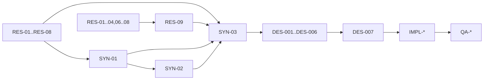

# RAW Pipeline Task Index

The authoritative contracts are the per-task TOML manifests in this directory.
This index defines the planned dependency graph and wave layout only. Live
progress and review state are in GitHub pull requests, as described in
[`../README.md`](../README.md).

For a human-readable status overview, see [`STATUS.md`](STATUS.md). It is a
convenience snapshot; the task pull requests remain authoritative.

## Task manifest map

| Wave | Task | Manifest | Planned dependency |
| --- | --- | --- | --- |
| R0 | `RES-01` | [`RES-01.toml`](RES-01.toml) | none |
| R0 | `RES-02` | [`RES-02.toml`](RES-02.toml) | none |
| R0 | `RES-03` | [`RES-03.toml`](RES-03.toml) | none |
| R0 | `RES-04` | [`RES-04.toml`](RES-04.toml) | none |
| R0 | `RES-05` | [`RES-05.toml`](RES-05.toml) | none |
| R0 | `RES-06` | [`RES-06.toml`](RES-06.toml) | none |
| R0 | `RES-07` | [`RES-07.toml`](RES-07.toml) | none |
| R0 | `RES-08` | [`RES-08.toml`](RES-08.toml) | none |
| R1 | `RES-09` | [`RES-09.toml`](RES-09.toml) | `RES-01`–`RES-04`, `RES-06`–`RES-08` |
| S1 | `SYN-01` | [`SYN-01.toml`](SYN-01.toml) | `RES-01`–`RES-04`, `RES-06`, `RES-07` |
| S2 | `SYN-02` | [`SYN-02.toml`](SYN-02.toml) | `RES-02`, `RES-04`, `SYN-01` |
| S3 | `SYN-03` | [`SYN-03.toml`](SYN-03.toml) | `RES-01`–`RES-09`, `SYN-01`, `SYN-02` |
| D | `DES-001` | [`DES-001.toml`](DES-001.toml) | `SYN-01`, `SYN-02`, `DES-003` |
| D | `DES-002` | [`DES-002.toml`](DES-002.toml) | `SYN-01` |
| D | `DES-003` | [`DES-003.toml`](DES-003.toml) | `SYN-01` |
| D | `DES-004` | [`DES-004.toml`](DES-004.toml) | `SYN-01`, `SYN-02`, `DES-001`, `DES-003` |
| D | `DES-005` | [`DES-005.toml`](DES-005.toml) | `SYN-01`, `SYN-03`, `DES-001`, `DES-003` |
| D | `DES-006` | [`DES-006.toml`](DES-006.toml) | `SYN-03`, `DES-001`, `DES-004`, `DES-005` |
| Gate | `DES-007` | [`DES-007.toml`](DES-007.toml) | `SYN-03`, `DES-001`–`DES-006` |
| I | `IMPL-DEC-001` | [`IMPL-DEC-001.toml`](IMPL-DEC-001.toml) | `DES-001`, `DES-006`, `DES-007` |
| I | `IMPL-DEC-002` | [`IMPL-DEC-002.toml`](IMPL-DEC-002.toml) | `IMPL-DEC-001` |
| I | `IMPL-DEC-003` | [`IMPL-DEC-003.toml`](IMPL-DEC-003.toml) | `IMPL-DEC-001`, `DES-002`, `DES-003` |
| I | `IMPL-DEC-004` | [`IMPL-DEC-004.toml`](IMPL-DEC-004.toml) | `IMPL-DEC-002`, `IMPL-DEC-003` |
| I | `IMPL-PRE-001` | [`IMPL-PRE-001.toml`](IMPL-PRE-001.toml) | `DES-001`, `DES-004`, `DES-007` |
| I | `IMPL-PRE-002` | [`IMPL-PRE-002.toml`](IMPL-PRE-002.toml) | `IMPL-PRE-001`, `DES-003` |
| I | `IMPL-PRE-003` | [`IMPL-PRE-003.toml`](IMPL-PRE-003.toml) | `IMPL-PRE-002` |
| I | `IMPL-PRE-004` | [`IMPL-PRE-004.toml`](IMPL-PRE-004.toml) | `DES-004`, `DES-007` |
| I | `IMPL-DEM-001` | [`IMPL-DEM-001.toml`](IMPL-DEM-001.toml) | `DES-005`, `DES-007` |
| I | `IMPL-DEM-002` | [`IMPL-DEM-002.toml`](IMPL-DEM-002.toml) | `DES-005`, `DES-007` |
| I | `IMPL-DEM-003` | [`IMPL-DEM-003.toml`](IMPL-DEM-003.toml) | `DES-005`, `DES-007`, `RES-05` |
| I | `IMPL-INT-001` | [`IMPL-INT-001.toml`](IMPL-INT-001.toml) | `IMPL-DEC-004`, `IMPL-PRE-002`, one `IMPL-DEM-*` |
| Q | `QA-001` | [`QA-001.toml`](QA-001.toml) | `IMPL-INT-001` |
| Q | `QA-002` | [`QA-002.toml`](QA-002.toml) | `IMPL-INT-001` |
| Q | `QA-003` | [`QA-003.toml`](QA-003.toml) | `IMPL-INT-001` |
| Q | `QA-004` | [`QA-004.toml`](QA-004.toml) | `IMPL-INT-001` |
| Q | `QA-005` | [`QA-005.toml`](QA-005.toml) | `DES-007`, `IMPL-INT-001` |
| Q | `QA-006` | [`QA-006.toml`](QA-006.toml) | all `IMPL-*`, `QA-001`–`QA-005` |

## Planned execution waves

- **R0:** `RES-01`–`RES-08` can run concurrently.
- **R1:** `RES-09` starts after the existing-decoder and Rust ecosystem reports
  are merged.
- **S1:** `SYN-01` starts after its six inputs are merged.
- **S2:** `SYN-02` starts after its inputs are merged.
- **S3:** `SYN-03` starts after every research report and synthesis note is
  merged.
- **D:** `DES-002` and `DES-003` start after `SYN-01`; the remaining design tasks
  follow their manifest dependencies.
- **I:** implementation starts only after `DES-007` is merged.
- **Q:** each QA task starts after its listed implementation artifacts merge.

The decoder implementation track adapts existing decoders behind the selected
backend contract. It must not replace that boundary with a newly maintained
first-party RAW format decoder.

The dependency and parallelization requirements are repeated only where they
are task-specific. Create branches from the current `origin/agent` tip, not from
another task's local worktree, after the dependency PR is merged.
