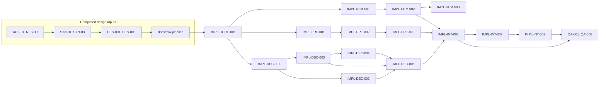

# RAW Pipeline Task Index

The authoritative contracts are the per-task TOML manifests in this directory.
This index defines the dependency graph and wave layout. GitHub pull requests
remain the review and merge authority.

For the human-readable task-status snapshot, see [`../STATUS.md`](../STATUS.md).
The snapshot marks a task `Done` when its PR is opened; downstream readiness
still requires dependency PRs to be merged.

## Task manifest map

The research, synthesis, and design rows are completed history. The
implementation rows are the post-design plan and supersede the pre-design
implementation placeholders.

| Wave | Task | Manifest | Planned dependency |
| --- | --- | --- | --- |
| R0 | `RES-01` | [`RES-01.toml`](RES-01.toml) | none |
| R0 | `RES-02` | [`RES-02.toml`](RES-02.toml) | none |
| R0 | `RES-03` | [`RES-03.toml`](RES-03.toml) | none |
| R0 | `RES-04` | [`RES-04.toml`](RES-04.toml) | none |
| R0 | `RES-05` | [`RES-05.toml`](RES-05.toml) | none |
| R0 | `RES-06` | [`RES-06.toml`](RES-06.toml) | none |
| R0 | `RES-07` | [`RES-07.toml`](RES-07.toml) | none |
| R0 | `RES-08` | [`RES-08.toml`](RES-08.toml) | none |
| R1 | `RES-09` | [`RES-09.toml`](RES-09.toml) | `RES-01`–`RES-04`, `RES-06`–`RES-08` |
| S1 | `SYN-01` | [`SYN-01.toml`](SYN-01.toml) | `RES-01`–`RES-04`, `RES-06`, `RES-07` |
| S2 | `SYN-02` | [`SYN-02.toml`](SYN-02.toml) | `RES-02`, `RES-04`, `SYN-01` |
| S3 | `SYN-03` | [`SYN-03.toml`](SYN-03.toml) | `RES-01`–`RES-09`, `SYN-01`, `SYN-02` |
| D | `DES-001` | [`DES-001.toml`](DES-001.toml) | `SYN-01`, `SYN-02`, `DES-003` |
| D | `DES-002` | [`DES-002.toml`](DES-002.toml) | `SYN-01` |
| D | `DES-003` | [`DES-003.toml`](DES-003.toml) | `SYN-01` |
| D | `DES-004` | [`DES-004.toml`](DES-004.toml) | `SYN-01`, `SYN-02`, `DES-001`, `DES-003` |
| D | `DES-005` | [`DES-005.toml`](DES-005.toml) | `SYN-01`, `SYN-03`, `DES-001`, `DES-003` |
| D | `DES-006` | [`DES-006.toml`](DES-006.toml) | `SYN-03`, `DES-001`, `DES-004`, `DES-005` |
| I0 | `IMPL-CORE-001` | [`IMPL-CORE-001.toml`](IMPL-CORE-001.toml) | `DES-001`–`DES-003`, `DES-006` |
| I1 | `IMPL-DEC-001` | [`IMPL-DEC-001.toml`](IMPL-DEC-001.toml) | `IMPL-CORE-001`, `DES-006` |
| I1 | `IMPL-PRE-001` | [`IMPL-PRE-001.toml`](IMPL-PRE-001.toml) | `IMPL-CORE-001`, `DES-004` |
| I1 | `IMPL-DEM-001` | [`IMPL-DEM-001.toml`](IMPL-DEM-001.toml) | `IMPL-CORE-001`, `DES-005` |
| I2 | `IMPL-DEC-002` | [`IMPL-DEC-002.toml`](IMPL-DEC-002.toml) | `IMPL-DEC-001`, `DES-002`, `DES-003` |
| I2 | `IMPL-DEC-003` | [`IMPL-DEC-003.toml`](IMPL-DEC-003.toml) | `IMPL-DEC-001`, `DES-002`, `DES-003` |
| I2 | `IMPL-PRE-002` | [`IMPL-PRE-002.toml`](IMPL-PRE-002.toml) | `IMPL-PRE-001`, `DES-003` |
| I2 | `IMPL-DEM-002` | [`IMPL-DEM-002.toml`](IMPL-DEM-002.toml) | `IMPL-DEM-001`, `DES-005` |
| I3 | `IMPL-DEC-004` | [`IMPL-DEC-004.toml`](IMPL-DEC-004.toml) | `IMPL-DEC-001`, `IMPL-DEC-003` |
| I3 | `IMPL-PRE-003` | [`IMPL-PRE-003.toml`](IMPL-PRE-003.toml) | `IMPL-PRE-002` |
| I3 | `IMPL-DEM-003` | [`IMPL-DEM-003.toml`](IMPL-DEM-003.toml) | `IMPL-DEM-002`, `DES-005`, `RES-05` |
| I4 | `IMPL-DEC-005` | [`IMPL-DEC-005.toml`](IMPL-DEC-005.toml) | `IMPL-DEC-002`–`IMPL-DEC-004` |
| I5 | `IMPL-INT-001` | [`IMPL-INT-001.toml`](IMPL-INT-001.toml) | `IMPL-DEC-005`, `IMPL-PRE-003`, `IMPL-DEM-001`, one of `IMPL-DEM-002` / `IMPL-DEM-003` |
| I6 | `IMPL-INT-002` | [`IMPL-INT-002.toml`](IMPL-INT-002.toml) | `IMPL-INT-001` |
| I7 | `IMPL-INT-003` | [`IMPL-INT-003.toml`](IMPL-INT-003.toml) | `IMPL-DEC-002`, `IMPL-DEC-004`, `IMPL-DEM-002`, `IMPL-DEM-003`, `IMPL-INT-002` |
| Q | `QA-001` | [`QA-001.toml`](QA-001.toml) | `IMPL-DEC-005`, `IMPL-INT-001` |
| Q | `QA-002` | [`QA-002.toml`](QA-002.toml) | `IMPL-INT-001`, `IMPL-PRE-003`, `IMPL-DEM-002`, `IMPL-DEM-003` |
| Q | `QA-003` | [`QA-003.toml`](QA-003.toml) | `IMPL-DEC-005`, `IMPL-PRE-003`, `IMPL-INT-001` |
| Q | `QA-004` | [`QA-004.toml`](QA-004.toml) | `IMPL-DEC-005`, `IMPL-INT-001`, `IMPL-DEM-003` |
| Q | `QA-005` | [`QA-005.toml`](QA-005.toml) | `IMPL-INT-002`, `IMPL-INT-003` |
| Q | `QA-006` | [`QA-006.toml`](QA-006.toml) | `IMPL-INT-003`, `QA-001`–`QA-005` |

## Planned execution waves

- **R0:** `RES-01`–`RES-08` can run concurrently.
- **R1:** `RES-09` starts after the existing-decoder and Rust ecosystem reports
  are merged.
- **S1:** `SYN-01` starts after its six inputs are merged.
- **S2:** `SYN-02` starts after its inputs are merged.
- **S3:** `SYN-03` starts after every research report and synthesis note is
  merged.
- **D:** `DES-002` and `DES-003` start after `SYN-01`; the remaining design tasks
  follow their manifest dependencies.
- **I0:** `IMPL-CORE-001` renames the universal implementation to `fornax`,
  flattens the model, establishes the draft global protocol, ports the reusable
  linear demosaic baseline, and removes `fornax-dalim` after the design and
  persistent documentation are merged.
- **I1:** the decoder registry, preprocessing foundation, and demosaic contract
  can start concurrently as distinct modules in `fornax` after the core gate.
  Root `Cargo.toml`/`Cargo.lock` edits are shared: merge one branch first, then
  rebase/regenerate the others before opening or updating their PRs when those
  files overlap.
- **I2:** the LibRaw and dnglab adapter modules and black subtraction follow
  their track contracts; later demosaic tasks refine the core baseline.
  Decoder tasks own separate
  `fornax::decode` modules and must not edit one another's sources; the same
  shared lockfile merge rule applies when their branches are finalized.
- **I3:** the DNC bridge, normalization/final clipping, and in-crate
  Malvar-He-Cutler strategy follow their prerequisites.
- **I4–I5:** decoder conformance precedes the explicit pipeline module.
- **I6–I7:** Python/devtool migration and legacy-crate retirement complete the
  supported production surface.
- **Q:** metadata, numerical, error, and performance QA start after integration;
  migration documentation waits for the retired public surface, and final
  workspace validation is last.

The decoder implementation track adapts existing decoders behind the selected
backend contract. It must not replace that boundary with a newly maintained
first-party RAW format decoder.

Implementation agents should use the applicable `glatzel-*` skills while
working: preferred Rust crates for dependency decisions, Rust API docs guidance
for public interfaces, and tool discovery when installed local tools materially
improve validation or analysis. The Pixi `agent` environment exports
`CODEX_HOME`, so Codex discovers the installed `skill-glatzel` packages
automatically; no separate skill installation or configuration is required.
The task manifest and persistent design remain authoritative.

The dependency and parallelization requirements are repeated only where they
are task-specific. Create `IMPL-*` and `QA-*` branches from the current
`origin/refactor/raw-pipeline-v2` tip, not from another task's local worktree,
after the dependency PR is merged into that branch. Do not promote the
integration branch to `main` until `QA-006` is merged and its final validation
passes there.
