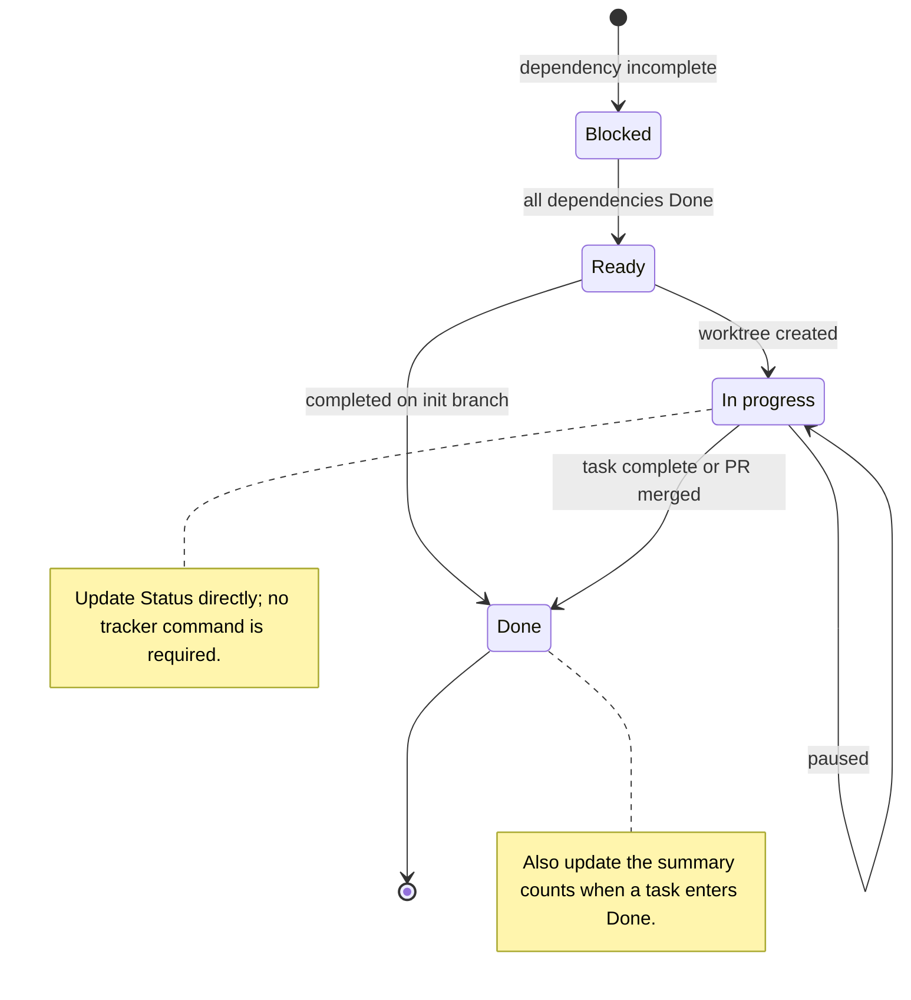

# RAW Pipeline Task Tracker

**Snapshot:** 2026-10-24

This is a manually maintained, human-readable overview. It is updated directly
when task work starts or finishes.

This is the init branch and some tasks were dispatched directly here rather than
through individual task worktrees and pull requests. Their completed work is
recorded as `Done` below. The aggregate draft
[#534](https://github.com/Glatzel/fornax/pull/534) contains the current branch
materials.

## Status legend

| Status | Meaning |
| --- | --- |
| `Blocked` | At least one dependency is not `Done`. |
| `Ready` | All dependencies are `Done`; the task has not started. |
| `In progress` | A worktree has been created, including when work is paused. |
| `Done` | Task work is complete, or its task PR has been merged. |

## Summary

| Phase | Tasks | Blocked | Ready | In progress | Done |
| --- | ---: | ---: | ---: | ---: | ---: |
| Research | 9 | 0 | 1 | 0 | 8 |
| Synthesis | 3 | 2 | 1 | 0 | 0 |
| Design | 7 | 7 | 0 | 0 | 0 |
| Implementation | 12 | 12 | 0 | 0 | 0 |
| QA | 6 | 6 | 0 | 0 | 0 |
| **Total** | **37** | **27** | **2** | **0** | **8** |

## Research

| ID | Task | Depends on | Status | Artifact / PR |
| --- | --- | --- | --- | --- |
| `RES-01` | [Inventory existing components](RES-01.toml) | none | `Done` | [report](../../research/RES-01-fornax-inventory.md), [#534](https://github.com/Glatzel/fornax/pull/534) |
| `RES-02` | [Research LibRaw](RES-02.toml) | none | `Done` | [report](../../research/RES-02-libraw.md), [#534](https://github.com/Glatzel/fornax/pull/534) |
| `RES-03` | [Research dnglab and DNG metadata](RES-03.toml) | none | `Done` | [report](../../research/RES-03-dnglab.md), [#534](https://github.com/Glatzel/fornax/pull/534) |
| `RES-04` | [Research darktable preprocessing](RES-04.toml) | none | `Done` | [report](../../research/RES-04-darktable.md), [#534](https://github.com/Glatzel/fornax/pull/534) |
| `RES-05` | [Research demosaicing](RES-05.toml) | none | `Done` | [report](../../research/RES-05-demosaicing.md), [#534](https://github.com/Glatzel/fornax/pull/534) |
| `RES-06` | [Survey Rust RAW decoders](RES-06.toml) | none | `Done` | [report](../../research/RES-06-rust-raw-decoders.md), [#534](https://github.com/Glatzel/fornax/pull/534) |
| `RES-07` | [Survey Rust TIFF and DNG components](RES-07.toml) | none | `Done` | [report](../../research/RES-07-rust-dng-tiff.md), [#534](https://github.com/Glatzel/fornax/pull/534) |
| `RES-08` | [Survey Rust demosaicing crates](RES-08.toml) | none | `Done` | [report](../../research/RES-08-rust-demosaicing.md), [#534](https://github.com/Glatzel/fornax/pull/534) |
| `RES-09` | [Compare Rust ecosystem candidates](RES-09.toml) | `RES-06`–`RES-08` | `Ready` | [placeholder](../../research/RES-09-rust-ecosystem.md) |

## Synthesis

| ID | Task | Depends on | Status | Artifact / PR |
| --- | --- | --- | --- | --- |
| `SYN-01` | [Reconcile metadata and sample semantics](SYN-01.toml) | `RES-01`–`RES-04`, `RES-06`, `RES-07` | `Ready` | [placeholder](../../research/notes/SYN-01.md) |
| `SYN-02` | [Reconcile preprocessing and black levels](SYN-02.toml) | `RES-02`, `RES-04`, `SYN-01` | `Blocked` | [placeholder](../../research/notes/SYN-02.md) |
| `SYN-03` | [Synthesize cross-source recommendations](SYN-03.toml) | all `RES-*`, `SYN-01`, `SYN-02` | `Blocked` | [placeholder](../../research/SYN-03-summary.md) |

## Design

| ID | Task | Depends on | Status | Manifest |
| --- | --- | --- | --- | --- |
| `DES-001` | Design universal RAW representation | `SYN-01`, `SYN-02`, `DES-003` | `Blocked` | [manifest](DES-001.toml) |
| `DES-002` | Design metadata and provenance | `SYN-01` | `Blocked` | [manifest](DES-002.toml) |
| `DES-003` | Design Bayer CFA model and indexing | `SYN-01` | `Blocked` | [manifest](DES-003.toml) |
| `DES-004` | Design preprocessing and processing state | `SYN-01`, `SYN-02`, `DES-001`, `DES-003` | `Blocked` | [manifest](DES-004.toml) |
| `DES-005` | Design the demosaicing interface | `SYN-01`, `SYN-03`, `DES-001`, `DES-003` | `Blocked` | [manifest](DES-005.toml) |
| `DES-006` | Design crate boundaries | `SYN-03`, `DES-001`, `DES-004`, `DES-005` | `Blocked` | [manifest](DES-006.toml) |
| `DES-007` | Review and consolidate the design | `SYN-03`, `DES-001`–`DES-006` | `Blocked` | [manifest](DES-007.toml) |

## Implementation

| ID | Task | Depends on | Status | Manifest |
| --- | --- | --- | --- | --- |
| `IMPL-DEC-001` | Define the decoder adapter interface | `DES-001`, `DES-006`, `DES-007` | `Blocked` | [manifest](IMPL-DEC-001.toml) |
| `IMPL-DEC-002` | Adapt the LibRaw backend | `IMPL-DEC-001` | `Blocked` | [manifest](IMPL-DEC-002.toml) |
| `IMPL-DEC-003` | Map source metadata to universal metadata | `IMPL-DEC-001`, `DES-002`, `DES-003` | `Blocked` | [manifest](IMPL-DEC-003.toml) |
| `IMPL-DEC-004` | Add decoder validation and regressions | `IMPL-DEC-002`, `IMPL-DEC-003` | `Blocked` | [manifest](IMPL-DEC-004.toml) |
| `IMPL-PRE-001` | Implement scalar black-level correction | `DES-001`, `DES-004`, `DES-007` | `Blocked` | [manifest](IMPL-PRE-001.toml) |
| `IMPL-PRE-002` | Implement CFA-aware black-level correction | `IMPL-PRE-001`, `DES-003` | `Blocked` | [manifest](IMPL-PRE-002.toml) |
| `IMPL-PRE-003` | Implement spatially varying black levels | `IMPL-PRE-002` | `Blocked` | [manifest](IMPL-PRE-003.toml) |
| `IMPL-PRE-004` | Implement additional approved preprocessing | `DES-004`, `DES-007` | `Blocked` | [manifest](IMPL-PRE-004.toml) |
| `IMPL-DEM-001` | Implement bilinear demosaicing | `DES-005`, `DES-007` | `Blocked` | [manifest](IMPL-DEM-001.toml) |
| `IMPL-DEM-002` | Implement Malvar–He–Cutler demosaicing | `DES-005`, `DES-007` | `Blocked` | [manifest](IMPL-DEM-002.toml) |
| `IMPL-DEM-003` | Implement selected edge-aware demosaicing | `DES-005`, `DES-007`, `RES-05` | `Blocked` | [manifest](IMPL-DEM-003.toml) |
| `IMPL-INT-001` | Integrate the end-to-end pipeline | `IMPL-DEC-004`, `IMPL-PRE-002`, one `IMPL-DEM-*` | `Blocked` | [manifest](IMPL-INT-001.toml) |

## QA

| ID | Task | Depends on | Status | Manifest |
| --- | --- | --- | --- | --- |
| `QA-001` | Validate metadata preservation | `IMPL-INT-001` | `Blocked` | [manifest](QA-001.toml) |
| `QA-002` | Add numerical regression coverage | `IMPL-INT-001` | `Blocked` | [manifest](QA-002.toml) |
| `QA-003` | Validate error paths and unsupported inputs | `IMPL-INT-001` | `Blocked` | [manifest](QA-003.toml) |
| `QA-004` | Establish performance baselines | `IMPL-INT-001` | `Blocked` | [manifest](QA-004.toml) |
| `QA-005` | Document behavior and API migration | `DES-007`, `IMPL-INT-001` | `Blocked` | [manifest](QA-005.toml) |
| `QA-006` | Run final workspace validation | `IMPL-DEC-004`, `IMPL-INT-001`, `QA-001`–`QA-005` | `Blocked` | [manifest](QA-006.toml) |

## Update rules

