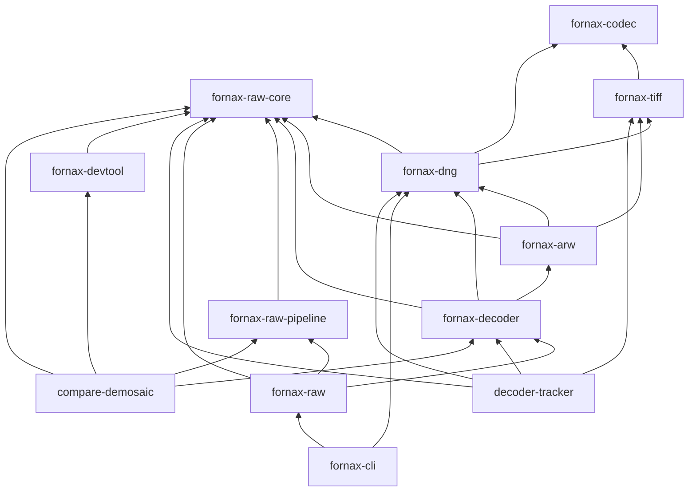

# Steps 1-6 workspace refactor review summary

This archived workspace-refactor record documents Steps 1-6 workspace refactor review summary.

`[DONE]` This review uses current `main`, source files, merge history, and read-only GitHub PR records. Commit/check metadata is not line-addressable; source claims use repository-relative `path:line` citations.

## 1. Baseline and state

| Item | Verified fact | Evidence |
| --- | --- | --- |
| `[DONE]` Baseline | `9b9c1b284ff5f4fe9ef1c8ff41eb6c3cff17b8d2` | `docs/_archive/workspace-refactor/baseline-findings.md:8` |
| `[DONE]` Current `main` | `74c8100692e56638f52f0c5430e5a1ab5dd8672b`, equal to `origin/main` | `.git/refs/heads/main:1`, `.git/refs/remotes/origin/main:1` |
| `[DONE]` Working tree | Only `external/raw.pixls.us` is dirty at top level; its worktree is `bdef075de28da656976c7cf54f89c1214dbc65d4-dirty`, not the recorded gitlink `a96f50803e8c7b2923badc983cba80246b80eb1e`. Six Sony ARW files are modified inside it. | `.gitmodules:9`; `git status --porcelain=v2` and `git -C external/raw.pixls.us status` |
| `[DEVIATION]` Out-of-band merge | PR #690, `refactor: clean up`, merged after Step 6. It renamed the former core crate to `fornax-raw-core`, renamed the facade to `fornax-raw`, and deleted the compatibility processor crates. | `.git/refs/heads/main:1`; `Cargo.toml:16`; `crates/fornax-raw/Cargo.toml:2` |
| `[DONE]` Interleaved non-step merges | PR #682 added trigger documents; PR #685 only reordered a dependency declaration. | `docs/_archive/workspace-refactor/workspace-refactor-steps.md:1`; `Cargo.toml:22` |

| Step | PR and title | Merge status |
| --- | --- | --- |
| 1 | #681 `chore: add refactor decode baseline` | `[DONE]` Merged |
| 2 | #683 `refactor: merge preprocessing and postprocessing` | `[DONE]` Merged |
| 3 | #684 `refactor: share generic TIFF accessors` | `[DONE]` Merged |
| 4 | #686 `refactor: add neutral codec sample buffer` | `[DONE]` Merged |
| 5 | #687 `refactor: add TIFF raster layout support` | `[DONE]` Merged |
| 6 | #688 `refactor: move DNG constants into DNG crate` | `[DONE]` Merged |

## 2. Per-step results

**Step 1 — decode baseline**

| Field | Result |
| --- | --- |
| Scope | `[DONE]` PR #681 touched only `decoder-tracker`; no production API or symbol moved. |
| Metrics | 0 moved LOC; 0 external callers; test attributes `+8/-0`; 9 golden cases (`crates/decoder-tracker/golden/selected-manifest.csv:1`, `crates/decoder-tracker/golden/decode-hashes.csv:1`). |
| Deviation | `[DONE]` None found. |

**Step 2 — merge raw processing**

| Field | Result |
| --- | --- |
| Scope and symbols | `[DONE]` PR #683 touched both former compatibility processor crates, the new `fornax-raw-pipeline`, the facade, `fornax-cli`, and `compare-demosaic`. It moved `Preprocessor` and `{Demosaic, LmmseMode, IDemosaic, LazyDemosaic, OutputColorSpace, PostProcessor}` to `fornax_raw_pipeline::*` (`crates/fornax-raw-pipeline/src/lib.rs:10`). |
| Metrics | 8,496 non-blank LOC moved (238 preprocessor + 8,258 postprocessor); 8 consumer/facade files changed; test attributes `+15/-12` because suites moved. |
| Deviation | `[DONE]` None at #683; its pre/post compatibility crates were retained. They were deleted later by #690. |

**Step 3 — generic TIFF accessors**

| Field | Result |
| --- | --- |
| Scope and symbols | `[DONE]` PR #684 touched `fornax-tiff`, `fornax-dng`, and `fornax-arw`. Duplicate scalar/list helpers became `fornax_tiff::{unsigned_scalar, unsigned_vec, ValueAccessError}` (`crates/fornax-tiff/src/value.rs:155`). |
| Metrics | 26 shared helper-body lines extracted; 4 production callers changed; test attributes `+6/-0`. |
| Deviation | `[DONE]` None found. |

**Step 4 — neutral codec buffer**

| Field | Result |
| --- | --- |
| Scope and symbols | `[DONE]` PR #686 touched `fornax-codec` and `fornax-dng`. It added `SampleBuffer`/`SampleBufferError`, changed `decode` to return `SampleBuffer`, and changed `EncodeRequest.image` to `&SampleBuffer` (`crates/fornax-codec/src/lib.rs:99`, `crates/fornax-codec/src/request.rs:180`). |
| Metrics | 0 ownership-move lines; 285 non-blank lines added for the buffer; 2 external production callers changed; test attributes `+8/-0`; recorded codec 56 and DNG 30 passing. |
| Deviation | `[UNVERIFIED]` PR #686 calls the shape approved, but no maintainer-ruling artifact is committed. |

**Step 5 — TIFF raster**

| Field | Result |
| --- | --- |
| Scope and symbols | `[DONE]` PR #687 touched `fornax-tiff` and `fornax-dng`, plus ARW tests. DNG-local planning became `RasterLayout`/`RasterRequest`; TIFF defaults became `resolve_tiff_compression` (`crates/fornax-dng/src/dng_decoder/mod.rs:155`). |
| Metrics | No file rename; 694 non-blank lines in the new raster module; 1 production caller changed; test attributes `+15/-0`; recorded TIFF 50 and workspace 325 passing. |
| Deviation | `[DEVIATION]` The target design made raster optional, but current TIFF has no feature section and always depends on codec (`crates/fornax-tiff/Cargo.toml:6`). |

**Step 6 — DNG constants**

| Field | Result |
| --- | --- |
| Scope and symbols | `[DONE]` PR #688 touched `fornax-tiff`, `fornax-dng`, and `fornax-arw`. Five existing values moved to `DngCompressionMethod::*` and `DngPhotometricInterpretation::LinearRaw`; `Depth` and `PhotometricMask` are new (`crates/fornax-dng/src/constants.rs:9`). |
| Metrics | 5 enum-variant lines moved; 5 source callers changed; test attributes `+9/-0`; recorded workspace 334 and unchanged 9-row hashes. |
| Deviation | `[DEVIATION]` The PR wording calls three photometric values moved, but only `LinearRaw` existed in baseline TIFF; two are additions (`crates/fornax-dng/src/constants.rs:26`). |

## 3. Verified architecture facts

`cargo tree -p fornax-codec -e normal --depth 1` output:

```text
fornax-codec v0.0.17 (crates/fornax-codec)
├── bytemuck v1.25.2
├── image v0.25.9
├── rayon v1.12.0
└── thiserror v2.0.21
```

`[DONE]` No workspace crate appears at depth 1. A full normal-tree scan found no `png`, `jpeg`, `gif`, or `tiff` crate anywhere in the tree.

`cargo tree -p fornax-tiff -e normal --depth 1` output:

```text
fornax-tiff v0.0.17 (crates/fornax-tiff)
├── fornax-codec v0.0.17 (crates/fornax-codec)
├── num_enum v0.7.6
└── strum v0.28.0
```

`[DEVIATION]` `cargo tree -p fornax-tiff -e normal --depth 1 --features raster` fails with `the package 'fornax-tiff' does not contain this feature: raster`. The dependency is unconditional in `crates/fornax-tiff/Cargo.toml:7`; there is no `[features]` table.

`[DONE]` Normal internal dependency edges from `cargo metadata`:

```text
compare-demosaic -> fornax-decoder, fornax-devtool, fornax-raw-core, fornax-raw-pipeline
decoder-tracker -> fornax-decoder, fornax-dng, fornax-raw-core, fornax-tiff
fornax-arw -> fornax-dng, fornax-raw-core, fornax-tiff
fornax-cli -> fornax-dng, fornax-raw
fornax-decoder -> fornax-arw, fornax-dng, fornax-raw-core
fornax-dng -> fornax-codec, fornax-raw-core, fornax-tiff
fornax-raw -> fornax-decoder, fornax-raw-core, fornax-raw-pipeline
fornax-raw-pipeline -> fornax-raw-core
fornax-tiff -> fornax-codec
fornax-devtool -> fornax-raw-core
```



`[DONE]` No cycle exists. Feeding the same 25 edges to `tsort` exited 0 and ordered all 12 workspace members.

## 4. SampleBuffer as implemented

`[DONE]` The final public type and signatures are:

```rust
type Mono<T> = ImageBuffer<Luma<T>, Vec<T>>;

#[derive(Debug, Clone, PartialEq)]
#[non_exhaustive]
pub enum SampleBuffer {
    U8(Mono<u8>),
    U16(Mono<u16>),
    U32(Mono<u32>),
    F32(Mono<f32>),
}

pub fn from_u8(width: u32, height: u32, data: Vec<u8>) -> Result<Self, SampleBufferError>;
pub fn from_u16(width: u32, height: u32, data: Vec<u16>) -> Result<Self, SampleBufferError>;
pub fn from_u32(width: u32, height: u32, data: Vec<u32>) -> Result<Self, SampleBufferError>;
pub fn from_f32(width: u32, height: u32, data: Vec<f32>) -> Result<Self, SampleBufferError>;
pub fn width(&self) -> u32;
pub fn height(&self) -> u32;
pub fn into_raw_u8(self) -> Option<Vec<u8>>;
pub fn into_raw_u16(self) -> Option<Vec<u16>>;
pub fn into_raw_u32(self) -> Option<Vec<u32>>;
pub fn into_raw_f32(self) -> Option<Vec<f32>>;

#[derive(Clone, Debug, Eq, Error, PartialEq)]
#[non_exhaustive]
pub enum SampleBufferError {
    SampleCountOverflow { width: u32, height: u32 },
    SampleCountMismatch { width: u32, height: u32, expected: usize, actual: usize },
    InvalidDimensions { width: u32, height: u32 },
}
```

Evidence: `crates/fornax-codec/src/sample_buffer.rs:4`, `:49`, `:125`, `:166`, `:244`.

`[DONE]` It supports exactly `u8`, `u16`, `u32`, and `f32`; it is single-band and wraps `image::ImageBuffer<Luma<T>, Vec<T>>`. There is no band-count, interleaved, or planar API; `Luma` means one scalar channel (`crates/fornax-codec/src/sample_buffer.rs:6`).

`[DONE]` Construction converts dimensions to `usize`, checks `checked_mul`, requires `data.len() == width * height`, then calls `ImageBuffer::from_raw`; overflow, mismatch, and invalid dimensions have distinct errors (`crates/fornax-codec/src/sample_buffer.rs:277`).

`[DONE]` `fornax-dng` privately owns the `RawMosaic` adapter:

```rust
pub fn from_raw_mosaic(mosaic: &RawMosaic) -> SampleBuffer
pub fn into_raw_mosaic(buffer: SampleBuffer) -> Result<RawMosaic, DecodeError>
```

Evidence: `crates/fornax-dng/src/sample_buffer.rs:5`, `crates/fornax-dng/src/lib.rs:6`.

`[DONE]` Decode into `RawMosaic` is zero-copy at the adapter boundary: codec decode returns an owned `SampleBuffer`, `into_raw_mosaic` moves each `ImageBuffer` into the matching variant, and extraction uses `image.into_raw()` without copying (`crates/fornax-dng/src/sample_buffer.rs:14`, `crates/fornax-codec/src/sample_buffer.rs:166`, `crates/fornax-dng/src/dng_decoder/mod.rs:233`).

`[DONE]` Encode is not zero-copy: `DngWriter::write_dng_with` passes a borrowed `RawMosaic` to `from_raw_mosaic`, which clones the `ImageBuffer`; encoding then copies samples into byte-oriented chunks (`crates/fornax-dng/src/writer.rs:147`, `crates/fornax-dng/src/sample_buffer.rs:5`, `crates/fornax-codec/src/encode.rs:40`).

## 5. DNG-owned constants

| `[DONE]` Name/value | Current location | Origin evidence |
| --- | --- | --- |
| `[DONE]` `DngCompressionMethod::LossyJpeg = 34892` | `crates/fornax-dng/src/constants.rs:14` | DNG specification; `docs/reference/decoders/dng-compression.md:63` |
| `[DONE]` `DngCompressionMethod::Zstd = 50000` | `crates/fornax-dng/src/constants.rs:16` | LibTIFF self-assignment; `docs/reference/decoders/dng-compression.md:64` |
| `[DONE]` `DngCompressionMethod::JpegXlLegacy = 50002` | `crates/fornax-dng/src/constants.rs:18` | GDAL self-assignment, not DNG or LibTIFF; `docs/reference/decoders/dng-compression.md:65` |
| `[DONE]` `DngCompressionMethod::JpegXl = 52546` | `crates/fornax-dng/src/constants.rs:20` | DNG 1.7 specification; `docs/reference/decoders/dng-compression.md:66` |
| `[UNVERIFIED]` `DngPhotometricInterpretation::LinearRaw = 34892` | `crates/fornax-dng/src/constants.rs:31` | Origin is asserted only in code (`crates/fornax-dng/src/constants.rs:26`); no value-specific citation is retained. |
| `[UNVERIFIED]` `DngPhotometricInterpretation::Depth = 51177` | `crates/fornax-dng/src/constants.rs:33` | Origin unknown in current repository evidence. |
| `[UNVERIFIED]` `DngPhotometricInterpretation::PhotometricMask = 52527` | `crates/fornax-dng/src/constants.rs:35` | Origin unknown in current repository evidence. |

`[DONE]` Only the first five values were present in baseline `fornax-tiff`; `Depth` and `PhotometricMask` are additions.

| `[DONE]` Stayed in TIFF | Why |
| --- | --- |
| `CompressionMethod::{Uncompressed=1, LosslessJpeg=7, Deflate=8}` | TIFF 6.0/TIFF Technical Note 2/Adobe Deflate vocabulary; `crates/fornax-tiff/src/constants.rs:85` |
| `PhotometricInterpretation::{WhiteIsZero=0, BlackIsZero=1, Rgb=2, Palette=3, TransparencyMask=4, Separated=5, YCbCr=6, CieLab=8, Cfa=32803}` | TIFF and TIFF/EP vocabulary; CFA remains TIFF/EP-owned; `crates/fornax-tiff/src/constants.rs:103` |
| `TiffTag` standard, Technical Note 1, and TIFF/EP tags | Includes `SubIfds=330`, CFA repeat/pattern tags, and generic TIFF fields; `crates/fornax-tiff/src/constants.rs:10` |

`[DONE]` Open types use catch-all variants. Verbatim:

```rust
pub struct Tag(pub u16);

#[repr(u16)]
#[derive(Clone, Copy, Debug, Eq, Hash, PartialEq, FromPrimitive, IntoPrimitive)]
pub enum CompressionMethod {
    Uncompressed = 1,
    LosslessJpeg = 7,
    Deflate = 8,
    #[num_enum(catch_all)]
    Unknown(u16),
}

#[repr(u16)]
#[derive(Clone, Copy, Debug, Eq, Hash, PartialEq, FromPrimitive, IntoPrimitive)]
pub enum DngCompressionMethod {
    LossyJpeg = 34_892,
    Zstd = 50_000,
    JpegXlLegacy = 50_002,
    JpegXl = 52_546,
    #[num_enum(catch_all)]
    Unknown(u16),
}
```

Evidence: `crates/fornax-tiff/src/value.rs:3`, `crates/fornax-tiff/src/constants.rs:85`, `crates/fornax-dng/src/constants.rs:9`. Photometric enums use the same `Unknown(u16)` pattern (`crates/fornax-tiff/src/constants.rs:103`, `crates/fornax-dng/src/constants.rs:26`).

## 6. TIFF raster

`[DONE]` Public raster API, names and signatures:

```rust
pub enum RasterStorage { Strips, Tiles }
pub struct RasterLayout { /* private fields */ }
impl RasterLayout {
    pub fn from_directory(directory: &Directory) -> Result<Self, RasterError>;
    pub const fn storage(&self) -> RasterStorage;
    pub const fn width(&self) -> usize;
    pub const fn height(&self) -> usize;
    pub const fn chunk_width(&self) -> usize;
    pub const fn chunk_height(&self) -> usize;
    pub fn chunks(&self) -> &[Chunk];
}
pub struct RasterRequest<'a> { /* private fields */ }
impl<'a> RasterRequest<'a> {
    pub fn new(source: &'a [u8], directory: &Directory, compression: DecodeCompression,
        bits_per_sample: u16, sample_format: SampleFormat, byte_order: ByteOrder,
        predictor: Predictor) -> Result<Self, RasterError>;
    pub const fn compression(&self) -> DecodeCompression;
    pub const fn layout(&self) -> &RasterLayout;
    pub const fn bits_per_sample(&self) -> u16;
    pub const fn sample_format(&self) -> SampleFormat;
    pub const fn byte_order(&self) -> ByteOrder;
    pub const fn predictor(&self) -> Predictor;
    pub fn codec_request(&self) -> DecodeRequest<'_>;
}
pub enum RasterError {
    MissingTag(Tag), InvalidValueType(Tag), ValueOutOfRange(Tag), ZeroDimension(Tag),
    ChunkListLengthMismatch { offsets: usize, byte_counts: usize },
    ChunkCountMismatch { expected: usize, found: usize },
    ChunkCountOverflow, ChunkRangeOverflow { index: usize },
    ChunkOutOfBounds { index: usize, offset: usize, byte_count: usize, source_len: usize },
}
pub const fn resolve_tiff_compression(id: u16) -> Option<DecodeCompression>;
```

Evidence: `crates/fornax-tiff/src/raster.rs:20`, `:54`, `:92`, `:186`, `:324`, `:368`, `:588`, `:694`; re-exports at `crates/fornax-tiff/src/lib.rs:13`.

`[DONE]` TIFF resolves only IDs `1`, `7`, and `8` (`crates/fornax-tiff/src/raster.rs:694`). DNG first maps `34892`, `50000`, `50002`, and `52546`, then falls back to TIFF (`crates/fornax-dng/src/dng_decoder/mod.rs:220`). The request carries already-resolved codec compression (`crates/fornax-dng/src/dng_decoder/mod.rs:155`).

`[DEVIATION]` Current `fornax-tiff` has no features, so raster is always compiled and `fornax-codec` is not feature-gated; the dependency also forces Deflate and lossless JPEG (`crates/fornax-tiff/Cargo.toml:6`).

## 7. Public API changes

Counts below mean current Rust files outside the defining crate that mention the item; tests and facade re-exports are included.

| `[DONE]` API change | Current users |
| --- | ---: |
| Pipeline types moved to `fornax_raw_pipeline::{Preprocessor, Demosaic, LmmseMode, IDemosaic, LazyDemosaic, OutputColorSpace, PostProcessor}` (`crates/fornax-raw-pipeline/src/lib.rs:10`) | 5, 8, 0, 4, 4, 3, 3 |
| `fornax_codec::decode`: `Result<RawMosaic, _>` -> `Result<SampleBuffer, _>` (`crates/fornax-codec/src/lib.rs:99`) | 2 |
| `EncodeRequest.image`: `&RawMosaic` -> `&SampleBuffer` (`crates/fornax-codec/src/request.rs:180`) | 1 |
| New `SampleBuffer`; new `SampleBufferError` | 3; 0 |
| New `unsigned_scalar`; new `unsigned_vec`; new `ValueAccessError` | 5; 4; 2 |
| New `RasterStorage`, `RasterLayout`, `RasterRequest`, `RasterError`, `resolve_tiff_compression` | 0, 0, 1, 0, 1 |
| DNG constants now use `DngCompressionMethod` / `DngPhotometricInterpretation` | 0 / 2 |
| `[DEVIATION]` All public items in the former core crate changed namespace to `fornax_raw_core::*` after #690 (`crates/fornax-raw-core/Cargo.toml:2`) | 53 files / 157 references |
| `[DEVIATION]` Facade moved from package `fornax` to `fornax-raw`; public exports now live under `fornax_raw::*` (`crates/fornax-raw/Cargo.toml:2`, `crates/fornax-raw/src/lib.rs:1`) | 5 Rust files |
| `[DEVIATION]` The compatibility processor crates were deleted; `fornax_raw::preprocessor` and `fornax_raw::postprocessor` remain modules (`crates/fornax-raw/src/preprocessor.rs:1`, `crates/fornax-raw/src/postprocessor.rs:1`) | 0 in-workspace Rust users of old crate names |

`[DONE]` `fornax-cli` uses `fornax-raw`/`fornax-dng` (`crates/fornax-cli/Cargo.toml:15`); `decoder-tracker` uses the renamed core (`crates/decoder-tracker/Cargo.toml:16`); both passed #690's Ubuntu/macOS workspace-test jobs. `compare-demosaic` uses the renamed raw crates (`crates/compare-demosaic/Cargo.toml:10`) and its #690 comparison check passed; it was not compiled locally.

`[DONE]` `fornax-py` is excluded (`Cargo.toml:4`) and requests workspace dependency `fornax` (`crates/fornax-py/Cargo.toml:12`), but the root now defines `fornax-raw` (`Cargo.toml:16`). It still imports `fornax::dnc`, `fornax::fornax_dalim`, `fornax::libraw`, and `fornax::Fornax` (`crates/fornax-py/src/lib.rs:9`); it cannot currently resolve as written.

`[UNVERIFIED]` The intended `fornax-py` API and desired post-rename build path.

## 8. Quality evidence

`[DONE]` Static `#[test]`/`#[rstest]` counts (baseline -> current) are: compare-demosaic 56 -> 56; decoder-tracker 36 -> 44; fornax-arw 10 -> 11; fornax-cli 6 -> 6; fornax-codec 25 -> 31; core 10 -> 10; fornax-decoder 3 -> 3; fornax-devtool 11 -> 11; fornax-dng 26 -> 35; preprocessor 4 + postprocessor 85 -> raw-pipeline 89; facade 0 -> 1; fornax-tiff 10 -> 32. Total 282 -> 329. These are declarations, not expanded executions.

`[DONE]` Recorded workspace executions were 251 at baseline, then 262 (#683), 270 (#684), 290 (#686), 325 (#687), and 334 (#688); Step 5 also recorded TIFF 50, DNG 32, ARW 12, and tracker 47.

`[DONE]` Golden status was unchanged after Steps 2-6 with 9 rows; the files
still contain nine data rows (`crates/decoder-tracker/golden/selected-manifest.csv:1`,
`crates/decoder-tracker/golden/decode-hashes.csv:1`), and #690 changed no
golden file. Phase A reran the hash check and reported
`golden: unchanged (9 rows)`.

`[DONE]` Phase A recorded benchmark numbers in
`docs/_archive/workspace-refactor/measurements.md`. No `fornax-codec`
benchmark target exists at the baseline or current main. The DNG target is a
writer benchmark, and the older stage benchmarks moved from the preprocessor
and postprocessor crates into `fornax-raw-pipeline`.

`[DEVIATION]` CI was not uniformly green. #684, #686, #687, and #688 recorded
`lefthook` failures despite passing core test/comparison jobs.
`check-point` is an aggregate job that exits 1 when any needed job fails, and
it is a required status check in the active main ruleset. #690's
`benchmark (fornax-dng)` failure occurred after a successful bench build:
CodSpeed could not parse the multiline inline `fornax-codec` dependency table.
Phase A keeps the dependency feature set but uses a standard dependency
subtable.

## 9. Original pain points, re-checked

| # | Status | Current evidence |
| ---: | --- | --- |
| 1 | `[DEVIATION]` Partly resolved | The crate is now explicitly named `fornax-raw-core`, and codec no longer depends on it, but it still mixes Bayer/raw storage, process metadata, and all stage traits: `crates/fornax-raw-core/src/lib.rs:9`, `crates/fornax-raw-core/src/primitive.rs:23`, `crates/fornax-raw-core/src/protocol.rs:8`. |
| 2 | `[DONE]` Resolved | Codec has no `fornax-raw-core` dependency (`crates/fornax-codec/Cargo.toml:6`) and returns `SampleBuffer` (`crates/fornax-codec/src/lib.rs:99`). |
| 3 | `[DEVIATION]` Partly resolved | Current `RawMosaic` count is 166 occurrences in 19 Rust files, down from the analyst's 234/27 but still broad; the type remains at `crates/fornax-raw-core/src/primitive.rs:24`. |
| 4 | `[DEVIATION]` Unchanged | ARW still depends on DNG (`crates/fornax-arw/Cargo.toml:8`) and maps through DNG tags (`crates/fornax-arw/src/metadata.rs:1`, `:13`). |
| 5 | `[DEVIATION]` Unchanged | Decoder dispatch is still a closed DNG/ARW enum (`crates/fornax-decoder/src/lib.rs:15`) and the facade explicitly re-exports selected types (`crates/fornax-raw/src/lib.rs:3`). |
| 6 | `[DONE]` Resolved | Shared unsigned scalar/list access is in TIFF (`crates/fornax-tiff/src/value.rs:155`); DNG/ARW retain only thin adapters (`crates/fornax-dng/src/dng_decoder/mod.rs:277`, `crates/fornax-arw/src/container.rs:239`). |
| 7 | `[DEVIATION]` Unchanged | DNG and ARW still own separate active-area/default-crop interpretation (`crates/fornax-dng/src/dng_decoder/process_metadata.rs:157`, `crates/fornax-arw/src/metadata.rs:188`). |
| 8 | `[DONE]` Resolved | DNG decode now returns `RasterRequest`; strip/tile layout and TIFF defaults live in `fornax-tiff` (`crates/fornax-dng/src/dng_decoder/mod.rs:155`, `crates/fornax-tiff/src/raster.rs:63`, `:694`). |
| 9 | `[DONE]` Resolved | TIFF compression/photometric enums no longer claim DNG IDs; tests assert this (`crates/fornax-tiff/src/constants.rs:85`, `crates/fornax-tiff/tests/constants.rs:43`). |
| 10 | `[DONE]` Resolved by Phase A | The comparison change filter now targets `crates/fornax-raw-core/**` (`.github/workflows/ci.yml:51`). |

## 10. Remaining coupling and new risks

`[DONE]` Raw-workflow Rust counts, codec/tiff/raw-core: `RawMosaic` 0/0/5; `BayerPattern` 0/0/15; `BayerChannel` 0/0/33; `ProcessMetadata` 0/0/6; `CroppedMosaic` 0/0/6; `NormalizedMosaic` 0/0/6; `demosaic` 0/0/3; `preprocess` 0/0/0; `postprocess` 0/0/0; `DNG` 2/3/18.

`[DEVIATION]` Codec's DNG matches are documentation only (`crates/fornax-codec/src/ljpeg.rs:3`); TIFF's are resolver-policy comments (`crates/fornax-tiff/src/raster.rs:288`), with no DNG dependency.

`[DEVIATION]` `crop_and_cast` remains duplicated except for the error constructor (`crates/fornax-dng/src/dng_decoder/mod.rs:126`, `crates/fornax-arw/src/lib.rs:158`).

`[DEVIATION]` New coupling risk: `fornax-tiff` unconditionally pulls `fornax-codec`, Rayon, `image`, and forced Deflate/lossless-JPEG features (`crates/fornax-tiff/Cargo.toml:7`), so a TIFF-only consumer cannot opt out.

`[DONE]` Phase A propagated the #690 names through CI, scripts, manifests,
architecture, crate READMEs, plans, proposals, references, and book links.

`[DONE]` The `fornax-raw` `zstd` feature is a maintainer decision and is
documented in `docs/architecture/overview.md`.

## 11. Decisions and gaps

`[DONE]` The approved `SampleBuffer` shape and its public compatibility
constraint are recorded in
`docs/_archive/workspace-refactor/codec-sample-buffer-step.md`.

`[UNVERIFIED]` Normative origins of photometric 51177 and 52527, and a value-specific citation for 34892.

`[DONE]` The current `fornax-py` dependency and import failures are documented
in `crates/fornax-py/README.md` and `docs/architecture/overview.md`. The intended API
remains a reserved decision.

`[DONE]` Phase A ran the allowed benchmark targets and full workspace
validation. `compare-demosaic` was not compiled locally.

`[DONE]` Markdown lint and full repository validation were not run; this is documentation-only and local Markdown lint is prohibited.

`[DEVIATION]` Current main contains out-of-band work beyond the Step 6 stop boundary.

## 12. Questions for the reviewer

1. Is the layering now sound, and where could a cycle or re-coupling appear?
2. Is the raster compression-resolver design right for both DNG and a future GeoTIFF crate?
3. Does the SampleBuffer implementation match the ruling, and is anything over- or under-built?
4. Were any DNG-owned constants moved incorrectly or left behind?
5. Is it safe to stop here, or should specific later steps be done before the geography repo uses fornax-tiff and fornax-codec?
6. What should be checked before the first crates.io publish?

7. Phase A fixed the stale CI path and processor-crate references. Which
   `fornax-py` API should replace the removed facade imports?
