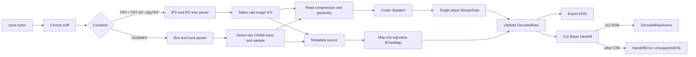

# fornax-decoder architecture

## Status

This document defines the initial architecture for the `fornax-decoder` crate.
The crate in this change is scaffolding only. It implements the public data
model and unsupported stubs; it does not parse, decompress, map metadata, or
write any RAW or DNG file.

The target format specification is Adobe Digital Negative (DNG) Specification
version 1.7.1.0, September 2023. Adobe's
[Digital Negative page](https://helpx.adobe.com/camera-raw/digital-negative.html)
was last updated on 13 October 2026 and links that published specification.
The page also publishes DNG SDK 1.7.1 Build 2768 dated 13 October 2026. The
specification is an extension of TIFF 6.0/TIFF-EP and DNG 1.7 adds BigTIFF
64-bit offsets.

## Format implementation order

| Tier | Order | Format plan |
| --- | ---: | --- |
| 0 | 1 | [DNG](formats/dng.md) |
| 1 | 2 | [Canon CR3](formats/canon-cr3.md) |
| 1 | 3 | [Sony ARW](formats/sony-arw.md) |
| 1 | 4 | [Nikon NEF](formats/nikon-nef.md) |
| 2 | 5 | [Fujifilm RAF](formats/fuji-raf.md) |
| 2 | 6 | [Hasselblad 3FR](formats/hasselblad-3fr.md) |
| 2 | 7 | [Panasonic RW2](formats/panasonic-rw2.md) |
| 2 | 8 | [Phase One IIQ](formats/phase-one-iiq.md) |
| 3 | 9 | [Other formats policy](formats/other.md) |

## Goals

- Decode every supported RAW format into one pure-Rust, DNG-shaped model.
- Preserve arbitrary repeating CFA layouts through decoding and DNG export.
- Keep decoding, preprocessing, and demosaicing as separate Fornax stages.
- Support the current `fornax-core` decoder protocol for conventional 2x2 RGB
  Bayer input.
- Reject every other CFA layout with a typed error at the preprocessor
  handoff, not while decoding or exporting.
- Use format specifications and observed corpus behavior as the primary
  implementation source.
- Keep binary RAW samples, images, and DNG files out of Git.

## Non-goals

- Implementing any format in this change.
- Removing the LibRaw, Rawler, or Adobe DNG Converter-backed decoders.
- Supporting all cameras of a listed format. A camera may be explicitly
  unsupported when the corpus records that result.
- Supporting formats outside the format plans without a separate request.
- Adding X-Trans, four-color, or monochrome input to the preprocessor or
  demosaic stages.

## Existing interfaces and conflicts

The current decoder protocol is
`fornax_core::protocol::IDecoder<I, T>` with:

```rust
fn decode_full(&self, input: &I)
    -> Result<(DecodedRawFull<T>, Metadata<T>), DecodeError>;
fn decode_active(&self, input: &I)
    -> Result<(DecodedRawActive<T>, Metadata<T>), DecodeError>;
```

`DecodedRawFull<T>` and `DecodedRawActive<T>` wrap a `MonoImage<T>`.
`fornax_core::metadata::Metadata<T>` stores `active_area`, `default_crop`,
`levels: Levels<T>`, `bayer_pattern: BayerPattern`, and optional white
balance. The preprocessor contract is
`fornax_core::protocol::IPreprocessor<T>::process(DecodedRawActive<T>,
&Levels<T>) -> Result<RawImage<T>, PreprocessError>`.

The Rawler and LibRaw adapters currently reject non-CFA or non-2x2 data while
creating `Metadata<T>`. That conflicts with this crate's requirement to decode
non-standard CFA layouts, retain their full pattern, and export them as DNG.

The resolution is:

- `fornax-decoder::Decoder::decode` is the native DNG-shaped API. It returns
  `DecodedRaw`, whose CFA tags may describe any non-empty repeating layout.
- A future `IDecoder<Path, T>` adapter decodes the native model first, then
  calls `DecodedRaw::preprocessor_pattern()`. Only a conventional RGB 2x2
  layout is converted into `Metadata<T>` and `DecodedRawActive<T>`.
- Every other layout returns `HandoffError::UnsupportedCfa` before a
  `fornax-core` active image is constructed.
- The scaffold's current protocol adapter returns
  `fornax_core::error::DecodeError::Unsupported` because no decode exists yet.

No immediate `fornax-core` protocol change is required. The existing protocol
remains the Bayer-only pipeline boundary, and the native API owns the richer
DNG model. A future protocol may carry the general CFA descriptor if another
pipeline stage needs it, but this proposal does not require or implement that
change. This is a decision for approval because the alternative is to extend
`Metadata<T>` itself.

## Crate modules

The scaffold contains these responsibilities:

| Module | Responsibility |
| --- | --- |
| `decoded` | `DecodedRaw`, image-buffer-backed `MosaicData`, important DNG getters, and the preprocessor handoff. |
| `error` | Stable decode categories, CFA validation, handoff failure, and writer failure. |
| `format` | RAW container family names and strum conversions. |
| `metadata` | DNG tag enum plus the `BTreeMap<DngTag, DngValue>` model backed by tiff values. |
| `protocol` | `fornax-core` `IDecoder<Path, T>` integration and the 2x2 Bayer preprocessor handoff. |
| `writer` | DNG writer options and compression selection. |
| `lib` | Public `Decoder` entry points and current `IDecoder` adapter. |

Future implementation modules should be split by responsibility:

```text
src/
  decoded.rs
  error.rs
  format.rs
  metadata.rs
  protocol.rs
  writer/
    mod.rs
    tiff.rs
    ljpeg.rs
  sniff.rs
  formats/
    mod.rs
    dng.rs
    cr3.rs
    arw.rs
    nef.rs
    raf.rs
    tfr.rs
    rw2.rs
    iiq.rs
  containers/
    tiff/
    bmff/
  codecs/
    ljpeg.rs
    deflate.rs
    jpeg_xl.rs
    crx/
    nef.rs
    arw.rs
    panasonic/
    phase_one/
```

Container parsing and codecs remain internal. Format modules return the common
`DecodedRaw` model rather than `fornax-core` image types.

## Public API

The stable public surface starts as:

```rust
impl Decoder {
    pub fn decode(&self, input: &Path) -> Result<DecodedRaw, DecodeError>;
}

impl DecodedRaw {
    pub fn write_dng<P: AsRef<Path>>(
        &self,
        path: P,
        options: DngWriteOptions,
    ) -> Result<(), DngWriteError>;

    pub fn write_dng_with<W: Write + Seek>(
        &self,
        writer: W,
        options: DngWriteOptions,
    ) -> Result<(), DngWriteError>;

    pub fn preprocessor_pattern(&self) -> Result<BayerPattern, HandoffError>;

    pub fn metadata_by_tag(&self, tag: DngTag) -> Option<&DngValue>;
}
```

`Decoder::decode` owns format sniffing and may later gain a byte-slice input
only when a caller needs it. `DecodedRaw::write_dng` consumes the model rather
than decoding an input again, while `write_dng_with` accepts any `Write + Seek`
sink for tests and callers. `DngWriteOptions` selects a DNG version and a
writer compression mode.

The current `IDecoder<Path, T>` implementation is retained in the private
`protocol` module so the future native decoder can be used by the existing
Fornax facade. Its methods are stubs in this change.

## Core data model

`DecodedRaw` contains one `MosaicData` image plus
`DngMetadata = BTreeMap<DngTag, DngValue>`. `MosaicData` wraps typed
`MonoImage<u8>`, `MonoImage<u16>`, `MonoImage<u32>`, or `MonoImage<f32>`
buffers, so dimensions and samples share image-rs's existing container.

The DNG tags `ImageWidth` and `ImageLength` remain in metadata and must agree
with the image buffer dimensions. Pixel data is not a tag: TIFF `Value`
represents metadata scalars and lists, not large raw planes.

`DngTag` is a `u16`-backed enum with explicit TIFF/DNG variants and a
`num_enum(catch_all)` `Unknown(u16)` variant. `num_enum` generates
`From<u16>`/`Into<u16>`, strum supplies variant names, and conversions to and
from `tiff::tags::Tag` are explicit. `DngValue` re-exports
`tiff::decoder::ifd::Value`, preserving BYTE, ASCII, SHORT, LONG, RATIONAL,
signed, float, and BigTIFF value families.

CFA is represented only by `CFARepeatPatternDim`, `CFAPattern`,
`CFAPlaneColor`, and `CFALayout` metadata. This avoids duplicate CFA state and
allows X-Trans, four-color, monochrome, and other repeating layouts to survive
decode and export. `DecodedRaw` validates CFA tag combinations on demand.

`DecodedRaw::metadata_by_tag(DngTag)` returns one value directly, while
`DecodedRaw::metadata()` exposes the complete map. Dedicated getters are
proposed for:

| Getter | DNG tag | Purpose |
| --- | --- | --- |
| `dng_version` | `DNGVersion` | Select parser compatibility and writer behavior. |
| `dng_backward_version` | `DNGBackwardVersion` | Preserve minimum-reader declaration. |
| `make`, `model` | `Make`, `Model` | Camera identity and corpus labels. |
| `unique_camera_model` | `UniqueCameraModel` | Stable profile key. |
| `active_area` | `ActiveArea` | Full-frame to usable-area mapping. |
| `default_crop_origin`, `default_crop_size` | `DefaultCropOrigin`, `DefaultCropSize` | Recommended output crop. |
| `masked_areas` | `MaskedAreas` | Optional optical-black regions. |
| `cfa_repeat_dim` | `CFARepeatPatternDim` | CFA shape. |
| `cfa_pattern` | `CFAPattern` | CFA phases. |
| `cfa_plane_colors` | `CFAPlaneColor` | Plane index to color mapping. |
| `cfa_layout` | `CFALayout` | Rectangular, staggered, or rotated layout. |
| `black_level_repeat_dim`, `black_level` | `BlackLevelRepeatDim`, `BlackLevel` | Repeating black correction. |
| `black_level_delta_h`, `black_level_delta_v` | `BlackLevelDeltaH`, `BlackLevelDeltaV` | Per-column and per-row black correction. |
| `white_level` | `WhiteLevel` | Per-plane saturation code. |
| `linearization_table` | `LinearizationTable` | Sensor-code linearization. |
| `as_shot_neutral`, `as_shot_white_xy` | `AsShotNeutral`, `AsShotWhiteXY` | As-shot white balance. |
| `analog_balance` | `AnalogBalance` | Camera-channel normalization. |
| `camera_calibration1`, `camera_calibration2` | `CameraCalibration1`, `CameraCalibration2` | Calibration matrices. |
| `color_matrix1`, `color_matrix2`, `forward_matrix1`, `forward_matrix2` | DNG color matrices | Camera-to-XYZ and XYZ-to-camera transforms. |
| `calibration_illuminant1`, `calibration_illuminant2` | DNG illuminants | Meaning for the paired matrices. |
| `orientation` | TIFF `Orientation` | Display orientation, not mosaic order. |
| `baseline_exposure`, `baseline_noise`, `baseline_sharpness` | DNG baseline tags | Default rendering hints. |
| `bayer_green_split` | `BayerGreenSplit` | Preserve green-phase separation. |
| `opcode_list1`, `opcode_list2`, `opcode_list3` | DNG opcode lists | Preserve or apply documented transforms. |

The first implementation needs `BlackLevel` and `CFAPattern`; the remaining
getters prevent callers from decoding private TIFF structures.

## Decode pipeline



1. Sniff by bytes, not filename extension. Extensions are only a hint for
   corpus selection.
2. Parse the container into offsets plus typed IFD/box values. All offset,
   count, and multiplication arithmetic is checked.
3. Select a single raw image IFD or media sample. Preview, thumbnail, mask,
   and depth IFDs are not raw payloads.
4. Decode compressed strips, tiles, or BMFF samples into a read-only
   single-plane mosaic with a known bit depth.
5. Build the DNG tag/value map from native tags or vendor metadata mapping.
6. Validate image geometry, sample count, CFA shape, crop bounds, and levels.
7. Return `DecodedRaw`; export and preprocessor conversion are separate calls.

Format modules must not invoke the preprocessor or demosaicer.

## DNG export

The writer is pure Rust and does not call Adobe DNG SDK. It wraps
`tiff::encoder::TiffEncoder`, uses a low-level image directory for the CFA raw
IFD because tiff's high-level image encoders do not expose DNG
`PhotometricInterpretation = 32803`, and starts with strip storage. BigTIFF
writing follows only if corpus files require it.

The default declarations are `DNGVersion = 1.7.1.0` and the lowest
`DNGBackwardVersion` that supports the feature set actually written. The writer
does not declare DNG 1.7.1 when no 1.7-specific feature is used.

Writer compression modes:

| Mode | Initial writer support | Notes |
| --- | --- | --- |
| Uncompressed | Yes | `Compression = 1`; correctness fallback. |
| Lossless JPEG-92 | Yes, default | DNG `Compression = 7` with the DNG predictor rules; integer samples only. |
| Deflate | No | Read support is useful, but it is not a first writer mode. |
| JPEG XL | No | Read support follows the DNG 1.7.1 corpus; write support is not required initially. |
| Lossy JPEG / JPEG XL | No | Preserve only when explicitly requested later. |

Reader scope is broader than writer scope:

- classic TIFF and BigTIFF IFDs;
- uncompressed strips and tiles;
- DNG lossless JPEG-92 strips and tiles;
- Deflate with supported predictors;
- JPEG XL compressed DNG images from DNG 1.7.1.0;
- documented DNG opcode lists and interleave/sub-tile layout metadata;
- linearization, black-level deltas, active area, and default crop tags.

The writer initially emits no preview, thumbnail, or vendor maker-note IFD.
Preserving unknown tags is deliberate only when the tag is structurally
independent of the rewritten raw IFD; offsets and IFD pointers are always
regenerated. DNG opcode lists are copied only if still valid for the exported
pixel stage. Applied opcodes are removed.

The DNG specification patent grant requires a prominent notice in source and
documentation for a compliant implementation:

> This product includes DNG technology under license by Adobe.

The project's own licence must be confirmed before production DNG code is
merged. Reference licences and their consequences are recorded below.

## Preprocessor handoff

The native decode result is not automatically a Bayer pipeline image.

`DecodedRaw::preprocessor_pattern` accepts only these CFA tag combinations:

| 2x2 entries | `CFAPlaneColor` interpretation | Fornax pattern |
| --- | --- | --- |
| `0, 1, 1, 2` | red, green, green, blue | `BayerPattern::RGGB` |
| `2, 1, 1, 0` | blue, green, green, red | `BayerPattern::BGGR` |
| `1, 0, 2, 1` | green, red, blue, green | `BayerPattern::GRBG` |
| `1, 2, 0, 1` | green, blue, red, green | `BayerPattern::GBRG` |

The adapter must then:

1. Align the active crop to the CFA phase.
2. Require the standard `[0, 1, 2]` `CFAPlaneColor` mapping (or its DNG
   default) before interpreting the 2x2 pattern as RGB Bayer.
3. Convert `ActiveArea`, `DefaultCropOrigin`, and `DefaultCropSize` to
   `image::math::Rect` using Fornax's existing relative-crop convention.
4. Translate `BlackLevel`, `BlackLevelDeltaH`, `BlackLevelDeltaV`, and
   `WhiteLevel` into `fornax_core::metadata::Levels<T>`.
5. Translate as-shot white balance into `WhiteBalance<T>`.
6. Shift the Bayer pattern by the active-area origin as the existing Rawler
   adapter does.
7. Construct `DecodedRawFull<T>` and `DecodedRawActive<T>` only after all
   validation succeeds.

X-Trans, four-color, monochrome, staggered, and any other non-2x2 layout stops
at `DecodedRaw::preprocessor_pattern()` and returns
`HandoffError::UnsupportedCfa { width, height }`. Malformed tag types or
lengths return `HandoffError::InvalidCfa(CfaPatternError)`.

## Error design

Errors are data for corpus tracking, not only display strings.

| Layer | Type | Stable cases |
| --- | --- | --- |
| Native decode | `DecodeError` | `InvalidInput`, `UnsupportedFormat`, `UnsupportedCamera`, `UnsupportedVariant`, `CorruptData`, `InvalidCfa` |
| Preprocessor handoff | `HandoffError` | `InvalidCfa`, `UnsupportedCfa` |
| DNG writer | `DngWriteError` | `Unsupported` initially; later invalid geometry and I/O categories |
| Current core protocol adapter | `fornax_core::error::DecodeError` | Existing `Unsupported`, `InvalidInput`, `Backend`, validation variants |

The native API is the source of precise categories. The current core adapter
must map `HandoffError::UnsupportedCfa` to `fornax_core::error::DecodeError::
Unsupported` because that protocol has no dedicated CFA handoff variant. The
corpus tracker calls the native API so it does not lose this distinction.

The taxonomy has these meanings:

- unsupported camera: the container is recognized but the make/model profile
  is absent;
- unsupported variant: the camera is known but a compression, bit depth,
  media-track, or other file variant is not implemented;
- corrupt data: required structure is present but inconsistent;
- unsupported CFA: decoding and DNG export may succeed, but this layout cannot
  enter the current preprocessor.

## Adding a format

The first registry is static and deliberately small:

1. Add a private `formats::<name>` module implementing an internal
   `FormatDecoder` trait.
2. Register a byte signature and camera/variant dispatch order in
   `formats::registry`.
3. Reuse container and codec modules. Do not expose TIFF or vendor IFD types
   in the public API.
4. Return `DecodedRaw` with complete DNG metadata or a typed
   `DecodeError`.
5. Add tiny synthetic parser/codec fixtures and one corpus manifest/config
   entry.
6. Add a format plan and baseline rows before marking the format supported.

There is no dynamic plugin ABI. The internal trait keeps the registry simple,
and format modules only need to produce the common model.

## Licence constraints

The following licences were read at the pinned revisions in this change:

| Reference | Revision/licence | Consequence |
| --- | --- | --- |
| `dnglab` / `rawler` | `62b77de1a206d467e910d55199191068b45a9cc1`, LGPL-2.1; `rawler` crate metadata is LGPL-2.1 | Reading for behavior is allowed. Copying or adapting rawler source into `fornax-decoder` would make that derived code subject to LGPL-2.1 and require corresponding source/relinking terms. Do not derive production code from it unless the project accepts that licence boundary. |
| LibRaw | `cf02d66eb5c19d4e46df7aee0582e47a4918509a`, LGPL-2.1 or CDDL-1.0 | Same caution for copied/adapted code. Keep LibRaw as a development reference unless a deliberate licensed derivative is introduced. |
| darktable | `20891f6c6fa7be995e5bf9dff9d1ee5062051773`, GPL-3.0 | GPL-3 code cannot be incorporated into a non-GPL production crate without changing the combined work's distribution obligations. Prefer observing behavior and implementing from specifications. |
| Adobe DNG specification | 1.7.1.0, Adobe patent licence | Reading/writing compliant DNG is licensed under the stated terms; include the required notice in production source and documentation. |

The planned policy is:

- specifications and observed input/output behavior are the implementation
  source;
- reference code is read to identify structures, variants, and edge cases;
- no reference implementation is a production dependency;
- rawler/LibRaw remain development-only comparison and benchmark dependencies;
- darktable files are fetched with `gh api` at a pinned commit when needed,
  never added as a submodule;
- any copied or adapted expression is documented before review and triggers a
  licence review.

`external/dnglab` and `external/libraw` are already submodules. They are
references, not workspace dependencies. The large darktable repository stays
outside `external/`; only named files and commit IDs are recorded in the format
plan that consults them.

## Testing strategy

No sample RAW, DNG, preview, or image is committed.

Unit tests build tiny byte arrays and temporary files in Rust:

- TIFF/IFD and BMFF bounds, offsets, endianness, and malformed nesting;
- each codec against hand-authored bitstreams with known samples;
- tag type round trips, including BigTIFF `LONG8`/`IFD8` values;
- CFA descriptors including X-Trans and four-color shapes;
- 2x2 Bayer conversion and non-2x2 handoff rejection;
- geometry, active-area, crop, black-level, and white-level validation;
- DNG writer/readback of a small synthetic CFA image with exact samples and
  required tags.

Property and fuzz tests are useful later for parsers and codecs, but they must
still use generated or tiny synthetic input. The full regression source is the
raw.pixls.us corpus, tracked per camera by the
[corpus design](corpus.md). Corpus files are downloaded into ignored storage;
only the CSV baseline and manifest metadata are committed.

## Migration

Tier 1 is complete only when DNG, Canon CR3, Sony ARW, and Nikon NEF meet their
format plan definitions of done for the supported corpus, including DNG export
and a valid 2x2 Bayer handoff.

The migration then proceeds in this order:

1. Add `fornax-decoder` as a feature-gated facade backend and make it the
   default for the covered formats.
2. Keep Rawler and LibRaw available as explicit, temporary fallbacks for
   cameras not covered by the tier plan.
3. Compare native and old decoder outputs in CI until every previously
   supported camera has either a reviewed pass or a typed, documented
   unsupported result in the baseline.
4. Remove production uses of Adobe DNG Converter-backed `fornax-decoder-dnc`
   after native decode plus DNG export covers the formats it is relied on for.
5. Remove the production `fornax-decoder-rawler` and LibRaw features only when
   the facade, Python binding, examples, benchmarks, and comparison tools no
   longer select them as production backends.
6. Delete the old decoder crates and their C/FFI dependencies in a separate
   change. Rawler and LibRaw may remain development references in dedicated
   benchmark/comparison crates, but they must not appear in the
   `fornax-decoder` dependency tree.
7. Remove obsolete setup scripts, package dependencies, and architecture
   references after the code is gone.

Removal is blocked by an unexplained pixel or metadata regression, a missing
DNG export path, a non-2x2 handoff leak, or a dependency tree containing a
`-sys`/C/C++ crate.
