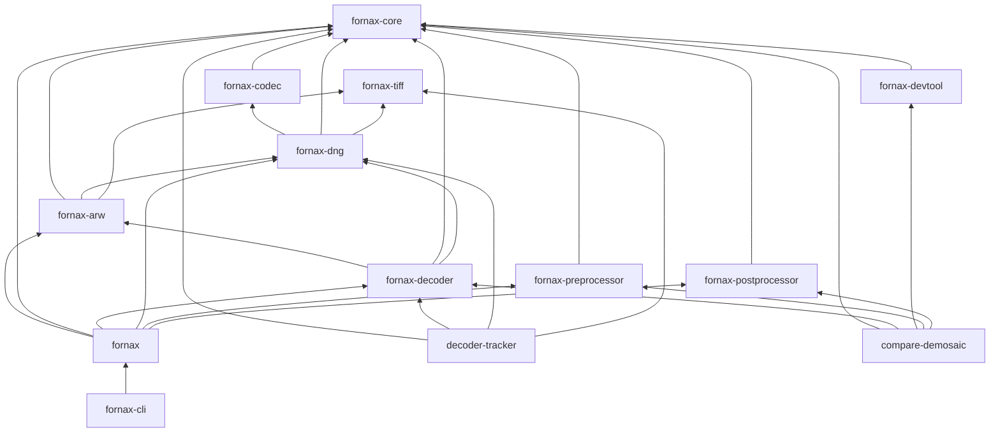
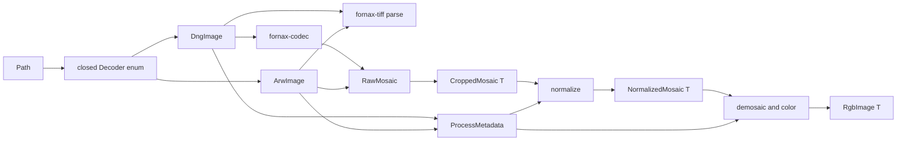

# Current architecture

## Workspace inventory

`[CURRENT]` `cargo metadata --format-version 1 --no-deps` reports 13 members,
with `fornax-py` excluded at `Cargo.toml:3` and `Cargo.toml:4`.

| Crate | Role | LOC | Normal internal dependencies | External evidence |
| --- | --- | ---: | --- | --- |
| `compare-demosaic` | Reference-vs-Fornax demosaic harness | 5,236 | core, decoder, devtool, postprocessor, preprocessor | `crates/compare-demosaic/Cargo.toml:10` |
| `decoder-tracker` | Corpus manifest and decoder regression tracker | 2,283 | core, decoder, dng, tiff | `crates/decoder-tracker/Cargo.toml:16` |
| `fornax` | Umbrella facade | 13 | arw, core, decoder, dng, postprocessor, preprocessor | `crates/fornax/Cargo.toml:7` |
| `fornax-arw` | Sony ARW/NRW format implementation | 1,531 | core, dng, tiff | `crates/fornax-arw/Cargo.toml:8` |
| `fornax-cli` | Batch converter | 771 | facade | `crates/fornax-cli/Cargo.toml:15` |
| `fornax-codec` | Sample codecs | 2,634 | core | `crates/fornax-codec/Cargo.toml:9` |
| `fornax-core` | Shared image, metadata, errors, and protocols | 1,149 | none | `crates/fornax-core/src/lib.rs:1` |
| `fornax-decoder` | DNG/ARW dispatch plus platform DNC fallback | 448 | arw, core, dng | `crates/fornax-decoder/Cargo.toml:12` |
| `fornax-devtool` | Fixtures, bench controls, synthetic images | 396 | core | `crates/fornax-devtool/Cargo.toml:8` |
| `fornax-dng` | DNG reader, transforms, metadata mapping, writer | 2,759 | codec, core, tiff | `crates/fornax-dng/Cargo.toml:12` |
| `fornax-postprocessor` | Demosaic and output-color conversion | 8,258 | core | `crates/fornax-postprocessor/Cargo.toml:11` |
| `fornax-preprocessor` | Black/white normalization | 238 | core | `crates/fornax-preprocessor/Cargo.toml:11` |
| `fornax-tiff` | Generic TIFF parsing, values, writer, constants | 1,086 | none | `crates/fornax-tiff/Cargo.toml:6` |
| `fornax-py` (excluded) | PyO3 binding source | 157 | package is excluded | `Cargo.toml:4`, `crates/fornax-py/Cargo.toml:12` |

`[CURRENT]` The LOC table is reproduced by
`for c in crates/*; do printf '%s ' "$c"; find "$c/src" -type f -name '*.rs' -print0 | xargs -0 awk 'NF{n++} END{print n+0}'; done`.

## Dependency graph

`[CURRENT]` The normal dependency graph below comes from
`cargo metadata --format-version 1 --no-deps`; dev-only edges are omitted.

`[CURRENT]` The graph has no cycle at baseline; the `cargo metadata` edge list
can be topologically sorted as documented in the earlier export.

## Data flow

`[CURRENT]` The CLI parses one job per input and dispatches to
`Decoder::decode` at `crates/fornax-cli/src/convert.rs:105` and
`crates/fornax-cli/src/convert.rs:156`.

`[CURRENT]` `Decoder` is a closed DNG/ARW enum at
`crates/fornax-decoder/src/lib.rs:15`; selection is by filename extension at
`crates/fornax-decoder/src/lib.rs:24` through
`crates/fornax-decoder/src/lib.rs:31`.

`[CURRENT]` Non-DNG/non-Sony inputs use Adobe DNG Converter only on Windows or
macOS and otherwise fail with `DecodeError::Unsupported` at
`crates/fornax-decoder/src/lib.rs:45` through
`crates/fornax-decoder/src/lib.rs:63`.

`[CURRENT]` DNG parsing selects the largest non-reduced CFA/LinearRaw IFD at
`crates/fornax-dng/src/dng_decoder/mod.rs:34` through
`crates/fornax-dng/src/dng_decoder/mod.rs:58`.

`[CURRENT]` DNG compression IDs are translated to codec enum values at
`crates/fornax-dng/src/dng_decoder/mod.rs:197` through
`crates/fornax-dng/src/dng_decoder/mod.rs:207`, then dispatched by
`crates/fornax-codec/src/lib.rs:90`.

`[CURRENT]` DNG returns storage-native `RawMosaic` from
`crates/fornax-dng/src/dng_decoder/mod.rs:77`, crops to `CroppedMosaic<T>` at
`crates/fornax-dng/src/dng_decoder/mod.rs:84`, and maps tags to
`ProcessMetadata` at `crates/fornax-dng/src/dng_decoder/process_metadata.rs:13`.

`[CURRENT]` ARW parsing, metadata mapping, and sample decoding are exposed by
`ArwImage` at `crates/fornax-arw/src/lib.rs:41`; its metadata language is the
DNG-style `Directory` returned at `crates/fornax-arw/src/lib.rs:112`.

`[CURRENT]` Preprocessing consumes `CroppedMosaic<T>` and `Levels` and returns
`NormalizedMosaic<T>` at `crates/fornax-preprocessor/src/lib.rs:12` through
`crates/fornax-preprocessor/src/lib.rs:16`.

`[CURRENT]` The postprocessor demosaics a mono Bayer image, then applies white
balance and an optional camera-to-output transform at
`crates/fornax-postprocessor/src/lib.rs:63` through
`crates/fornax-postprocessor/src/lib.rs:103`.

## Pain points

1. `[CURRENT]` The foundational crate mixes neutral image plumbing with Bayer,
   raw levels, color calibration, and all stage protocols:
   `crates/fornax-core/src/lib.rs:9`,
   `crates/fornax-core/src/metadata.rs:27`,
   `crates/fornax-core/src/protocol.rs:8`.
2. `[CURRENT]` The nominally format-neutral codec returns the raw-domain
   `RawMosaic`: `crates/fornax-codec/src/lib.rs:49`,
   `crates/fornax-codec/src/lib.rs:90`.
3. `[CURRENT]` Raw/codec types have a wide import spread: `RawMosaic` appears in
   27 files and 234 token occurrences across the workspace.
4. `[CURRENT]` The format-specific ARW crate depends on DNG and calls the DNG
   metadata converter: `crates/fornax-arw/Cargo.toml:9`,
   `crates/fornax-arw/src/lib.rs:121`.
5. `[CURRENT]` Decoder dispatch is a closed enum whose match and facade
   reexports must change for every format:
   `crates/fornax-decoder/src/lib.rs:15`,
   `crates/fornax/src/lib.rs:2`.
6. `[CURRENT]` Duplicate tag extraction exists in DNG and ARW:
   `crates/fornax-dng/src/dng_decoder/mod.rs:340`,
   `crates/fornax-arw/src/container.rs:236`.
7. `[CURRENT]` Duplicate crop and active-area interpretation exists:
   `crates/fornax-dng/src/dng_decoder/process_metadata.rs:157`,
   `crates/fornax-arw/src/metadata.rs:189`.
8. `[CURRENT]` Strip/tile execution planning lives in DNG even though its
   mechanics are TIFF-shaped: `crates/fornax-dng/src/dng_decoder/mod.rs:191`,
   `crates/fornax-dng/src/dng_decoder/mod.rs:223`.
9. `[CURRENT]` `fornax-tiff` contains DNG-oriented compression and
   photometric values: `crates/fornax-tiff/src/constants.rs:82`,
   `crates/fornax-tiff/src/constants.rs:105`.
10. `[CURRENT]` Codec availability is unconditional despite the target need
    for feature-selected builds: `crates/fornax-codec/Cargo.toml:7`,
    `crates/fornax-codec/src/lib.rs:90`.
11. `[CURRENT]` One `fornax-devtool` mixes neutral bench helpers with raw
    `RawFormat`/`RawMosaic` fixtures:
    `crates/fornax-devtool/src/bench.rs:52`,
    `crates/fornax-devtool/src/dirs.rs:4`.
12. `[CURRENT]` The facade has no codec features and eagerly composes every raw
    stage: `crates/fornax/Cargo.toml:7`,
    `crates/fornax/Cargo.toml:14`.
13. `[CURRENT]` CI and validation scripts hard-code crate paths and package
    names: `.github/workflows/ci.yml:38`,
    `.github/workflows/ci.yml:149`,
    `scripts/agent-validation.sh:208`.
14. `[CURRENT]` The excluded Python crate imports facade names that do not
    exist, including `fornax::libraw` and `fornax::fornax_dalim`:
    `crates/fornax-py/src/lib.rs:10`,
    `crates/fornax/src/lib.rs:1`.
15. `[CURRENT]` Active architecture documentation describes non-member
    decoder crates and an obsolete generic protocol shape:
    `docs/architecture.md:25`, `docs/architecture.md:39`,
    `crates/fornax-core/src/protocol.rs:8`.

## Corrections to current-facing documentation

`[CURRENT]` `AGENTS.md` describes `fornax-decoder-rawler` and
`fornax-decoder-dnc` as crates at `AGENTS.md:28`, but no such workspace
manifests exist; DNC is a private platform-gated module at
`crates/fornax-decoder/src/lib.rs:3`.

`[CURRENT]` `AGENTS.md` names `fornax-decoder::Decoder<T>` at `AGENTS.md:25`,
but the type is non-generic at `crates/fornax-decoder/src/lib.rs:15`.

`[CURRENT]` The root README attributes the DNG decoder and writer to
`fornax-core` at `README.md:23`, while implementations live in
`crates/fornax-dng/src/lib.rs:7` and `crates/fornax-dng/src/lib.rs:13`.

`[CURRENT]` `docs/architecture.md` shows `IDecoder<I, T>` at
`docs/architecture.md:39`, while the current trait is `IDecoder` with a
`&Path` input at `crates/fornax-core/src/protocol.rs:8`.
