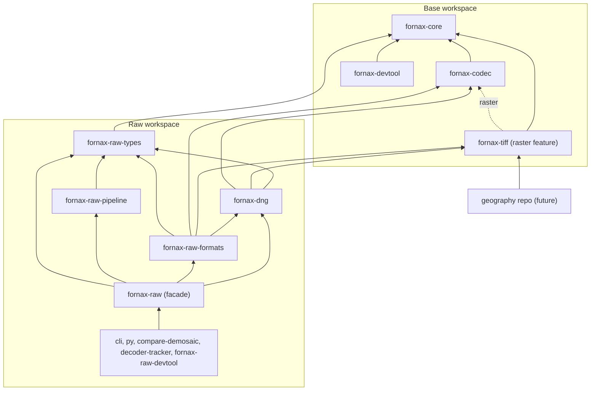

# Target architecture

## Status

`[TARGET]` This document encodes the maintainer-selected direction; it is not
implemented at the baseline.

## Workspace boundaries

`[TARGET]` Fornax should have two Cargo workspaces: a small neutral base
workspace and a raw-image workspace that consumes base crates by published
version.

### Base workspace

| Crate | Responsibility | Allowed internal dependencies | Feature list |
| --- | --- | --- | --- |
| `[TARGET]` `fornax-core` | Neutral sample/image buffers, shared error plumbing, byte-order-style basics | none | no raw feature; exact neutral surface is OPEN 1 |
| `[TARGET]` `fornax-codec` | Bytes to samples, generic tag-selected codecs, typed vendor codecs | `fornax-core` | `uncompressed` always on; `deflate`, `zstd`, `lzma`, `lzw`, `packbits` if retained, `lossless-jpeg`, `lossy-jpeg`, `jpeg-xl`; vendor codec features are OPEN 3 |
| `[TARGET]` `fornax-tiff` | TIFF data types, constants, classic/BigTIFF parsing, classic writer | `fornax-core`; optional `fornax-codec` under `raster` | `raster` optional |
| `[TARGET]` `fornax-devtool` | Neutral fixtures, synthetic buffers, bench parameters | `fornax-core` | none mandated; `publish = false` |

`[TARGET]` Base crates must never import raw domain types, raw format crates,
DNG policy, or pipeline stages.

### Raw workspace

| Crate | Responsibility | Allowed internal dependencies | Feature list |
| --- | --- | --- | --- |
| `[TARGET]` `fornax-raw-types` | Bayer, levels, process metadata, cropped/normalized mosaics, raw formats, decoder/pre/post protocols, color-matrix helpers | `fornax-core` | none mandated |
| `[TARGET]` `fornax-dng` | DNG tags, tag-to-process-metadata mapping, reader, writer, opcodes | `fornax-raw-types`, `fornax-tiff`, `fornax-codec` | existing metadata serialization feature may remain; publish policy OPEN 5 |
| `[TARGET]` `fornax-raw-formats` | Vendor decoders; ARW now, NEF/CR3/others later | `fornax-raw-types`, `fornax-dng`, `fornax-tiff`, `fornax-codec` | no format-selection feature is mandated; practical feature needs are evidence gaps |
| `[TARGET]` `fornax-raw-pipeline` | `normalize`, `demosaic`, and `color` | only `fornax-raw-types` | none mandated |
| `[TARGET]` `fornax-raw` | Facade, detection, decoder dispatch, reexports | raw crates | none; the facade must have no Cargo features |
| `[TARGET]` `fornax-cli` | Batch converter | `fornax-raw` and required base APIs | none mandated |
| `[TARGET]` `fornax-py` | Python binding when revived | `fornax-raw` | none mandated |
| `[TARGET]` `compare-demosaic` | Reference comparison tool; excluded from default members | raw workspace APIs plus development references | none mandated |
| `[TARGET]` `decoder-tracker` | Manual corpus tracker | `fornax-raw`, `fornax-dng`, `fornax-tiff` | none mandated |
| `[TARGET]` `fornax-raw-devtool` | Raw fixtures and mosaic helpers | `fornax-raw-types` and base devtool | none mandated; `publish = false` |

`[TARGET]` Vendor decoders may consume DNG metadata and tag vocabulary but must
not depend on `fornax-raw-pipeline`.

`[TARGET]` Only `fornax-raw` composes decoder dispatch with pipeline policy.

## Dependency graph

## Dependency rules

| Rule | Required target behavior |
| --- | --- |
| `[TARGET]` Neutrality | Base crates never import raw types. |
| `[TARGET]` Pipeline isolation | `fornax-raw-pipeline` depends only on `fornax-raw-types`. |
| `[TARGET]` Vendor isolation | Vendor decoders may use DNG metadata but never pipeline stages. |
| `[TARGET]` Facade composition | Only `fornax-raw` composes decoding and processing. |
| `[TARGET]` Devtools | Each workspace has its own devtool; raw helpers do not leak into base. |
| `[TARGET]` TIFF boundary | Generic TIFF/TIFF-EP vocabulary is always present; DNG/GeoTIFF vocabulary is outside `fornax-tiff`. |
| `[TARGET]` Codec boundary | Generic compression uses one tag-identified entry; vendor algorithms are typed functions. |
| `[TARGET]` Feature errors | Disabling a codec compiles successfully, and selecting it returns `UnsupportedCompression` naming the required feature. |

## Per-crate API sketch

`[TARGET]` These are names and boundaries only; no code is implemented here.

| Crate | Public names and modules |
| --- | --- |
| `[TARGET]` `fornax-core` | neutral buffer placeholder from OPEN 1, `Primitive`, `ByteOrder`, shared error primitives |
| `[TARGET]` `fornax-codec` | `DecodeRequest`, `decode`, neutral output buffer, `UnsupportedCompression`, generic compression enum, typed vendor decode functions |
| `[TARGET]` `fornax-tiff` | `Tag`, `TiffTag`, `Value`, `Directory`, `ParsedTiff`, `parse`, `parse_ifd_at`, `TiffWriter`, `TiffDirectory`; `raster`: strip/tile layout and `Compression` mapping |
| `[TARGET]` `fornax-devtool` | `BenchParams`, synthetic buffer helpers, fixture paths |
| `[TARGET]` `fornax-raw-types` | `BayerPattern`, `Levels`, `ProcessMetadata`, `CroppedMosaic`, `NormalizedMosaic`, `RawFormat`, decoder/pre/post protocols, color helpers |
| `[TARGET]` `fornax-dng` | `DngTag`, DNG reader, DNG writer, opcodes, tag-to-`ProcessMetadata` mapping |
| `[TARGET]` `fornax-raw-formats` | `ArwImage`, later NEF/CR3 decoder values, shared vendor decode output |
| `[TARGET]` `fornax-raw-pipeline` | `normalize`, `demosaic`, `color`, `Demosaic`, `OutputColorSpace`, `PostProcessor`, `Preprocessor` compatibility names if needed |
| `[TARGET]` `fornax-raw` | `Decoder`, format detection, `raw_mosaic`, `cropped_mosaic`, `process_metadata`, `dng_metadata`, reexports |
| `[TARGET]` Tools | Existing CLI/tracker/compare names, rewired to raw workspace APIs |

## Codec behavior

`[TARGET]` Uncompressed sample handling is always compiled.

`[TARGET]` Deflate, zstd, lzma, optional LZW/PackBits, lossless JPEG, lossy
JPEG, and JPEG XL each sit behind a Cargo feature.

`[TARGET]` A generic `decode(DecodeRequest)` chooses a compression codec from a
tag-identified request.

`[TARGET]` Sony, Canon, Nikon, and other vendor codecs are typed functions and
do not masquerade as generic TIFF compression values.

`[TARGET]` A disabled generic codec returns `UnsupportedCompression` with the
feature name.

`[TARGET]` Vendor codecs move to `fornax-codec` immediately only if OPEN 3 is
resolved that way; otherwise the initial implementation keeps them in
`fornax-raw-formats` until a second format shares them.

## TIFF and raster behavior

`[TARGET]` `fornax-tiff` preserves unknown tag IDs through the open `Tag`
representation and must preserve unknown value representations after the
target's open-value design is settled.

`[TARGET]` TIFF 6.0 and TIFF/EP constants are always compiled and grouped by
specification.

`[TARGET]` The optional `raster` feature adds strip/tile layout and maps the
TIFF `Compression` tag to codec requests.

`[TARGET]` `raster` may depend on `fornax-codec`, but TIFF must not depend on
`fornax-dng`.

`[TARGET]` DNG-defined and GeoTIFF-defined constants do not live in
`fornax-tiff`; GeoTIFF support belongs to a future geography repository.

## Pipeline behavior

`[TARGET]` `fornax-raw-pipeline::normalize` performs black-level, white-level,
and normalization work only.

`[TARGET]` `fornax-raw-pipeline::demosaic` contains the current Bayer
algorithms.

`[TARGET]` `fornax-raw-pipeline::color` applies white balance, color matrices,
and output color-space conversion.

`[TARGET]` The active target remains conventional 2x2 RGB Bayer input; no new
CFA support is implied.

## Release and workspace wiring

`[TARGET]` During development, raw workspace manifests consume base crates by
version and use local `[patch.crates-io]` entries.

`[TARGET]` Release order starts with non-optional base crates, then feature
dependencies, then raw crates and tools.

`[TARGET]` The raw facade remains feature-free so callers cannot accidentally
change its surface through feature unification.

`[TARGET]` The final crate naming and publish list remain OPEN 5.
