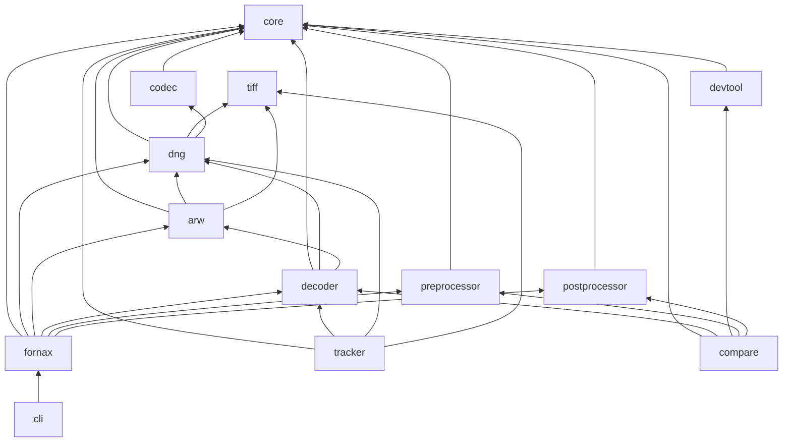
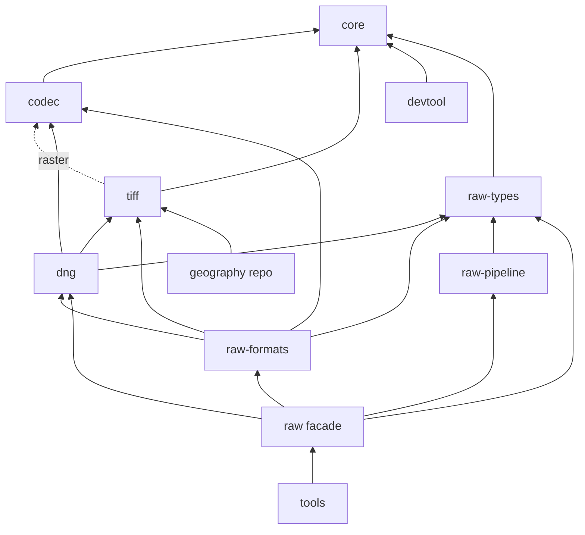

# Fornax refactor: summary for feasibility analysis

## 1. Context (5-10 lines): what fornax is, why the refactor, baseline commit

`[CURRENT]` Fornax is a Rust workspace for RAW decoding, Bayer normalization, demosaic, and RGB output at baseline commit `9b9c1b284ff5f4fe9ef1c8ff41eb6c3cff17b8d2` (`README.md:8`, `Cargo.toml:1`).
`[CURRENT]` The active pipeline supports conventional 2x2 RGB Bayer input only (`crates/fornax-dng/src/dng_decoder/process_metadata.rs:259`, `crates/fornax-arw/src/container.rs:68`).
`[CURRENT]` The current workspace has 13 members plus an excluded `fornax-py` crate (`Cargo.toml:3`, `Cargo.toml:4`).
`[CURRENT]` The motivating problems are raw concepts in the foundational core, raw output from the neutral codec, format-specific DNG coupling, duplicated TIFF helpers, and expensive native comparison builds; path evidence appears in section 3.
`[TARGET]` The proposal splits neutral TIFF/codec work into a small base workspace and raw decoding/pipeline work into a separate raw workspace.
`[TARGET]` The intent is faster base CI, reuse by a future geography repository, clearer ownership, feature-selected generic codecs, and a feature-free raw facade.
`[TARGET]` This summary is self-contained; all paths are repository-relative and all size statements are estimates.

## 2. Current architecture [CURRENT]: crate table (name, role, LOC, internal deps), compact mermaid graph

`[CURRENT]` The table is derived with `cargo metadata --format-version 1 --no-deps` and `for c in crates/*; do printf '%s ' "$c"; find "$c/src" -type f -name '*.rs' -print0 | xargs -0 awk 'NF{n++} END{print n+0}'; done`.

| `[CURRENT]` crate | Role | LOC | Normal internal deps | Evidence |
| --- | --- | ---: | --- | --- |
| `fornax-core` | Image buffers, Bayer, metadata, errors, stage traits | 1,149 | none | `crates/fornax-core/src/lib.rs:9` |
| `fornax-codec` | Sample codecs and chunk/predictor handling | 2,634 | core | `crates/fornax-codec/src/lib.rs:90` |
| `fornax-tiff` | TIFF parsing, values, writer, constants | 1,086 | none | `crates/fornax-tiff/src/lib.rs:7` |
| `fornax-devtool` | Fixtures, synthetic data, bench controls | 396 | core | `crates/fornax-devtool/src/lib.rs:7` |
| `fornax-dng` | DNG reader, transforms, metadata mapping, writer | 2,759 | core, tiff, codec | `crates/fornax-dng/src/lib.rs:7` |
| `fornax-arw` | Sony ARW/NRW parser, metadata, codecs | 1,531 | core, dng, tiff | `crates/fornax-arw/src/lib.rs:41` |
| `fornax-decoder` | Closed DNG/ARW dispatch plus DNC fallback | 448 | core, dng, arw | `crates/fornax-decoder/src/lib.rs:15` |
| `fornax-preprocessor` | Black/white normalization | 238 | core | `crates/fornax-preprocessor/src/lib.rs:7` |
| `fornax-postprocessor` | Demosaic and output color | 8,258 | core | `crates/fornax-postprocessor/src/lib.rs:5` |
| `fornax` | Umbrella facade | 13 | core, dng, arw, decoder, preprocessor, postprocessor | `crates/fornax/src/lib.rs:2` |
| `fornax-cli` | Batch conversion tool | 771 | fornax | `crates/fornax-cli/src/lib.rs:7` |
| `decoder-tracker` | Manual corpus regression tracker | 2,283 | core, decoder, dng, tiff | `crates/decoder-tracker/src/lib.rs:3` |
| `compare-demosaic` | Native reference comparison harness | 5,236 | core, decoder, devtool, preprocessor, postprocessor | `crates/compare-demosaic/src/lib.rs:1` |
| `fornax-py` (excluded) | Python binding source | 157 | old facade API; currently incompatible | `crates/fornax-py/src/lib.rs:10` |

`[CURRENT]` Total non-blank source LOC is 26,959, reproduced with `find crates -path '*/src/*.rs' -type f -print0 | xargs -0 awk 'NF{n++} END{print n}'`.

`[CURRENT]` The graph has no dependency cycle; `cargo metadata --format-version 1 --no-deps` produced the edges.

## 3. Pain points [CURRENT]: top 10, each one line with path:line evidence

1. `[CURRENT]` Core mixes neutral storage with Bayer/raw metadata and all stage protocols: `crates/fornax-core/src/lib.rs:9`, `crates/fornax-core/src/metadata.rs:27`, `crates/fornax-core/src/protocol.rs:8`.
2. `[CURRENT]` Codec imports and returns raw-domain `RawMosaic`: `crates/fornax-codec/src/lib.rs:49`, `crates/fornax-codec/src/lib.rs:90`.
3. `[CURRENT]` `RawMosaic` is spread across 27 workspace files and 234 token occurrences; reproduce with `rg -l '\bRawMosaic\b' crates -g '*.rs' | wc -l` and `rg -o '\bRawMosaic\b' crates -g '*.rs' | wc -l`.
4. `[CURRENT]` ARW depends on DNG and calls its metadata mapper: `crates/fornax-arw/Cargo.toml:9`, `crates/fornax-arw/src/lib.rs:121`.
5. `[CURRENT]` Decoder and facade use a closed enum and explicit reexports: `crates/fornax-decoder/src/lib.rs:15`, `crates/fornax/src/lib.rs:2`.
6. `[CURRENT]` DNG and ARW duplicate unsigned tag accessors: `crates/fornax-dng/src/dng_decoder/mod.rs:340`, `crates/fornax-arw/src/container.rs:236`.
7. `[CURRENT]` DNG and ARW duplicate crop/active-area interpretation: `crates/fornax-dng/src/dng_decoder/process_metadata.rs:157`, `crates/fornax-arw/src/metadata.rs:189`.
8. `[CURRENT]` DNG owns generic strip/tile plan and compression-ID mapping: `crates/fornax-dng/src/dng_decoder/mod.rs:191`, `crates/fornax-dng/src/dng_decoder/mod.rs:197`.
9. `[CURRENT]` TIFF constants contain DNG-oriented compression/photometric values: `crates/fornax-tiff/src/constants.rs:82`, `crates/fornax-tiff/src/constants.rs:105`.
10. `[CURRENT]` CI and validation hard-code crate paths and package names: `.github/workflows/ci.yml:38`, `.github/workflows/ci.yml:149`, `scripts/agent-validation.sh:208`.

## 4. Target architecture [TARGET]: crate table, mermaid graph, dependency rules, features

| `[TARGET]` crate | Role | Allowed internal deps | Features |
| --- | --- | --- | --- |
| `fornax-core` | Neutral image/sample buffers and basics | none | no raw feature; buffer shape OPEN |
| `fornax-codec` | Bytes to samples; generic and typed vendor codecs | core | uncompressed on; `deflate`, `zstd`, `lzma`, `lzw`, `packbits` if kept, `lossless-jpeg`, `lossy-jpeg`, `jpeg-xl`; vendor feature policy OPEN |
| `fornax-tiff` | TIFF values/parse/write plus optional raster layout | core; codec under `raster` | `raster` |
| `fornax-devtool` | Neutral dev/bench helpers | core | none mandated; unpublished |
| `fornax-raw-types` | Bayer, levels, process metadata, raw protocols, color helpers | core | none mandated |
| `fornax-dng` | DNG tags, reader/writer, metadata mapping, opcodes | raw-types, tiff, codec | metadata serialization policy OPEN |
| `fornax-raw-formats` | Vendor decoders, ARW now, NEF/CR3 later | raw-types, dng, tiff, codec | vendor feature policy OPEN |
| `fornax-raw-pipeline` | Normalize, demosaic, color | raw-types only | none mandated |
| `fornax-raw` | Feature-free facade, detection, dispatch | dng, formats, pipeline, raw-types | none |
| tools | CLI, Python, compare, tracker, raw devtool | raw facade/base APIs | tool-specific only; compare excluded from defaults |

`[TARGET]` Base crates never import raw types.
`[TARGET]` `fornax-raw-pipeline` depends only on `fornax-raw-types`.
`[TARGET]` Vendor decoders may use DNG metadata but never pipeline stages.
`[TARGET]` Only `fornax-raw` composes decoding and processing.
`[TARGET]` Each workspace has its own devtool crate.
`[TARGET]` Uncompressed is always compiled; disabled generic codecs return `UnsupportedCompression` naming the feature.
`[TARGET]` Generic compression uses `decode(DecodeRequest)`; vendor algorithms are separate typed functions.
`[TARGET]` TIFF 6.0/TIFF-EP constants are always compiled; DNG/GeoTIFF constants do not live in TIFF.

## 5. Mapping digest: crate-level table, LOC moving across crate boundaries, count of public items changing crate path

| `[TARGET]` current crate | Destination |
| --- | --- |
| `fornax-core` | split: neutral core plus raw-types |
| `fornax-codec` | codec with neutral output and features |
| `fornax-tiff` | TIFF plus optional raster |
| `fornax-dng` | DNG plus generic raster moved to TIFF |
| `fornax-arw` | raw-formats; codec functions subject to OPEN |
| `fornax-decoder` | raw-formats adapter plus raw facade dispatch |
| `fornax-preprocessor` | raw-pipeline normalize |
| `fornax-postprocessor` | raw-pipeline demosaic/color |
| `fornax-devtool` | split neutral devtool/raw devtool |
| `fornax` | raw facade; old package retired or shimmed |
| `fornax-cli`, tracker, compare | same tools, rewired APIs |
| `fornax-py` | same excluded tool, API rebuild required |

`[TARGET]` Approximately 11,824 non-blank LOC cross a current crate boundary in the indicative allocation; most is the pre/post merge.
`[TARGET]` Forty-one primary root-reachable type/trait/item names change crate path. Methods, fields, variants, and facade reexports travel with them.
`[CURRENT]` The highest-use moved names include `RawMosaic` (27 files/234 occurrences), `BayerPattern` (31/296), `MonoImage` (42/200), `ProcessMetadata` (10/26), `Directory` (20/111), and `Value` (20/561), reproduced with `rg -l '\bNAME\b' crates -g '*.rs' | wc -l` and `rg -o '\bNAME\b' crates -g '*.rs' | wc -l`.
`[TARGET]` `RawMosaic`, `CroppedMosaic`, `NormalizedMosaic`, `BayerPattern`, `Levels`, `ProcessMetadata`, `RawFormat`, and raw protocols move to `fornax-raw-types`.
`[TARGET]` `DecodeRequest` stays in codec but its output becomes the neutral buffer.
`[TARGET]` `Directory`, `Value`, and `Tag` stay in TIFF; DNG-owned compression/photometric constants leave TIFF.

## 6. Migration steps: numbered, with size, risk, callers affected, tests covering the moved code

1. `[TARGET]` Consolidate tag/crop helpers in TIFF. Size S; risk M; four source files in DNG/ARW; 46 DNG/ARW/TIFF unit/integration tests cover related behavior.
2. `[TARGET]` Give codec a neutral output buffer with temporary adapters. Size M-L; risk H; 27 files/234 `RawMosaic` occurrences; 67 codec/DNG/ARW/CLI tests plus decoder/DNG benches.
3. `[TARGET]` Split core into neutral core and raw-types. Size L; risk H; 10 direct core dependents and 54 files with core-path imports; 10 core tests plus all 282 workspace tests.
4. `[TARGET]` Merge preprocessor/postprocessor into raw-pipeline. Size L; risk M-H; facade/CLI/compare callers; 89 pipeline tests, 56 compare tests, 6 CLI tests, two stage benches.
5. `[TARGET]` Move strip/tile layout and compression mapping to TIFF raster. Size M; risk M; DNG/ARW callers; 88 TIFF/DNG/ARW/tracker/CLI tests plus decoder/DNG benches.
6. `[TARGET]` Move vendor codecs only if OPEN 3 selects immediate movement. Size M; risk M-H; ARW dispatch; 35 ARW/codec tests plus decoder bench.
7. `[TARGET]` Move DNG constants out of TIFF and make tag/value preservation open. Size M; risk H; TIFF/DNG/ARW/tracker/CLI callers; 88 related tests plus decoder/DNG benches.
8. `[TARGET]` Merge ARW/decoder into raw-formats plus raw facade. Size L; risk H; CLI/tracker/compare/Python callers; 10 ARW, 3 decoder, 26 DNG, 6 CLI, 36 tracker, 56 compare, 89 pipeline tests.
9. `[TARGET]` Split into two workspaces and establish version/patch/release wiring. Size L; risk H; manifests/CI/scripts only; all 282 tests and four bench targets.
10. `[TARGET]` Housekeeping: default members, Python status, compatibility cleanup, live docs. Size M; risk M; no runtime callers; all tests under final layout.

## 7. Risk register: top risks with evidence

| `[TARGET]` risk | Evidence |
| --- | --- |
| TIFF raster creates a cycle risk | DNG depends on TIFF at `crates/fornax-dng/Cargo.toml:14`; raster must map compression without importing DNG |
| Neutral buffer causes broad API churn | `RawMosaic` appears in 27 files/234 tokens; codec imports it at `crates/fornax-codec/src/lib.rs:49` |
| Core split breaks public paths | Core root reexports at `crates/fornax-core/src/lib.rs:9`; facade reexports at `crates/fornax/src/lib.rs:2` |
| Non-TIFF formats may not fit DNG metadata language | ARW already synthesizes DNG-style `Directory` at `crates/fornax-arw/src/lib.rs:112` |
| Vendor codec ownership can recouple codec to metadata policy | ARW2 codec depends on curve knots at `crates/fornax-arw/src/decode.rs:118` |
| Tools directly import moving APIs | CLI `crates/fornax-cli/src/convert.rs:5`; tracker `crates/decoder-tracker/src/stages.rs:5`; compare `crates/compare-demosaic/src/reference.rs:4` |
| CI/scripts hard-code current names | `.github/workflows/ci.yml:38`, `scripts/agent-validation.sh:200`, `scripts/agent-validation.sh:208` |
| Native comparison slows the raw workspace | `crates/compare-demosaic/build.rs:91` compiles pinned C/C++ references |
| Two-workspace release ordering fails late | Current crates inherit workspace metadata at `Cargo.toml:6`; raw workspace must consume base by version plus patch |
| Open TIFF value representation can lose fields | Current `Value` enumerates known TIFF field types at `crates/fornax-tiff/src/value.rs:23` |
| Python is already API-incompatible | `crates/fornax-py/src/lib.rs:10` imports facade exports absent at `crates/fornax/src/lib.rs:1` |

## 8. Evidence gaps: things the agent could not determine

`[TARGET]` The neutral buffer shape and multi-band semantics cannot be selected from current mono-only code; see OPEN 1.
`[TARGET]` The final name and publish list for raw domain/base crates cannot be determined; see OPEN 5.
`[TARGET]` The exact physical directories and root/meta-workspace layout for the two workspaces are not specified.
`[TARGET]` The intended Python binding API and a buildable acceptance command cannot be determined from the repository.
`[TARGET]` Normative ownership of Deflate 8, lossy JPEG 34892, legacy JPEG XL 50002, and CFA photometric 32803 is not established by repository evidence.
`[TARGET]` Vendor-selection feature policy for `fornax-raw-formats` is not specified.
`[TARGET]` External public users outside this repository cannot be inspected; only workspace tools and README/book references are visible.
`[TARGET]` The target does not assign the DNC adapter or decoder benchmark/Rawler wrapper to a final crate.

## 9. Questions for the analyst (copy verbatim, then add any new ones the evidence suggests)

1. Is the layering sound (base workspace, raw-types, dng, formats, pipeline, facade)? Where could a dependency cycle or forced re-coupling appear?
2. Is the proposed neutral buffer (see OPEN decision 1) adequate for both raw mosaics and multi-band rasters? Which option is safer for the existing demosaic code?
3. Is it right to keep vendor decoders in one crate and the DNG metadata mapping as their shared language? What breaks if a vendor format is not TIFF-based (for example CR3)?
4. Which migration steps are the riskiest or most likely to be underestimated, and in what order would you do them?
5. Which public-API changes will hurt external users most, and how should they be staged or deprecated?
6. What is the cheapest viable subset of this refactor if time is limited?
7. What should be measured before and after (compile time, binary size, test time) to judge whether the refactor was worth it?
8. How should `fornax-tiff::raster` expose DNG-owned compression IDs without either moving DNG constants into TIFF or forcing TIFF to depend on DNG?
9. What compatibility shim, if any, is appropriate for the package rename from `fornax` to `fornax-raw`?
10. Should vendor codecs move now, or wait until a second vendor shares the implementation?
11. What acceptance criteria should `fornax-py` meet before it re-enters a workspace or release path?
