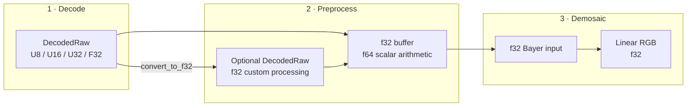

# Universal RAW Representation Guides

These documents define the persistent `fornax` RAW image model at three
different levels:

- [Raw image processing flow](raw-image-process.md) describes how a decoded
  file moves through custom processing, preprocessing, and demosaicing.
- [Precision by phase](precision.md) explains when data uses u8, u16, f32, or
  f64 and what each choice guarantees.
- [Key structures and fields](raw-image-struct.md) maps the persistent Rust types,
  fields, units, and invariants.
- [Demosaicing interface](demosaicing.md) defines input/output, strategy
  registration, border behavior, and errors.

These files are the normative, persistent RAW pipeline design. The task-owned
files under `agent-work/design/` are design history and implementation
provenance; if they differ from these guides, these guides take precedence.

Every PR that changes pipeline flow, precision, structs, public behavior,
errors, or allocation semantics must update the relevant files in this
directory in the same PR.

## Reading map

Use [Precision by phase](precision.md) when deciding a sample type and
[Key structures and fields](raw-image-struct.md) when implementing or reviewing
the data model.
