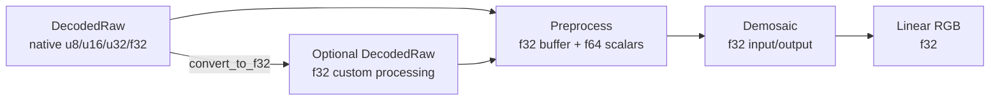

# Universal RAW Representation Guides

These documents explain the proposed `fornax` RAW image model at three
different levels:

- [Raw image processing flow](raw-image-process.md) describes how a decoded
  file moves through custom processing, preprocessing, and demosaicing.
- [Precision by phase](precision.md) explains when data uses u8, u16, f32, or
  f64 and what each choice guarantees.
- [Key structures and fields](raw-image-struct.md) maps the proposed Rust types,
  fields, units, and invariants.

The normative design is
[`DES-001-universal-raw-representation.md`](../../agent-work/design/raw-pipeline/DES-001-universal-raw-representation.md).
These guides explain that design; they do not introduce additional behavior.

## Reading map

Use [Precision by phase](precision.md) when deciding a sample type and
[Key structures and fields](raw-image-struct.md) when implementing or reviewing
the data model.
