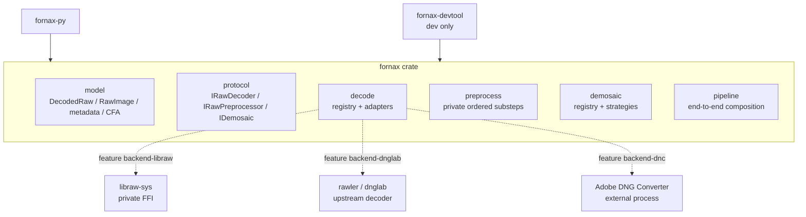

# RAW Pipeline Crate Architecture

The production RAW pipeline is one Rust crate named `fornax`. There is no
separate `fornax-core`, decoder-contract crate, decoder-adapter crates,
preprocessing crate, or demosaicing crate.

The current `fornax-core` package is the implementation starting point and is
renamed to `fornax`. The existing legacy `fornax` facade is replaced rather
than preserved.

## Crate and module topology



Arrow direction means dependency. Upstream decoder dependencies are optional
Cargo features. Demosaicing is implemented entirely inside `fornax`; the base
crate remains usable without enabling any decoder backend.

## Module responsibilities

| Module | Responsibility |
| --- | --- |
| `fornax::model` | Universal geometry, CFA, sample specification, metadata, provenance, `DecodedRaw`, f32-only `RawImage`, and shared validation |
| `fornax::protocol` | `IRawDecoder`, `IRawPreprocessor`, `IDemosaic`, phase options, inputs/outputs, and structured phase errors |
| `fornax::decode` | Backend registry, explicit selection, capabilities, provenance, and target-format dispatch |
| `fornax::decode::libraw` | Private LibRaw adapter over `libraw-sys` |
| `fornax::decode::rawler` | Private rawler/dnglab adapter |
| `fornax::decode::dnc` | Private process bridge composed with a DNG decoder |
| `fornax::preprocess` | One standard preprocessing implementation with private linearization, black subtraction, normalization, and clipping substeps |
| `fornax::demosaic` | Strategy contract/registry plus in-crate bilinear and Malvar–He–Cutler implementations |
| `fornax::pipeline` | Explicit end-to-end backend and strategy composition |

These modules are an implementation boundary inside one crate. They are not
reason to reintroduce workspace crates.

## Workspace members

| Package | Responsibility |
| --- | --- |
| `fornax` | Universal model, protocols, upstream decoder integrations, preprocessing, demosaicing, and end-to-end pipeline |
| `fornax-py` | Python package over `fornax` |
| `fornax-devtool` | Non-published fixtures and examples |
| `libraw-sys` | Private generated LibRaw FFI used only by `fornax::decode::libraw` |

`libraw-sys` is a low-level build-support package, not a pipeline stage or
public abstraction. Upstream decoder crates are normal optional Cargo
dependencies of `fornax`; they do not appear in the public model. Demosaicing
algorithms are implemented in `fornax` itself.

## Dependency direction

- `fornax` depends on image-rs, `thiserror`, and standard library support.
- `fornax` optionally depends on `libraw-sys`, rawler/dnglab, and parallelism
  support.
- Adobe DNC integration invokes an external process and does not expose an
  upstream Rust type.
- `fornax-py` and `fornax-devtool` depend on `fornax`.
- No production package depends on `fornax-core`; that package no longer
  exists after migration.

Upstream decoder types remain private to their adapter module. `DecodedRaw`,
`RawImage`, metadata, protocol traits, errors, and pipeline APIs contain no
LibRaw, rawler, or DNC-runtime types; demosaicing implementation types remain
inside `fornax::demosaic`.

## Stage protocols

The public protocols are stage boundaries inside `fornax`, not crate
boundaries:

```rust
pub trait IRawDecoder: Send + Sync {
    fn decode(
        &self,
        input: &RawInput<'_>,
        config: &DecodeConfig,
    ) -> Result<DecodedRaw, DecodeError>;
}

pub trait IRawPreprocessor: Send + Sync {
    fn pre_process(
        &self,
        input: DecodedRaw,
        options: &PreprocessOptions,
    ) -> Result<RawImage, PreprocessError>;
}

pub trait IDemosaic: Send + Sync {
    fn demosaic(
        &self,
        input: &RawImage,
        options: &DemosaicOptions,
    ) -> Result<RgbImageF32, DemosaicError>;
}
```

`DecodedRaw::pre_process` is available for every supported stored plane and
returns the distinct f32-only `RawImage`. `RawImage::demosaic` returns
`(RgbImageF32, Arc<ValidatedMetadata>)`, where `RgbImageF32` is image-rs
interleaved RGB.

`IMPL-CORE-001` establishes the draft protocols. The decoder, preprocessing,
and demosaicing tasks refine their concrete implementations inside `fornax`
without creating new pipeline crates.

## Features

The `fornax` default feature set is empty:

```text
backend-libraw
backend-dnglab
backend-dnc
parallel
serde
```

- `backend-libraw` enables the private LibRaw adapter through `libraw-sys`.
- `backend-dnglab` enables the pinned rawler/dnglab adapter.
- `backend-dnc` enables the process bridge and requires a selected DNG backend.
- `parallel` enables documented parallel execution where benchmarks justify it.
- `serde` serializes validated metadata and processing descriptors.

Enabling a feature makes an implementation available; it never selects that
backend or algorithm at runtime.

## Errors

Errors remain typed by phase inside `fornax`:

- `RawValidationError` for model and metadata invariants;
- `DecodeError` for decoder registry and adapters;
- `PreprocessError` for preprocessing;
- `DemosaicError` for demosaicing; and
- `FornaxError` for end-to-end pipeline context.

Upstream errors are translated at the decoder adapter boundary. No public API
exposes upstream decoder error types or a string-only top-level error.

## Migration

- Rename `fornax-core` to `fornax`.
- Replace the legacy `fornax` implementation with the renamed universal crate.
- Move decoder selection and concrete `libraw`, rawler, and DNC adapters into
  `fornax::decode` modules.
- Move usable `fornax-dalim` algorithms into `fornax::demosaic`.
- Move preprocessing into `fornax::preprocess`.
- Retire the public `libraw` and `dnc` wrapper crates after their private
  integrations exist in `fornax`.
- Keep `libraw-sys` only as private FFI support.
- Rewrite `fornax-py` and `fornax-devtool` over `fornax`.

No old core, adapter, preprocessing, demosaic, or facade crate boundary is
preserved for compatibility.

## Validation

- Build `fornax` with default features and every supported feature combination.
- Verify no upstream decoder type appears in public API documentation.
- Run model, metadata, decoder, preprocessing, demosaic, and end-to-end tests in
  the same crate.
- Verify disabled backend features return explicit no-backend errors.
- Verify optional features do not imply runtime selection.
- Verify the workspace dependency graph contains no `fornax-core` or adapter
  crate.
