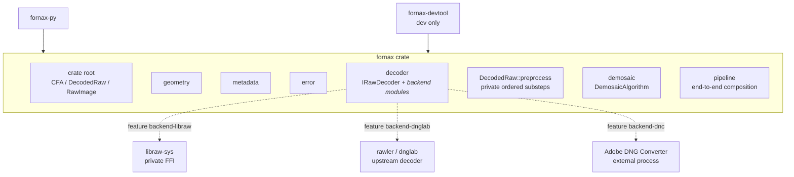

# RAW Pipeline Crate Architecture

The production RAW pipeline is one Rust crate named `fornax`. There is no
separate `fornax-core`, decoder-contract crate, decoder-adapter crates,
preprocessing crate, or demosaicing crate.

The former `fornax-core` package has been renamed to `fornax`. The existing
legacy `fornax` facade was replaced rather than preserved.

## Crate and module topology



Arrow direction means dependency. Upstream decoder dependencies are optional
Cargo features. Demosaicing is implemented entirely inside `fornax`; the base
crate remains usable without enabling any decoder backend.

## Module responsibilities

| Module | Responsibility |
| --- | --- |
| `fornax` crate root | Public re-exports for decoded planes, `DecodedRaw`, demosaic output, and f32-only `RawImage` |
| `fornax::decoded_raw` | Internal `DecodedRaw` owner with a private `plane` submodule for native sample containers |
| `fornax::geometry` | Pixel sizes, rectangles, ActiveArea, and stored geometry |
| `fornax::metadata` | Nested metadata aggregates with focused submodules for camera, CFA, extensible fields, levels, provenance, and exact values |
| `fornax::error` | Model, metadata, decoder, preprocessing, and demosaicing errors |
| `fornax::decoder` | Generic-input `IRawDecoder<I>` contract and backend modules |
| `fornax::decoder::libraw` | Private LibRaw adapter over `libraw-sys` |
| `fornax::decoder::rawler` | Private rawler/dnglab adapter |
| `fornax::decoder::dnc` | Private process bridge composed with a DNG decoder |
| `DecodedRaw::preprocess` | One standard preprocessing entry point with private linearization, black subtraction, normalization, and clipping substeps |
| `fornax::demosaic` | Direct algorithm selection, image-rs RGB output, and in-crate Bayer implementations |
| `fornax::pipeline` | Explicit end-to-end backend and algorithm composition |

These modules are an implementation boundary inside one crate. They are not
reason to reintroduce workspace crates.

The operation and its private module are both named `preprocess`. A single
word is the conventional Rust form for this action and keeps the method and
module aligned; `pre_process` is not retained as a compatibility alias.

Source ownership follows the same hierarchy:

```text
src/
├── lib.rs
├── decoder/
│   └── mod.rs                 # generic decoder boundary; concrete members follow
├── decoded_raw/
│   ├── mod.rs                 # DecodedRaw
│   ├── preprocess.rs          # private ordered preprocessing substeps
│   └── plane.rs               # native u8/u16/u32/f32 sample containers
├── demosaic/
│   ├── mod.rs                 # algorithm selection and RGB output
│   └── linear.rs              # linear/Bayer implementation
├── error.rs
├── geometry.rs
├── metadata/
│   ├── mod.rs                 # nested CommonMetadata / ValidatedMetadata only
│   ├── camera.rs              # camera, crop, capture, WB, color, orientation
│   ├── cfa.rs                 # Bayer/CFA layout and indexing
│   ├── extensible.rs          # extensible keys, entries, values, conflicts
│   ├── levels.rs              # black/white level metadata
│   ├── provenance.rs          # provider, source, authority, confidence
│   ├── value.rs               # exact rational values
│   └── tests.rs               # metadata invariant tests
└── raw_image.rs               # f32-only preprocessing output
```

## Workspace members

| Package | Responsibility |
| --- | --- |
| `fornax` | Universal model, decoder contracts, upstream decoder integrations, preprocessing, demosaicing, and end-to-end pipeline |
| `fornax-py` | Python package over `fornax` |
| `fornax-devtool` | Non-published fixtures and examples |
| `libraw-sys` | Private generated LibRaw FFI used only by `fornax::decoder::libraw` |

`libraw-sys` is a low-level build-support package, not a pipeline stage or
public abstraction. Upstream decoder crates are normal optional Cargo
dependencies of `fornax`; they do not appear in the public model. Demosaicing
algorithms are implemented in `fornax` itself.

## Dependency direction

- `fornax` depends on image-rs, `thiserror`, and standard library support.
- `fornax` optionally depends on `libraw-sys`, rawler/dnglab, and parallelism
  support.
- Adobe DNC integration invokes an external process and does not expose an
  upstream Rust type.
- `fornax-py` and `fornax-devtool` depend on `fornax`.
- No production package depends on `fornax-core`; that package no longer
  exists after migration.

Upstream decoder types remain private to their adapter module. `DecodedRaw`,
`RawImage`, metadata, decoder contracts, errors, and pipeline APIs contain no
LibRaw, rawler, or DNC-runtime types; demosaicing implementation types remain
inside `fornax::demosaic`.

## Stage boundaries

The phase interfaces are direct methods and one generic decoder contract inside
`fornax`, not crate boundaries:

```rust
pub trait IRawDecoder<I: ?Sized>: Send + Sync {
    fn decode(&self, input: &I) -> Result<DecodedRaw, DecodeError>;
}

impl DecodedRaw {
    pub fn preprocess(self) -> Result<RawImage, PreprocessError>;
}

impl RawImage {
    pub fn demosaic(
        &self,
        algorithm: DemosaicAlgorithm,
    ) -> Result<(RgbImageF32, Arc<ValidatedMetadata>), DemosaicError>;
}
```

The generic decoder input may be an in-memory byte slice, a filesystem path, or
another backend-specific source. `DecodedRaw::preprocess` is the single
consuming preprocessing entry point; its ordered substeps live in the private
`decoded_raw::preprocess` module.

`RawImage::demosaic` accepts a `DemosaicAlgorithm` and returns
`(RgbImageF32, Arc<ValidatedMetadata>)`, where `RgbImageF32` is image-rs
interleaved RGB. `preprocess` is declared in `src/decoded_raw/mod.rs`; its
numerical implementation lives in `src/decoded_raw/preprocess.rs`. Demosaic
dispatch and output validation live in `src/demosaic/` and `src/raw_image.rs`.

`IMPL-CORE-001` establishes these direct boundaries. Later decoder,
preprocessing, and demosaicing tasks refine their implementations inside
`fornax` without adding a protocol module, options wrapper, or new pipeline
crate.

## Features

The `fornax` default feature set is empty:

```text
backend-libraw
backend-dnglab
backend-dnc
parallel
serde
```

- `backend-libraw` enables the private LibRaw adapter through `libraw-sys`.
- `backend-dnglab` enables the crates.io rawler `0.8.0` adapter.
- `backend-dnc` enables the process bridge and requires a selected DNG backend.
- `parallel` enables documented parallel execution where benchmarks justify it.
- `serde` serializes validated metadata and processing descriptors.

Enabling a feature makes an implementation available; it never selects that
backend or algorithm at runtime.

## Errors

Errors remain typed by phase under `fornax::error`:

- `RawValidationError` for model and metadata invariants;
- `DecodeError` for concrete decoder implementations;
- `PreprocessError` for preprocessing;
- `DemosaicError` for demosaicing; and
- `MetadataError` for metadata construction and conflicts.

Upstream errors are translated at the decoder adapter boundary. No public API
exposes upstream decoder error types or a string-only top-level error.

## Migration

- The `fornax-core` package has been renamed to `fornax`.
- The legacy `fornax` implementation has been replaced by the renamed
  universal crate.
- Move decoder selection and concrete `libraw`, rawler, and DNC adapters into
  `fornax::decoder` modules.
- The `fornax-dalim` crate is removed after migrating its reusable linear
  demosaic implementation and Bayer tests into `fornax::demosaic`.
- Implement the private substeps behind `DecodedRaw::preprocess`.
- Retire the public `libraw` and `dnc` wrapper crates after their private
  integrations exist in `fornax`.
- Keep `libraw-sys` only as private FFI support.
- Rewrite `fornax-py` and `fornax-devtool` over `fornax`.

No old core, adapter, preprocessing, demosaic, or facade crate boundary is
preserved for compatibility.

## Validation

- Build `fornax` with default features and every supported feature combination.
- Verify no upstream decoder type appears in public API documentation.
- Run model, metadata, decoder, preprocessing, demosaic, and end-to-end tests in
  the same crate.
- Verify disabled backend features return explicit no-backend errors.
- Verify optional features do not imply runtime selection.
- Verify the workspace dependency graph contains no `fornax-core` or adapter
  crate.
