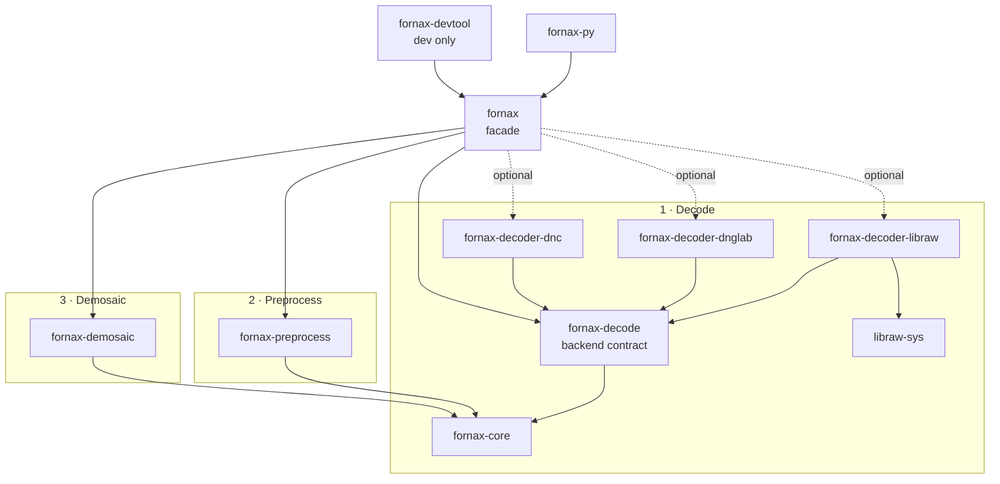

# RAW Pipeline Crate Architecture

This is the persistent crate topology for the Rust RAW pipeline. Existing crate
boundaries are migration input, not compatibility requirements.

## Pipeline phases



Arrow direction means the source crate depends on the target crate.

## Responsibilities

| Crate | Responsibility |
| --- | --- |
| `fornax-core` | Single `RawImage` container, universal samples, metadata, geometry, CFA, provenance, validation, and processing-state guards |
| `fornax-decode` | `RawDecoderBackend`, backend capabilities/selection, decode configuration/errors |
| `fornax-decoder-libraw` | LibRaw `unpack` adapter and metadata translation |
| `fornax-decoder-dnglab` | dnglab/rawler adapter |
| `fornax-decoder-dnc` | Adobe DNG conversion bridge composed with a DNG decoder |
| `fornax-preprocess` | One `RawImage::pre_process` entry point with private LUT, black correction, normalization, and clipping substeps |
| `fornax-demosaic` | Object-safe strategy registry, planar f32 output, built-in/external algorithms |
| `fornax` | Explicit backend selection and end-to-end composition |
| `fornax-py` | Python package over the facade |
| `fornax-devtool` | Non-published fixtures and examples |
| `libraw-sys` | Private generated LibRaw FFI |

## Boundaries

- `fornax-core` has no dependency on any decoder or demosaic implementation.
- `fornax-decode`, `fornax-preprocess`, and `fornax-demosaic` depend on core but
  not on one another.
- Decoder crates implement `RawDecoderBackend`; upstream types remain private.
- `fornax-preprocess` implements one consuming `pre_process` operation for the
  non-generic core `RawImage`; preprocessing substeps stay private.
- Demosaic strategies are object-safe and registered at runtime.
- Only `fornax` depends on concrete adapters, and only through enabled features.
- `fornax-core`'s `serde` feature currently serializes validated metadata and
  processing descriptors; validating deserialization and plane wire formats remain
  separate schema work so deserialization cannot bypass constructors.

## Selection and features

The facade has no default backend. Callers enable and explicitly select:

```text
backend-libraw
backend-dnglab
backend-dnc
demosaic-external
parallel
serde
```

Enabling a backend does not select it automatically. `fornax` records the
selected backend and decode provenance.

## Errors

Each pipeline phase owns its structured error:

- `RawValidationError` in core;
- `DecodeError` in `fornax-decode`;
- `PreprocessError` in `fornax-preprocess`;
- `DemosaicError` in `fornax-demosaic`; and
- `FornaxError` in the facade, wrapping phase errors with context.

Public APIs do not expose upstream LibRaw/rawler/demosaic types or string-only
errors.

## Migration

- Rewrite `fornax-core` under its existing name.
- Move usable linear demosaic code/tests into `fornax-demosaic`; retire
  `fornax-dalim` as an architecture.
- Move LibRaw wrapper logic into `fornax-decoder-libraw`; retain `libraw-sys` as
  private FFI support.
- Recreate the `dnc` process wrapper inside `fornax-decoder-dnc`.
- Rewrite `fornax` and `fornax-py` over the new contracts.
- Keep `fornax-devtool` development-only.

No legacy public trait or crate boundary is preserved solely for compatibility.
