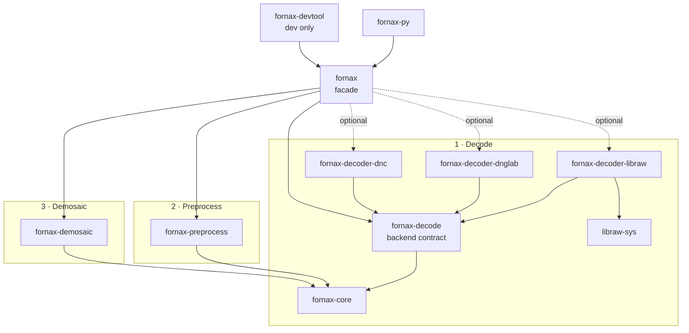

# RAW Pipeline Crate Architecture

This is the persistent crate topology for the Rust RAW pipeline. Existing crate
boundaries are migration input, not compatibility requirements.

## Pipeline phases



Arrow direction means the source crate depends on the target crate.

## Responsibilities

| Crate | Responsibility |
| --- | --- |
| `fornax-core` | `DecodedRaw`, f32-only `RawImage`, universal metadata/geometry/CFA, and the draft decoder/preprocess/demosaic protocols |
| `fornax-decode` | Concrete `RawDecoderBackend` registry, capabilities, selection policy, and decoder errors |
| `fornax-decoder-libraw` | LibRaw `unpack` adapter and metadata translation |
| `fornax-decoder-dnglab` | dnglab/rawler adapter |
| `fornax-decoder-dnc` | Adobe DNG conversion bridge composed with a DNG decoder |
| `fornax-preprocess` | `RawPreprocessor` implementation with private LUT, black correction, normalization, and clipping substeps |
| `fornax-demosaic` | `DemosaicBackend` implementations, registry, and built-in/external algorithms |
| `fornax` | Explicit backend selection and end-to-end composition |
| `fornax-py` | Python package over the facade |
| `fornax-devtool` | Non-published fixtures and examples |
| `libraw-sys` | Private generated LibRaw FFI |

## Boundaries

- `fornax-core` defines the draft global protocols but no decoder or demosaic
  implementation.
- `fornax-decode`, `fornax-preprocess`, and `fornax-demosaic` depend on core but
  not on one another.
- Decoder crates implement `RawDecoderBackend`; upstream types remain private.
- `fornax-preprocess` implements `RawPreprocessor`; preprocessing substeps stay
  private.
- Demosaic backends implement `DemosaicBackend`; strategy registries can be
  added in the demosaicing task.
- Only `fornax` depends on concrete adapters, and only through enabled features.
- `fornax-core`'s `serde` feature currently serializes validated metadata and
  processing descriptors; validating deserialization and plane wire formats remain
  separate schema work so deserialization cannot bypass constructors.

## Decoder protocol

The draft contract lives in `fornax-core::protocol`; `fornax-decode` will add
registry and capability policy around it in `IMPL-DEC-001`:

```rust
pub trait RawDecoderBackend: Send + Sync {
    fn id(&self) -> DecoderBackendId;
    fn capabilities(&self) -> DecoderCapabilities;

    fn decode(
        &self,
        input: &RawInput<'_>,
        config: &DecodeConfig,
    ) -> Result<DecodedRaw, DecodeError>;
}
```

The backend attaches `DecoderProvenance` while constructing validated metadata.
Consequently both `DecodedRaw` and the preprocessed `RawImage` retain decoder
identity through their shared `Arc<ValidatedMetadata>`; `RawImage` does not
store or expose a separate decoder field.

The draft preprocessing contract consumes and returns distinct image types:

```rust
pub trait RawPreprocessor: Send + Sync {
    fn pre_process(
        &self,
        input: DecodedRaw,
        options: &PreprocessOptions,
    ) -> Result<RawImage, PreprocessError>;
}
```

The draft demosaicing contract accepts the f32-only preprocessed image:

```rust
pub trait DemosaicBackend: Send + Sync {
    fn demosaic(
        &self,
        input: &RawImage,
        options: &DemosaicOptions,
    ) -> Result<RgbImageF32, DemosaicError>;
}
```

Core's `RawImage::demosaic` wrapper validates output dimensions and returns
`(RgbImageF32, Arc<ValidatedMetadata>)`, where `RgbImageF32` is
`ImageBuffer<Rgb<f32>, Vec<f32>>`.

Later implementation tasks may refine options, capabilities, registries, and
output details, but the phase boundaries and consuming image types are the
global protocol reviewed by `IMPL-CORE-001`.

## Selection and features

The facade has no default backend. Callers enable and explicitly select:

```text
backend-libraw
backend-dnglab
backend-dnc
demosaic-external
parallel
serde
```

Enabling a backend does not select it automatically. `fornax` records the
selected backend and decode provenance.

## Errors

The draft phase errors live in `fornax-core::protocol`; concrete crates may
refine or wrap their own errors in later implementation tasks:

- `RawValidationError` for shared model validation;
- `DecodeError` for decoder backends;
- `PreprocessError` for preprocessors;
- `DemosaicError` for demosaic backends; and
- `FornaxError` in the facade, wrapping phase errors with context.

Public APIs do not expose upstream LibRaw/rawler/demosaic types or string-only
errors.

## Migration

- Rewrite `fornax-core` under its existing name.
- Move usable linear demosaic code/tests into `fornax-demosaic`; retire
  `fornax-dalim` as an architecture.
- Move LibRaw wrapper logic into `fornax-decoder-libraw`; retain `libraw-sys` as
  private FFI support.
- Recreate the `dnc` process wrapper inside `fornax-decoder-dnc`.
- Rewrite `fornax` and `fornax-py` over the new contracts.
- Keep `fornax-devtool` development-only.

No legacy public trait or crate boundary is preserved solely for compatibility.
