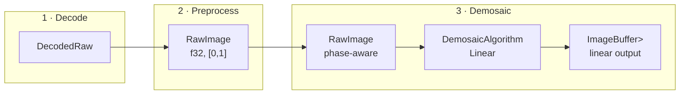

# Demosaicing Interface

Demosaicing is the final phase in the required pipeline. It accepts the
f32-only preprocessed `RawImage` and returns linear image-rs RGB f32.



## Input contract

`RawImage` provides:

- a single-channel f32 mosaic of ActiveArea `width * height` samples;
- dimensions and the validated `BayerLayout`;
- ActiveArea-relative phase information; and
- immutable validated metadata.

Validation rejects:

- incorrect buffer length;
- zero or overflowing dimensions;
- non-finite samples;
- samples outside `[0,1]`; and
- unsupported CFA phases.

The input is immutable. The implementation maps dense active-buffer
coordinates through the original ActiveArea origin before selecting the Bayer
slot.

## Output contract

`RgbImageF32` is
`image::ImageBuffer<image::Rgb<f32>, Vec<f32>>`. It stores
`3 * width * height` interleaved f32 samples:

```text
[R G B][R G B]...
```

Output dimensions equal input dimensions. Values remain linear and are not
implicitly quantized or clipped. Algorithms document overshoot/undershoot
behavior; callers may apply an explicit output policy where appropriate.

Image-rs owns the output allocation and dimensions. `fornax` validates exact
sample counts and finite values before returning the image.

## Algorithm interface

Demosaicing uses direct enum dispatch. There is no separate demosaic trait or
options wrapper:

```rust
impl RawImage {
    pub fn demosaic(
        &self,
        algorithm: DemosaicAlgorithm,
    ) -> Result<(RgbImageF32, Arc<ValidatedMetadata>), DemosaicError>;
}
```

`fornax::demosaic::DemosaicAlgorithm` is the current selectable algorithm
type. It dispatches `Linear` to the in-crate linear implementation.
`RawImage::demosaic` adds output-size and finite-value validation while
retaining metadata.

## Border behavior

Supported descriptions are:

- `Clamp` — out-of-range kernel coordinates clamp to image edges;
- `BilinearFallback` — the algorithm uses bilinear reconstruction near
  borders; and
- `AlgorithmDefined` — the implementation documents and tests its own policy.

The output always has the input dimensions. An algorithm requiring an internal
halo gathers it only from available input; no implicit crop or CFA rebase is
allowed.

## Metadata retention

`RawImage::demosaic` returns `(RgbImageF32, Arc<ValidatedMetadata>)`, retaining
source metadata without a wrapper type. It does not apply or discard WB, color
matrices, orientation, crop, or decoder provenance. No per-pixel metadata is
emitted.

## Errors and allocation

`fornax::error::DemosaicError` covers invalid input/output dimensions, non-finite
or out-of-range samples, unsupported phases, too-small images, failed
algorithms, and allocation failure.

The demosaicing boundary checks `3 * width * height` overflow, exact buffer
length, finite values, and output dimensions. Algorithms may allocate private
scratch buffers; allocation failure is structured.

## Initial algorithms

1. Bilinear — implemented in `fornax::demosaic::linear`. It preserves the
   known CFA sample and averages available same-color neighbors, including
   reduced neighborhoods at image borders.
2. Malvar–He–Cutler — planned fixed higher-quality kernel with explicit border
   behavior.
3. Edge-aware algorithms — deferred until quality and options are evaluated.

Demosaicing algorithms are implemented inside `fornax::demosaic`. No external
demosaic crate or adapter is part of the target architecture.

## Exclusions

Demosaicing does not perform black correction, normalization, WB, camera color
matrices, highlight reconstruction, gain maps, denoising, sharpening, tone
mapping, or display color conversion.
