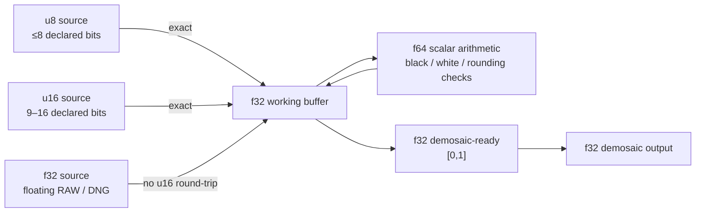

# Precision by Phase

Precision has two dimensions: the **container** used to store samples and the
**semantic precision** declared by the source. They are not interchangeable.

Normative rules are in
[DES-001 §4](../../agent-work/design/raw-pipeline/DES-001-universal-raw-representation.md#4-source-container-validation)
and [DES-001 §7](../../agent-work/design/raw-pipeline/DES-001-universal-raw-representation.md#7-stage-invariants).

## Precision flow

## Phase table

| Phase | Stored representation | Arithmetic/computation | Why |
| --- | --- | --- | --- |
| Decoded integer | u8 for ≤8 bits; u16 for 9–16 bits | Store source codes unchanged | Native compact storage; actual bit depth remains metadata |
| Decoded float | f32 | Retain backend float values | Floating DNG and verified floating decoder paths |
| Optional custom bridge | f32 | Explicit u8/u16 conversion | Every initial ≤16-bit integer is exact in f32; supports fractions/sign |
| Linearization | f32 working buffer | Exact table lookup, then f32 storage | DNG/rawler order applies LUT before black correction |
| Black subtraction | f32 working buffer | Widen operands/scalars to f64; round result to f32 | Avoid avoidable integer quantization and scalar rounding |
| Normalization | f32 working buffer | f64 division, f32 storage | Preserve signed unclipped values and fractional signal |
| Demosaic-ready | f32 | Clamp to `[0,1]` | Bounded input with enough precision for the 16-bit source |
| Demosaic | f32 input/output | Algorithm-defined; optional f64 internal accumulators | No memory/bandwidth cost of pipeline-wide f64 |

## Storage rules

| Declared source | Container | Semantic note |
| --- | --- | --- |
| Unsigned integer ≤8 bits | `ImageBuffer<Luma<u8>, Vec<u8>>` | Container width does not rewrite bit depth |
| Unsigned integer 9–16 bits | `ImageBuffer<Luma<u16>, Vec<u16>>` | No implicit left shift |
| Floating DNG / float decoder path | `ImageBuffer<Luma<f32>, Vec<f32>>` | Do not round-trip through u16 |
| Preprocessing | `ImageBuffer<Luma<f32>, Vec<f32>>` | f64 only for scalar arithmetic |
| Demosaic output | planar `f32` | Preserve linear values; do not quantize to integer |

Signed integer samples, integer precision above 16 bits, and f64 source planes
require a separately verified wider path or structured rejection.

## What f32 guarantees

- All 8-bit and 16-bit unsigned integers are represented exactly.
- Fractional normalized values and negative underflow are representable.
- Multiplying/dividing by scalar metadata does not require quantizing back to
  an integer between operations.
- f32 has 24 bits of significand precision; it is not a universal replacement
  for integer values above 24 significant bits or arbitrary f64 source data.
- f64 is used for black/white arithmetic, not as the image buffer type. f64
  buffers double memory and bandwidth without recovering information already
  represented in the f32 preprocessing input.

## Custom processing rule

Converting decoded u8/u16 data to f32 for custom processing is opt-in. The
custom operation must return a distinct state and declare whether original
black/white metadata remains valid. A changed sample basis with stale levels is
rejected before standard preprocessing.

## Related guides

- [Raw image processing flow](raw-image-process.md)
- [Key structures and fields](raw-image-struct.md)
