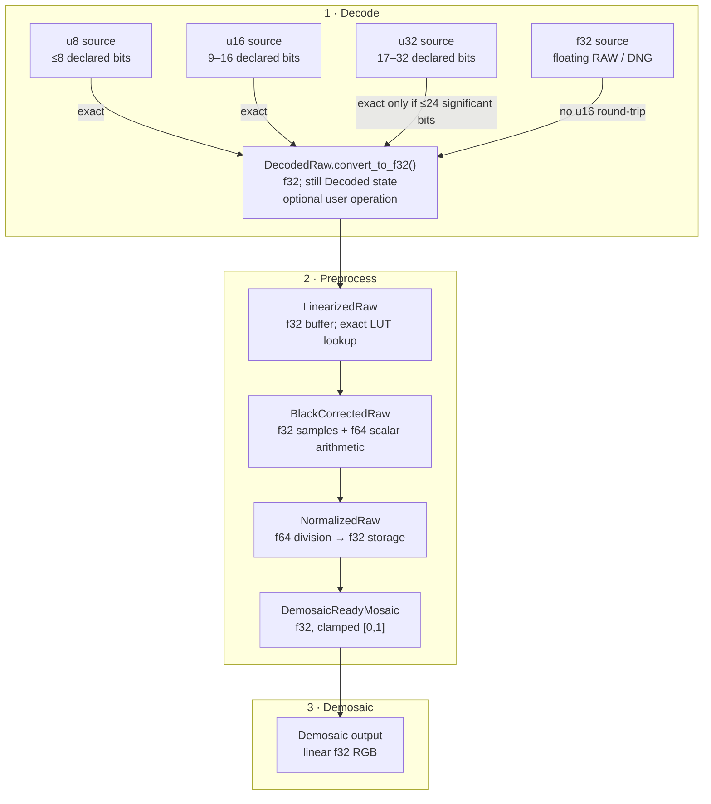

# Precision by Phase

Precision has two dimensions: the **container** used to store samples and the
**semantic precision** declared by the source. They are not interchangeable.

Normative rules are in
[DES-001 §4](../../agent-work/design/raw-pipeline/DES-001-universal-raw-representation.md#4-source-container-validation)
and [DES-001 §7](../../agent-work/design/raw-pipeline/DES-001-universal-raw-representation.md#7-stage-invariants).

## Precision flow

## Storage rules

| Declared source | Container | Semantic note |
| --- | --- | --- |
| Unsigned integer ≤8 bits | `ImageBuffer<Luma<u8>, Vec<u8>>` | Container width does not rewrite bit depth |
| Unsigned integer 9–16 bits | `ImageBuffer<Luma<u16>, Vec<u16>>` | No implicit left shift |
| Unsigned integer 17–32 bits | `ImageBuffer<Luma<u32>, Vec<u32>>` | Requires backend/source evidence; not every value is exact in f32 |
| Floating DNG / float decoder path | `ImageBuffer<Luma<f32>, Vec<f32>>` | Do not round-trip through u16 |
| Preprocessing | `ImageBuffer<Luma<f32>, Vec<f32>>` | f64 only for scalar arithmetic |
| Demosaic output | planar `f32` | Preserve linear values; do not quantize to integer |

Signed integer samples, integer precision above 32 bits, and f64 source planes
require a separately verified wider path or structured rejection.

## What f32 guarantees

- All 8-bit and 16-bit unsigned integers are represented exactly.
- Fractional normalized values and negative underflow are representable.
- Multiplying/dividing by scalar metadata does not require quantizing back to
  an integer between operations.
- f32 has 24 bits of significand precision; it is not a universal replacement
  for integer values above 24 significant bits or arbitrary f64 source data.
  A u32 conversion is therefore accepted only when declared precision is ≤24
  bits; wider integer values need a separately designed wider path.
- f64 is used for black/white arithmetic, not as the image buffer type. f64
  buffers double memory and bandwidth without recovering information already
  represented in the f32 preprocessing input.

## Custom processing rule

Converting decoded u8/u16/u32 data to f32 for custom processing is opt-in and
returns the same `Decoded` state with an f32 plane. The custom operation must
declare whether original black/white metadata remains valid. A changed sample
basis with stale levels is rejected before standard preprocessing.

## Related guides

- [Raw image processing flow](raw-image-process.md)
- [Key structures and fields](raw-image-struct.md)
