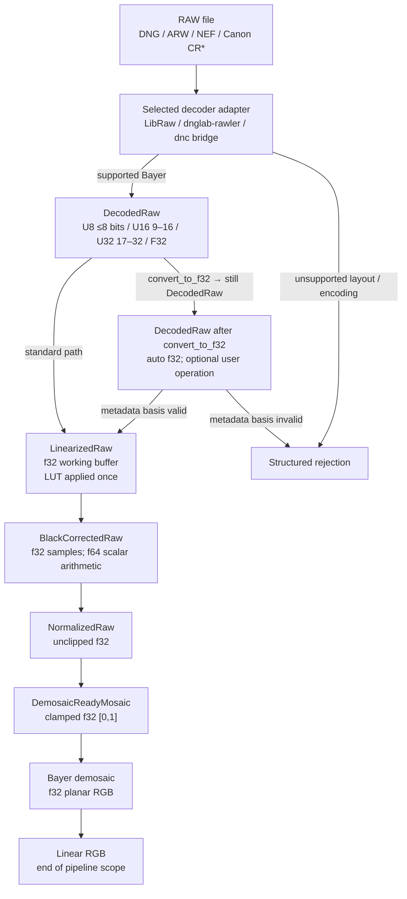

# Raw Image Processing Flow

This guide describes the proposed processing path from a decoder adapter to a
linear demosaiced image. The normative type and invariant details are in
[DES-001 §3–§9](../../agent-work/design/raw-pipeline/DES-001-universal-raw-representation.md#3-stage-typed-image).

## End-to-end flow

## Stage contract

| Stage | Payload | Main operation | Required invariant | Failure mode |
| --- | --- | --- | --- | --- |
| Decode / custom | u8/u16/u32/f32 sensor plane | Backend unpack; optional `convert_to_f32` (lossless when representable) and user operation while state remains `Decoded` | Native encoding, geometry, CFA, ActiveArea, levels, provenance, and metadata basis validated | Unsupported encoding/layout or lossy conversion |
| Linearization | f32 plane | Apply declared LUT once, otherwise identity | ActiveArea/CFA geometry unchanged | Missing/invalid table |
| Black subtraction | f32 plane | Select black by active CFA/tile coordinate; subtract once | Black and white levels valid; no clamp yet | Unsupported pattern/delta |
| Normalization | f32 plane | `(sample - black) / (white - black)` with f64 scalar arithmetic | Signed and overflow values remain unclipped | `white <= black` or non-finite |
| Demosaic-ready | f32 plane | Clamp to `[0,1]` and validate finite values | Bayer phase and ActiveArea unchanged | Wrong state/non-finite values |
| Demosaic | f32 planar RGB | Apply selected Bayer algorithm | Planar channel order and border policy explicit | Unsupported algorithm/layout |

The conversion itself is lossless for u8/u16 inputs. It does not prove that
arbitrary custom processing preserves the meaning of file-declared black or
white levels; `Decoded` retains that metadata-basis decision.

## Where preprocessing stops

The required `fornax` pipeline ends after demosaicing. It does not perform:

- white-balance multiplication;
- camera-to-working-space color matrices;
- highlight reconstruction;
- raw denoise, hot-pixel, or chromatic-aberration correction;
- tone mapping or curves;
- display/output color conversion, gamma, denoising, or sharpening.

Those metadata may be preserved, but they must not be applied in this pipeline.

## Related guides

- [Precision by phase](precision.md)
- [Key structures and fields](raw-image-struct.md)
