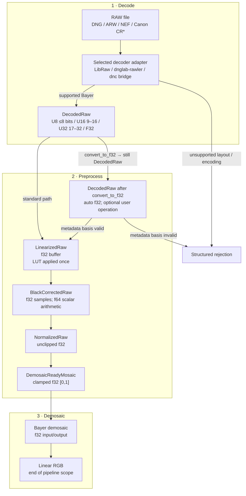

# Raw Image Processing Flow

This guide defines the persistent processing path from a decoder adapter to a
linear demosaiced image. [Precision by phase](precision.md) defines sample
types and [Key structures and fields](raw-image-struct.md) defines the
corresponding type invariants.

## End-to-end flow



## Stage contract

| Stage | Payload | Main operation | Required invariant | Failure mode |
| --- | --- | --- | --- | --- |
| Decode / custom | u8/u16/u32/f32 sensor plane | Backend unpack; optional `convert_to_f32` (lossless when representable) and user operation while state remains `Decoded` | Native encoding, geometry, CFA, ActiveArea, levels, provenance, and metadata basis validated | Unsupported encoding/layout or lossy conversion |
| Linearization | f32 plane | Apply declared LUT once, otherwise identity | ActiveArea/CFA geometry unchanged | Missing/invalid table |
| Black subtraction | f32 plane | Select black by active CFA/tile coordinate; subtract once | Black and white levels valid; no clamp yet | Unsupported pattern/delta |
| Normalization | f32 plane | `(sample - black) / (white - black)` with f64 scalar arithmetic | Signed and overflow values remain unclipped | `white <= black` or non-finite |
| Demosaic-ready | f32 plane | Clamp to `[0,1]` and validate finite values | Bayer phase and ActiveArea unchanged | Wrong state/non-finite values |
| Demosaic | f32 planar RGB | Apply selected Bayer algorithm | Planar channel order and border policy explicit | Unsupported algorithm/layout |

## Preprocessing operation contract

Preprocessing is expressed as consuming state transitions:

```text
DecodedRaw
  -> LinearizedRaw
  -> BlackCorrectedRaw
  -> NormalizedRaw
  -> DemosaicReadyMosaic
```

The public operations are:

```rust
impl DecodedRaw {
    pub fn convert_to_f32(self) -> Result<Self, PreprocessError>;
    pub fn into_linearized(
        self,
        table: Option<LinearizationTable>,
    ) -> Result<LinearizedRaw, PreprocessError>;
}

impl LinearizedRaw {
    pub fn subtract_black(
        self,
    ) -> Result<BlackCorrectedRaw, PreprocessError>;
}

impl BlackCorrectedRaw {
    pub fn normalize(
        self,
    ) -> Result<NormalizedRaw, PreprocessError>;
}

impl NormalizedRaw {
    pub fn finish_for_demosaic(
        self,
    ) -> Result<DemosaicReadyMosaic, PreprocessError>;
}
```

Custom f32 processing remains inside `DecodedRaw`. It records operation
provenance and whether original, replaced, or incompatible
linearization/black/white metadata applies.

Numerical rules:

```text
q64   = f64::from(linear_sample) - black
q     = round_f32(q64)
n64   = f64::from(q) / (white - black)
n     = round_f32(n64)
ready = clamp(n, 0.0, 1.0)
```

- Subtraction never clips.
- Normalization requires `white > black`.
- `NormalizedRaw` retains negative and above-one values.
- Final clipping occurs only in `finish_for_demosaic`.
- NaN and infinity are errors.

Allocation policy:

- linearization allocates at most one owned f32 plane;
- black selection is evaluated per sample without a black plane;
- subtraction, normalization, and clipping mutate the owned f32 plane in
  place while changing the state type;
- allocation arithmetic is checked; and
- metadata remains immutable behind an `Arc`.

Missing required CFA, linearization, black-level, or white-level metadata fails
with a structured `PreprocessError`. General spatial black tiles and
`BlackLevelDeltaH`/`V` remain unsupported.

The conversion itself is lossless for u8/u16 inputs. It does not prove that
arbitrary custom processing preserves the meaning of file-declared black or
white levels; `Decoded` retains that metadata-basis decision.

## Where preprocessing stops

The required `fornax` pipeline ends after demosaicing. It does not perform:

- white-balance multiplication;
- camera-to-working-space color matrices;
- highlight reconstruction;
- raw denoise, hot-pixel, or chromatic-aberration correction;
- tone mapping or curves;
- display/output color conversion, gamma, denoising, or sharpening.

Those metadata may be preserved, but they must not be applied in this pipeline.

## Related guides

- [Precision by phase](precision.md)
- [Key structures and fields](raw-image-struct.md)
