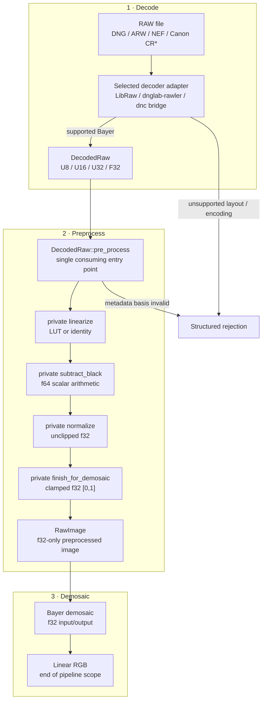

# Raw Image Processing Flow

This guide defines the persistent processing path from a decoder adapter to a
linear demosaiced image. [Precision by phase](precision.md) defines sample
types and [Key structures and fields](raw-image-struct.md) defines the
corresponding type invariants.

## End-to-end flow



## Processing contract

| Step | Payload | Main operation | Required invariant | Failure mode |
| --- | --- | --- | --- | --- |
| Decode / custom | u8/u16/u32/f32 sensor plane | Backend unpack; optional `convert_to_f32` (lossless when representable) and user operation while state remains `Decoded` | Native encoding, geometry, CFA, ActiveArea, levels, provenance, and metadata basis validated | Unsupported encoding/layout or lossy conversion |
| `pre_process` | `DecodedRaw` to `RawImage` | Runs linearization, black subtraction, normalization, and final clipping as private substeps | Input metadata basis permits standard preprocessing; output is f32-only and in `[0,1]` | Missing/invalid metadata or non-finite values |
| Demosaic | f32 planar RGB | Apply selected Bayer algorithm | Planar channel order and border policy explicit | Unsupported algorithm/layout |

## Preprocessing operation contract

Preprocessing has one public operation:

```rust
impl DecodedRaw {
    pub fn pre_process(
        self,
        options: &PreprocessOptions,
    ) -> Result<RawImage, PreprocessError>;
}
```

It applies for every supported `DecodedRaw`, regardless of whether the decoded
payload is u8, u16, u32, or f32. The implementation converts to the f32 working
domain as needed and calls private substep functions:

```text
pre_process
  -> linearize
  -> subtract_black
  -> normalize
  -> finish_for_demosaic
```

The substeps are private implementation details and do not expose intermediate
image types. Both image types keep their fields private. Core exposes the
validated `DecodedRaw::try_new` decode constructor and a doc-hidden finalizer
that constructs `RawImage`. Because `pre_process` is defined only on
`DecodedRaw`, a second call on the returned f32-only `RawImage` is impossible.

`DecodedRaw::convert_to_f32` changes `PlaneStorage` to `F32Working`; a second
conversion is rejected. Custom processing uses `DecodedRaw::plane_mut()` and
remains a `DecodedRaw`. After changing the sample basis, the caller updates it
with `set_metadata_basis` using
`MetadataBasis::{OriginalLevelsValid, ReplacedLevels, Incompatible}`. Standard
preprocessing revalidates the mutated plane and rejects `Incompatible`.

Numerical rules:

```text
q64   = f64::from(linear_sample) - black
q     = round_f32(q64)
n64   = f64::from(q) / (white - black)
n     = round_f32(n64)
ready = clamp(n, 0.0, 1.0)
```

- Subtraction never clips.
- Normalization requires `white > black`.
- The normalized working buffer retains negative and above-one values.
- Final clipping occurs only in `finish_for_demosaic`.
- NaN and infinity are errors.

Allocation policy:

- linearization allocates at most one owned f32 plane;
- black selection is evaluated per sample without a black plane;
- subtraction, normalization, and clipping mutate the owned f32 plane in
  place;
- allocation arithmetic is checked; and
- metadata remains immutable behind an `Arc`.

Missing required CFA, linearization, black-level, or white-level metadata fails
with a structured `PreprocessError`. General spatial black tiles and
`BlackLevelDeltaH`/`V` remain unsupported.

The conversion itself is lossless for u8/u16 inputs. It does not prove that
arbitrary custom processing preserves the meaning of file-declared black or
white levels; `DecodedRaw` retains that metadata-basis decision.

## Where preprocessing stops

The required `fornax` pipeline ends after demosaicing. It does not perform:

- white-balance multiplication;
- camera-to-working-space color matrices;
- highlight reconstruction;
- raw denoise, hot-pixel, or chromatic-aberration correction;
- tone mapping or curves;
- display/output color conversion, gamma, denoising, or sharpening.

Those metadata may be preserved, but they must not be applied in this pipeline.

## Related guides

- [Precision by phase](precision.md)
- [Key structures and fields](raw-image-struct.md)
