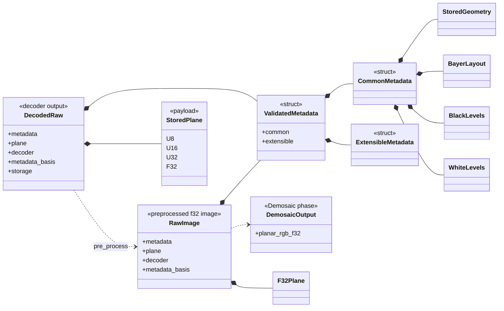

# Key Structures and Fields

This file is the normative field-level reference for the persistent RAW image
model. The task-owned DES-001 proposal records the drafting history and
rationale; field names, units, and invariants in this file are authoritative.

## Structure class diagram

## Core image

| Type/field | Type | Unit | Invariant |
| --- | --- | --- | --- |
| `DecodedRaw::metadata` | `Arc<ValidatedMetadata>` | N/A | Immutable during processing |
| `DecodedRaw::plane` | `StoredPlane` | samples | Matches source geometry and declared encoding |
| `DecodedRaw::decoder` | `DecoderProvenance` | N/A | Identifies the selected backend |
| `DecodedRaw::metadata_basis` | `MetadataBasis` | N/A | States whether level metadata remains applicable |
| `DecodedRaw::storage` | `PlaneStorage` | enum | `Native` or `F32Working` |
| `RawImage::metadata` | `Arc<ValidatedMetadata>` | N/A | Immutable during preprocessing and demosaicing |
| `RawImage::plane` | `F32Plane` | samples | Finite preprocessed Bayer samples in `[0,1]` |
| `RawImage::decoder` | `DecoderProvenance` | N/A | Retained decoder provenance |
| `RawImage::metadata_basis` | `MetadataBasis` | N/A | Retained metadata-validity basis |
| `StoredPlane` | `U8`, `U16`, `U32`, or `F32` variant | sample | Container compatible with `SampleEncoding` |
| `F32Plane` | `ImageBuffer<Luma<f32>, Vec<f32>>` | sample | Working and preprocessed payload |

## Geometry and encoding

| Type/field | Type | Unit | Invariant |
| --- | --- | --- | --- |
| `PixelSize::{width,height}` | `u32` | pixels | Both non-zero for a stored image |
| `PixelCoord::{row,col}` | `u32` | pixel | Stored raster coordinate |
| `PixelRect::{top,left,bottom,right}` | `u32` | half-open pixels | `top < bottom`, `left < right`, inside stored size |
| `SampleEncoding::bits_per_sample` | `u8` | bits | Non-zero and at most 32; semantic source precision |
| `SampleEncoding::format` | `SampleFormat` | enum | Unsigned integer or float |
| `StoredGeometry::dimensions` | `PixelSize` | pixels | Must equal payload dimensions |
| `StoredGeometry::source_row_stride_bytes` | `NonZeroU64` | bytes | Preserves original backend stride |

`StoredGeometry::source_row_stride_bytes` describes the backend allocation
before compacting. The canonical `ImageBuffer` is tightly packed.

## CFA, crop, and levels

| Type/field | Type | Unit | Invariant |
| --- | --- | --- | --- |
| `BayerLayout::pattern` | `BayerPattern` | enum | `RGGB`, `BGGR`, `GRBG`, or `GBRG` |
| `BayerLayout::active_area` | `ActiveArea` | stored pixels | Pattern origin is ActiveArea top-left |
| `DefaultCrop::{origin_x,origin_y,width,height}` | `Rational` | pre-scale raw coordinates | Kept separate from ActiveArea |
| `Orientation` | `u8` newtype | TIFF enum | Valid range 1–8 |
| `BlackLevels::common` | `Rational` | stored sample code | Scalar component |
| `BlackLevels::per_slot` | `[Rational; 4]` | stored sample code | CFA slots remain distinct |
| `BlackLevels::repeat` | `Option<BlackTile>` | stored sample code | ActiveArea-relative tile |
| `BlackTile::{rows,columns,samples_per_plane}` | `NonZeroU32` | samples | Value count matches dimensions × planes |
| `WhiteLevels::declared` | `Box<[Rational]>` | stored sample code | Source-declared saturation |
| `WhiteLevels::adjusted_maximum` | `Option<Box<[Rational]>>` | stored sample code | Decoder-adjusted value kept separate |
| `WhiteLevels::measured_maximum` | `Option<Box<[Rational]>>` | stored sample code | Observed value kept separate |

`BlackLevels`, `BlackTile`, and `WhiteLevels` are private-field types with
validating constructors. Scalar black levels are non-negative. A black tile's
value count must equal `rows * columns * samples_per_plane`. Declared white
levels contain either one scalar or four CFA-slot values and must be positive;
optional adjusted and measured arrays use the same length as the declared
array. This keeps both green CFA positions distinguishable without treating the
common scalar component as one of those slots.

## Image types

Decoder adapters produce `DecodedRaw`. Its `StoredPlane` covers native u8,
u16, u32, and f32 samples, so one preprocessing implementation handles every
supported decoder output.

`DecodedRaw::pre_process` is implemented by `fornax-preprocess` and consumes
the decoded image. It returns the distinct `RawImage` type, whose payload is
exclusively `F32Plane`. Linearization, black subtraction, normalization, and
final clipping are private substeps and expose no intermediate image types.

Because preprocessing is available only on `DecodedRaw`, calling it again on
the returned `RawImage` is a compile-time error. `RawImage` construction is
private to core's preprocessing finalizer and validates finite samples in
`[0,1]` before demosaicing.

Users may mutate `DecodedRaw::plane_mut()` directly for custom processing.
After changing the sample basis, they must call
`DecodedRaw::set_metadata_basis`; `require_standard_preprocessing` revalidates
the current plane's dimensions, encoding, and finite values before the single
preprocessing pass. No operation-history field is retained.

## Validation fields and errors

`ValidatedMetadata` is constructed only after checking required metadata,
geometry, CFA, level lengths, sample encoding, and provenance conflicts.
The required typed fields are sample encoding, stored geometry, ActiveArea, and
CFA. Their stored dimensions and ActiveArea must agree. The original row stride
is retained as nonzero provenance and is not assumed to equal the compact
`ImageBuffer` stride. Extensible keys use the `raw.*` names blocked for typed
concepts and cannot override those fields.

`RawValidationError` is the image/model boundary error. It distinguishes
missing metadata, invalid geometry/encoding, unsupported sample widths,
non-mosaic/non-2x2/non-RGB CFA layouts, invalid levels, non-finite samples,
invalid demosaic-ready values, metadata conflicts, and incompatible
custom-processing bases. `MetadataError` reports key grammar, duplicate typed
concepts, candidate conflicts, invalid values, and allocation limits.

The optional `serde` feature serializes the validated metadata and processing
descriptors. It deliberately does not derive deserialization for the model:
deserializing private invariants without a schema-aware validating decoder
would bypass construction checks. Plane serialization and stable schema
versioning remain follow-up design work.

Unsupported input is rejected at the adapter/constructor boundary. No code
guesses a missing CFA origin, fabricates black levels, converts an unknown CFA
to RGB, or treats a display image as a sensor plane.

## Construction boundary

`DecodedRaw::try_new` is the public decode boundary and validates the native
plane against its metadata. `fornax-core` exposes a doc-hidden finalization
helper solely for the single preprocessing implementation to construct a
`RawImage` after its private substeps finish. A custom
`MetadataBasis::Incompatible` decoded image is rejected before preprocessing
starts.

## Related guides

- [Raw image processing flow](raw-image-process.md)
- [Precision by phase](precision.md)
